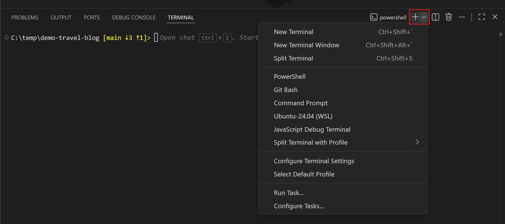
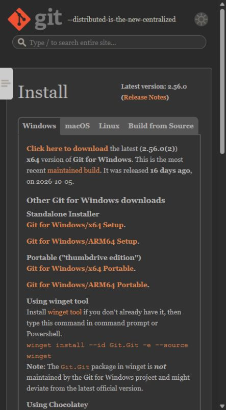
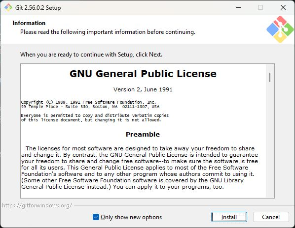
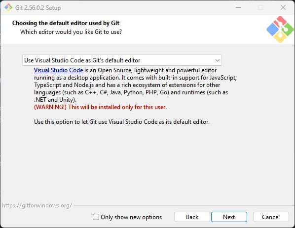
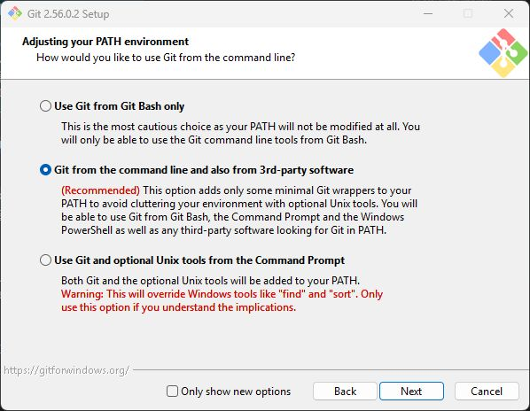
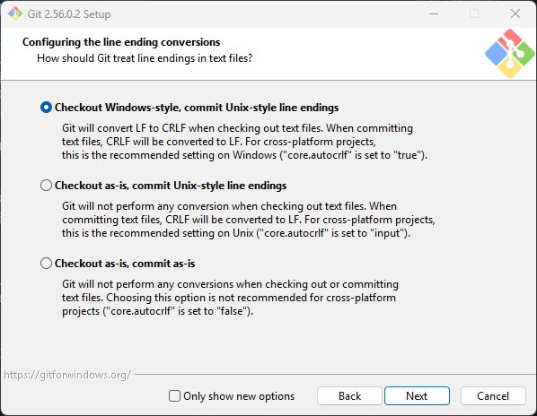
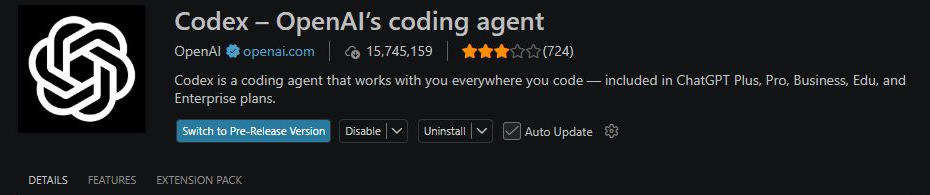
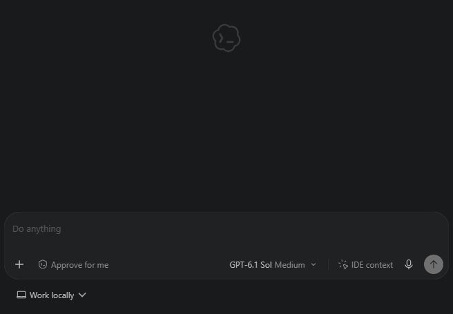
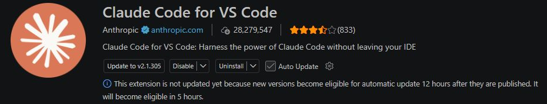
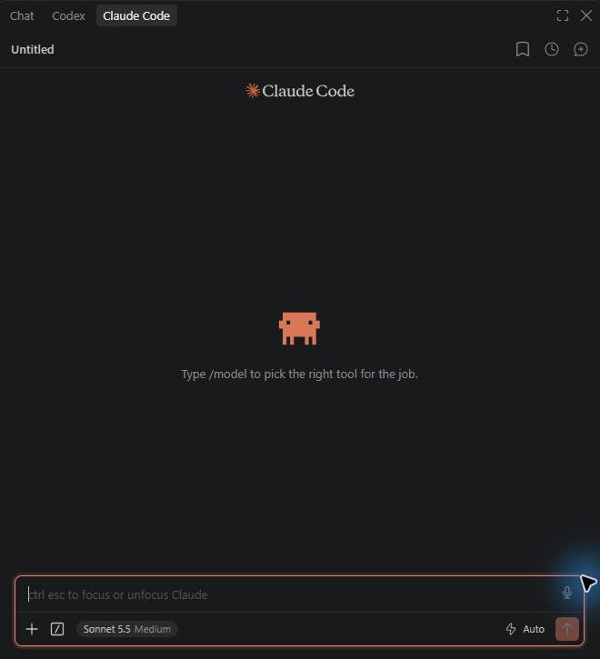

# 기초 실습 환경 준비: Chapter 2 선택 실습과 Chapter 3~11 실습 키트

> **이 준비 안내의 배포 기준:** `foundation-kit-v1.3.32` · [최신 배포와 다운로드](https://github.com/totobabycomanch-droid/foundation-lab-kit/releases/latest)

VS Code·PowerShell·Git 준비를 마쳤다면 [1. 실습 키트 다운로드·검증·압축 해제](#kit-download)로 바로 이동하세요.
처음 준비한다면 아래 도구 설치 안내부터 순서대로 진행합니다.

Chapter 2는 원고만으로 학습할 수 있으며, 실제 소스를 함께 보고 싶은 독자만 키트를 선택적으로
사용합니다. Chapter 3부터는 AI와 실제 소스를 조사하고, Chapter 4부터는 작은 프로젝트를 직접
바꾸며 실패도 재현합니다. 이를 위해 Day 00의 30일 ERP 프로젝트와 분리된 기초 실습 키트를
사용합니다.

**이 안내는 Chapter 3 시작 전 필수 준비 과정입니다.** Chapter 2에서 실제 소스 확인을 선택한다면
그 실습 전에 진행합니다. Chapter 2를 원고로만 읽는 독자는 읽기를 마친 뒤 Chapter 3에 들어가기 전에
준비하면 됩니다. 이미 준비를 마쳤다면 다시 설치하지 않고 아래 완료 기준만 확인하세요.

이 준비 단계의 목표는 모든 개발 도구를 한꺼번에 설치하는 것이 아닙니다. 먼저 완성된 소스를
AI와 함께 읽을 수 있는 상태를 만들고, 실행 도구는 필요한 Chapter에서 단계적으로 준비합니다.

| 준비 단계 | 마칠 내용 | 진행 시점 |
|---|---|---|
| 기본 도구와 소스 조사 환경 | VS Code·PowerShell·Git 확인, 키트 준비, AI 에이전트 하나 연결, 실제 파일 읽기 확인 | 이 안내에서 Chapter 3 시작 전에 완료 |
| Python 코드 실행 환경 | Python 3.12와 Chapter 7 전용 가상환경 준비·검증 | Chapter 6에서 완료한 뒤 Chapter 7로 이동 |
| 이후 실행 도구 | Node.js·npm은 Chapter 11 시작 전, Docker는 Day 00 시작 전까지 준비 | Chapter 6의 안내를 보고 필요한 시점까지 완료 |

Chapter 2~3의 선택 테스트를 먼저 실행할 때만 이 안내의 Python·Node.js 준비와 4절의 패키지 설치를
진행합니다. 소스 조사만 한다면 해당 설치를 건너뛰어도 됩니다. Chapter 5의 SQL 실습용 Supabase는
그 장의 시작 안내에서 별도로 준비합니다.

---

### 새 PC에서는 여기서 시작합니다

이 안내는 Windows와 VS Code를 기준으로 합니다. 먼저 VS Code·PowerShell·Git을 확인하고,
키트의 실습 폴더를 연 뒤 AI 에이전트를 연결합니다. 선택 테스트도 바로 실행할 독자는 필요한
Python·Node.js까지 준비하세요.
이전 PC의 `.venv`나 `node_modules`를 복사하지 않고, 새 PC에서 패키지 목록으로 다시 설치합니다.

| 준비 대상 | 설치·확인 방법 | 완료 기준 |
|---|---|---|
| VS Code | [공식 Windows 설치 안내](https://code.visualstudio.com/docs/setup/windows)의 User setup으로 설치 | VS Code가 열리고 `code --version` 출력 |
| PowerShell | 아래 안내에 따라 VS Code 안에서 터미널 열기 | PowerShell 5.1 또는 7 이상이며 현재 폴더 확인 |
| Git | 아래 Git 설치 안내에서 PC 종류와 주요 선택 항목 확인 | 새 PowerShell에서 `git --version` 출력 |
| Python과 pip(선택 테스트를 먼저 실행할 때) | 아래 Python 준비 절차 진행. 소스 조사만 하면 Chapter 6에서 준비 | Python 3.12와 pip 버전 출력 |
| Node.js와 npm(선택 테스트를 먼저 실행할 때) | 아래 Node.js 준비 절차 진행. 소스 조사만 하면 이후 준비 | Node.js `v24.x.x`와 npm 버전 출력 |
| AI 에이전트 | 2절에서 Codex 또는 Claude Code 중 하나 설치·로그인 | 실습 폴더의 실제 파일을 읽어 근거 보고 |

**VS Code를 처음 설치한다면** [공식 다운로드 페이지](https://code.visualstudio.com/Download)를 엽니다.
페이지 제목이 **Download Visual Studio Code**이고 주소가 `code.visualstudio.com`인지 확인하세요.

1. **Windows** 영역에서 다운로드 항목을 확인합니다. 화면 폭이 좁으면 다른 운영체제 항목은
   아래쪽에 표시될 수 있으므로, 눈에 먼저 보이는 버튼보다 운영체제 이름을 확인합니다.
2. Windows 다운로드 영역에는 **Windows 10 or 11 (64-bit)** 요구 사항이 표시됩니다.
   자신의 PC가 이 조건에 맞는지 확인하고, **Other downloads** 선택 목록이 보이면
   [공식 Windows 설치 안내](https://code.visualstudio.com/docs/setup/windows)와 함께
   앞의 표에서 안내한 **User setup** 설치 파일을 찾습니다.
3. 다운로드한 파일로 설치를 마친 뒤 VS Code를 엽니다. 이미 VS Code가 열리는 PC라면
   다시 설치하지 않고 아래 버전 확인부터 진행합니다.

다운로드가 끝난 것과 설치가 끝난 것은 다릅니다. VS Code가 실제로 열리는지 확인한 뒤,
아래 순서로 명령을 입력할 창을 준비합니다.

#### PowerShell 터미널을 엽니다

터미널은 명령을 입력하고 실행 결과를 확인하는 창입니다. PowerShell은 그 안에서 명령을
해석하고 실행하는 프로그램입니다. 이 책의 `powershell` 코드 블록은 이 창에서 실행합니다.
Windows에 기본으로 포함된 Windows PowerShell 5.1로 시작할 수 있으며, 이미 PowerShell 7
이상을 사용한다면 그대로 진행해도 됩니다.

1. VS Code의 **터미널 → 새 터미널(Terminal → New Terminal)**을 선택합니다.
   아래쪽에 **터미널(TERMINAL)** 패널이 열립니다.
2. 패널 오른쪽 위의 **+ 옆 아래쪽 화살표**를 누릅니다. 목록에 **PowerShell** 또는
   **Windows PowerShell**이 있으면 선택합니다. 이미 해당 터미널이 열려 있다면 그대로 사용합니다.
3. 목록에 보이지 않으면 `Ctrl + Shift + P`로 명령 팔레트를 열고
   **Terminal: Select Default Profile**을 검색해 실행합니다. PowerShell 계열 항목을
   선택한 뒤 **터미널 → 새 터미널**로 새 창을 엽니다. 기본 프로필 선택은 이미 열린 창에는 적용되지 않습니다.



그림. 터미널 선택 목록의 PowerShell 항목. 설치된 도구에 따라 다른 항목은 달라질 수 있습니다.
출처: [VS Code 공식 터미널 안내](https://code.visualstudio.com/docs/terminal/basics#_terminal-shells).

아래쪽 터미널의 입력 줄을 클릭하고 다음 명령을 **한 줄씩 입력한 뒤 Enter**를 누릅니다.
원고 파일이나 AI 대화 입력란에 붙여 넣지 않습니다.

```powershell
$PSVersionTable.PSVersion
Get-Location
```

첫 명령은 PowerShell 버전을, 두 번째 명령은 현재 작업 폴더를 보여줍니다. 버전 표의
`Major`가 `5`, `Minor`가 `1`이면 Windows PowerShell 5.1입니다. `Major`가 `7` 이상이어도 됩니다.
현재 폴더는 이 단계에서 사용자 폴더여도 괜찮습니다. 키트를 내려받고 압축을 푼 뒤 실습 폴더로 이동합니다.

기본 설정에서는 `PS C:\Users\사용자이름>`처럼 입력을 기다리는 표시가 보입니다.
이를 **프롬프트**라고 합니다. 앞의 `PS`와 경로, 마지막 `>`는 직접 입력하는 명령에 포함하지 않습니다.
색상이나 표시 모양이 다르더라도 위 두 명령의 결과로 확인하면 됩니다.

이제 같은 터미널에서 VS Code 버전도 확인합니다.

```powershell
code --version
```

버전 번호와 추가 정보가 출력되면 명령으로도 VS Code를 찾을 수 있는 상태입니다.
정확한 버전 번호는 설치 시점에 따라 달라집니다.

| 막힌 지점 | 다음 확인 |
|---|---|
| 터미널 패널이 보이지 않는다 | **터미널 → 새 터미널**을 다시 선택한다. |
| `$PSVersionTable.PSVersion` 실행 시 오류가 나거나 버전 표가 나오지 않는다 | 현재 터미널이 Command Prompt나 Git Bash인지 확인하고 PowerShell로 새로 연다. |
| `code` 명령을 찾지 못한다 | 설치 후 켜져 있던 VS Code를 모두 닫고 다시 열어 새 터미널에서 확인한다. 계속 실패하면 **파일 → 폴더 열기(File → Open Folder)**로 실습 폴더를 연다. |
| 명령이 끝나지 않고 `>>`가 표시된다 | 따옴표나 괄호가 덜 입력되었을 수 있다. `Ctrl + C`로 입력을 취소하고 명령 한 줄을 다시 입력한다. |

`PATH`는 터미널이 프로그램을 찾는 경로 목록입니다. 프로그램은 열리는데 명령만 찾지 못하면
설치 직후의 경로 반영 문제인지 먼저 확인합니다. 이 확인을 위해 관리자 권한이나 실행 정책 변경은 필요하지 않습니다.

**완료 확인:** PowerShell 버전과 현재 폴더를 직접 확인했고, 터미널에서 다음 명령을 입력할 수 있으면
이 단계는 끝입니다. 이후 “새 PowerShell”은 VS Code에서 새로 연 PowerShell 터미널을 뜻합니다.
시작 메뉴에서 Windows PowerShell을 열어도 같은 명령을 실행할 수 있습니다.

#### Git을 설치하고 PowerShell에서 확인합니다

Git은 파일의 변경 이력을 기록하고 이전 내용과 비교하는 도구입니다. GitHub는 Git 저장소를
온라인에서 공유하는 서비스입니다. **Git 설치와 버전 확인에는 GitHub 계정이나 로그인이 필요하지 않습니다.**
이미 Git을 사용하는 PC라면 먼저 아래의 `git --version`을 실행합니다. 버전이 출력되면
기존 설치를 유지하고 이 단계의 완료 기준으로 이동합니다.

**설치 파일을 고릅니다.**

1. [Git 공식 Windows 다운로드 페이지](https://git-scm.com/install/windows)를 엽니다.
   주소가 `git-scm.com`이고 페이지의 운영체제가 **Windows**인지 확인합니다.
2. Windows의 **설정 → 시스템 → 정보 → 시스템 종류**에서 PC 종류를 확인합니다.
   **x64 기반 프로세서**라면 **Git for Windows/x64 Setup**, **ARM 기반 프로세서**라면
   **Git for Windows/ARM64 Setup**을 선택합니다. x64는 주로 Intel·AMD PC에서 사용하고,
   ARM64는 ARM 기반 PC에서 사용합니다. 제품 이름보다 시스템 종류를 기준으로 고릅니다.
3. **Standalone Installer** 아래의 **Setup** 파일을 내려받습니다.
   이 안내는 **Portable** 대신 설치형 파일을 사용합니다. 공식 다운로드 링크는
   Git for Windows가 배포하는 `github.com/git-for-windows/git`의 릴리스 파일로 연결될 수 있습니다.



그림. Standalone Installer 아래에서 PC 종류에 맞는 x64 Setup 또는 ARM64 Setup을 고릅니다.
공식 주소: [git-scm.com/install/windows](https://git-scm.com/install/windows).

**새 PC와 기존 Git이 있는 PC를 구분합니다.**

이미 `git --version`이 정상 출력되는 PC는 기존 Git을 유지합니다. 화면을 따라 해 보기 위해
설치 파일을 다시 실행하거나 기존 편집기·PATH·줄바꿈 설정을 바꿀 필요는 없습니다.
새 PC에서 처음 설치한다면 아래의 선택 안내를 따릅니다.

아래 화면은 Git 2.56.0.2 설치 마법사의 예시입니다. 기존 Git이 있는 PC에서 확인했으므로,
표시된 선택값을 새 PC의 기본값으로 보지는 않습니다. 편집기는 Visual Studio Code를 직접
선택한 상태이며, 나머지는 화면에 표시된 선택을 유지한 예시입니다. 조직이나 기존 프로젝트에
정해진 설정이 있다면 그 기준을 우선합니다.



그림. 기존 Git이 있는 PC에서는 Only show new options가 선택되어 첫 화면부터 Install이 표시될 수 있습니다.
기존 Git을 유지할 때는 Install을 누르지 않고 Cancel로 닫습니다.

**처음 설치할 때 확인할 세 가지 선택입니다.**

기본 편집기 화면 **Choosing the default editor used by Git**에서는
**Use Visual Studio Code as Git's default editor**를 선택합니다. Git이 커밋 설명처럼 글을
작성할 때 열 편집기입니다. 목록에 VS Code가 없거나 선택할 수 없다면 앞의 VS Code 설치
완료 여부부터 확인합니다.



그림. 목록의 선택값이 Use Visual Studio Code as Git's default editor인지 확인합니다.

PATH 화면 **Adjusting your PATH environment**에서는
**Git from the command line and also from 3rd-party software**를 선택합니다.
앞에서 준비한 PowerShell과 VS Code에서도 `git` 명령을 찾도록 하는 항목입니다.



그림. 가운데 항목인 Git from the command line and also from 3rd-party software를 선택합니다.

줄바꿈 화면 **Configuring the line ending conversions**의 예시에서는
**Checkout Windows-style, commit Unix-style line endings**가 선택되어 있습니다.
이는 파일을 작업 폴더로 꺼낼 때 Windows 방식인 CRLF로, 커밋할 때 Unix 방식인 LF로
줄바꿈을 변환하는 선택입니다. 새 PC에서 별도 프로젝트 규칙이 없다면 이 예시를 따를 수 있습니다.
기존 프로젝트가 줄바꿈 규칙을 정해 두었다면 화면을 맞추려고 기존 설정을 바꾸지 않습니다.



그림. 예시의 선택은 Checkout Windows-style, commit Unix-style line endings입니다. 나머지 두 항목은 선택되지 않았습니다.

**나머지 화면은 다음 순서로 확인합니다.**

아래는 위 세 화면을 포함해 실제로 확인한 순서입니다. ‘선택할 내용’의 유지 안내는
이 예시의 선택값을 뜻하며, 모든 PC에서 같은 기본값이 표시된다는 뜻은 아닙니다.
화면 제목이나 순서가 다르면 해당 화면의 설명을 읽고 확인한 뒤 진행합니다.

| 화면 제목 | 선택할 내용 | 간단한 이유 |
|---|---|---|
| Information | 처음 설치할 독자는 안내를 읽고 **Next**로 이동한다. 기존 Git을 유지할 독자는 **Cancel**로 닫는다. | 기존 설치에서는 선택 화면을 건너뛰고 **Install**이 바로 표시될 수 있다. |
| Select Components | 예시의 선택은 **Windows Explorer integration**의 **Open Git Bash here·Open Git GUI here**, **Git LFS**, **Associate .git\* configuration files with the default text editor**, **Associate .sh files to be run with Bash**, **Scalar**다. **Additional icons·On the Desktop**, 일일 업데이트 확인, Windows Terminal 프로필 추가는 미선택이다. 별도 요구가 없다면 현재 제시된 선택을 유지한다. | 탐색기 메뉴·파일 연결 등 설치 구성 요소를 고르는 화면이다. 이 실습 때문에 추가 항목을 켤 필요는 없다. |
| Choosing the default editor used by Git | **Use Visual Studio Code as Git's default editor**를 선택한다. | Git이 글을 작성할 때 사용할 편집기를 정한다. |
| Adjusting the name of the initial branch in new repositories | 예시의 **Let Git decide**를 유지한다. | 새 저장소의 첫 브랜치 이름에 관한 선택이다. 화면 설명상 현재 이름은 `master`이며, 기존 저장소에는 영향을 주지 않는다. |
| Adjusting your PATH environment | **Git from the command line and also from 3rd-party software**를 선택한다. | PowerShell과 VS Code에서도 Git을 찾도록 한다. |
| Choosing the SSH executable | 예시의 **Use bundled OpenSSH**를 유지한다. | Git에 포함된 SSH 접속 도구를 사용한다. 조직에서 별도 SSH 도구를 지정했다면 그 기준을 따른다. |
| Choosing HTTPS transport backend | 예시의 **Use the OpenSSL library**를 유지한다. | 예시 화면에서는 인증서를 `ca-bundle.crt` 파일로 검증한다. 회사 인증서 사용 규칙이 있다면 그 기준을 따른다. |
| Configuring the line ending conversions | 별도 규칙이 없는 새 PC는 예시의 **Checkout Windows-style, commit Unix-style line endings**를 참고한다. | 작업 폴더와 커밋 사이의 줄바꿈 변환 방식을 정한다. |
| Configuring the terminal emulator to use with Git Bash | 예시의 **Use MinTTY (the default terminal of MSYS2)**를 유지한다. | Git Bash용 터미널 선택이다. 앞에서 준비한 VS Code의 PowerShell을 바꾸는 항목은 아니다. |
| Choose the default behavior of `git pull` | 예시의 **Merge**를 유지한다. | 원격 변경을 가져올 때 갈라진 이력을 병합하는 방식이다. 기존 프로젝트의 협업 규칙이 있다면 그 기준을 따른다. |
| Choose a credential helper | 예시의 **Git Credential Manager**를 유지한다. | Git의 인증을 돕는 도구를 선택한다. 이 화면에서 GitHub에 로그인하는 것은 아니다. |
| Configuring extra options | 예시의 **Enable file system caching** 선택, **Enable symbolic links** 미선택을 유지한다. | 파일 시스템 캐시는 성능을 위한 선택이고, 심볼릭 링크는 이 준비 실습에서 추가로 켤 필요가 없다. 이 화면에는 **Install** 버튼이 표시된다. |

새 PC에서 실제 설치가 목적일 때만 선택 내용을 확인한 뒤 **Install**로 진행합니다.
기존 Git의 화면만 확인했다면 **Cancel**로 닫습니다. 이 책의 명령은 Git Bash 대신 앞에서
준비한 PowerShell에서 실행합니다.

주요 선택 항목은 [GitHub 공식 Windows 설치 안내](https://accessibility.github.com/documentation/guide/cli/#installing-git-for-windows)에서도 확인할 수 있습니다.

**새 터미널에서 설치 결과를 확인합니다.**

설치 전에 열려 있던 VS Code 창을 모두 닫고 다시 엽니다. 새 PowerShell 터미널에서 다음 명령을 실행합니다.

```powershell
git --version
```

다음처럼 `git version` 뒤에 버전 번호가 나오면 됩니다. 아래 숫자는 출력 예시이며,
설치 시점에 따라 달라도 괜찮습니다.

```text
git version 2.52.0.windows.1
```

| 막힌 지점 | 다음 확인 |
|---|---|
| `git` 명령을 찾지 못한다 | VS Code를 모두 닫고 다시 연 뒤 새 PowerShell에서 재확인한다. 계속 실패하면 설치 때 PATH 항목을 위 표대로 선택했는지 확인한다. |
| 기존 Git과 새 Git 중 무엇이 실행되는지 모르겠다 | 아래 명령으로 발견되는 실행 파일 경로를 확인한다. 여러 경로가 나오면 기존 도구를 바로 삭제하지 말고, 사용할 설치 경로부터 확인한다. |
| `git status`에서 `not a git repository`가 나온다 | Git 설치 실패와는 다르다. 현재 폴더에 저장소 이력이 없다는 뜻이다. 설치 확인에는 `git --version`을 사용한다. |

설치 경로를 확인해야 할 때만 다음 명령을 실행합니다.

```powershell
Get-Command git -All | Select-Object Name, Source
```

**완료 확인:** 새 PowerShell에서 `git --version`의 결과가 나오면 다음 준비로 넘어갑니다.
이 단계에서 GitHub 로그인, 저장소 생성이나 사용자 이름·이메일 설정까지 마칠 필요는 없습니다.

**Python이 필요한 시점이라면** [Python 공식 Windows 안내](https://docs.python.org/3/using/windows.html)에서
Python Install Manager를 설치합니다. 설치 후 새 PowerShell에서 다음 명령을 실행하세요.
이미 Python 3.12를 사용하는 PC는 설치를 건너뛰고 `python --version`과 `python -m pip --version`을 확인합니다.

```powershell
pymanager install 3.12
pymanager exec -V:3.12 --version
pymanager exec -V:3.12 -m pip --version
```

첫 확인 결과가 `Python 3.12.x`이고 다음 명령에서 pip 버전이 나오면 준비된 것입니다.
Install Manager 설치 화면이나 명령 실행에서 막히면 [Chapter 6의 Python 준비](06_chapter6.md)에서
단계별 화면을 확인하세요. pip는 Python 패키지를 설치하는 도구이며, 이 경로에서는 별도 설치 파일을 찾지 않습니다.

**Node.js가 없다면** [공식 다운로드](https://nodejs.org/en/download)에서 24 LTS 계열과 Windows를 선택하고
PC에 맞는 Installer(`.msi`)를 설치합니다. npm은 함께 설치됩니다. 새 PowerShell에서 확인합니다.

```powershell
node --version
npm --version
```

Node.js는 `v24.x.x`가 나오면 됩니다. 기존 프로젝트가 다른 Node.js 버전을 사용 중이라면 먼저
[Chapter 6의 Node.js 준비](06_chapter6.md#nodejs-ready)에서 버전 보존 경로를 확인하세요.
`npm.ps1` 실행이 차단되면 실행 정책을 바꾸기 전에 `npm.cmd --version`으로 확인하고,
이 안내의 `npm ci`는 `npm.cmd ci`, `npx`는 `npx.cmd`로 실행할 수 있습니다.

도구 설치는 PC마다 한 번, Python·프론트엔드 패키지 설치는 실습 폴더마다 진행합니다.
Docker와 Supabase는 각 장에서 필요한 시점에 준비합니다. Chapter 5의 Supabase 준비는 해당 장에서 안내합니다.

<a id="1-두-작업-공간을-구분합니다"></a>
<a id="kit-download"></a>

## 1. 실습 키트 다운로드·검증·압축 해제

다음 공개 배포 파일을 내려받습니다.

- [최신 Release 안내 페이지](https://github.com/totobabycomanch-droid/foundation-lab-kit/releases/latest)
- [최신 실습 키트 ZIP](https://github.com/totobabycomanch-droid/foundation-lab-kit/releases/latest/download/foundation-lab-kit-latest.zip)
- [최신 SHA-256 체크섬 파일](https://github.com/totobabycomanch-droid/foundation-lab-kit/releases/latest/download/foundation-lab-kit-latest.sha256)

ZIP과 체크섬은 같은 Release에서 내려받습니다. 다운로드 폴더에서 PowerShell을 열고
파일이 손상되거나 바뀌지 않았는지 확인합니다.

```powershell
$kitExpectedHash = (Get-Content -LiteralPath .\foundation-lab-kit-latest.sha256 -Raw).Trim().Split()[0]
$kitActualHash = (Get-FileHash -LiteralPath .\foundation-lab-kit-latest.zip -Algorithm SHA256).Hash.ToLowerInvariant()
if ($kitActualHash -ne $kitExpectedHash) {
    throw 'SHA-256 mismatch. Download the ZIP and checksum from the same Release again.'
}
'SHA-256 verification passed.'
```

`SHA-256 verification passed.`가 출력되면 두 값이 일치합니다. 오류가 나면 압축을 풀지 말고
같은 Release의 ZIP·체크섬을 다시 받습니다. 압축 해제 후 실제 버전은 키트 루트의
`release-manifest.json`에서 확인합니다. 버전이 바뀌어도 위 최신 다운로드 주소는 그대로 사용합니다.

Windows에서는 경로가 너무 길어지는 문제를 피하기 위해 `C:\erp-book`처럼 짧고 찾기 쉬운
폴더에 압축을 풉니다.

```powershell
Expand-Archive -LiteralPath .\foundation-lab-kit-latest.zip -DestinationPath C:\erp-book
```

이미 `C:\erp-book\foundation-lab-kit` 폴더가 있다면 덮어쓰지 말고, 기존 폴더를 보존한 채
비어 있는 다른 폴더에 압축을 풉니다.
이전 버전으로 실습했다면 그 결과는 기존 폴더에 보존합니다.
새로 실습을 시작할 때는 [최신 배포](https://github.com/totobabycomanch-droid/foundation-lab-kit/releases/latest)를 새 폴더에 준비하세요. 이전 실습을 다시 할 필요는 없습니다.
예를 들어 `C:\erp-book-ch05`에 풀려면 위 명령의 `-DestinationPath`를 이 경로로 바꾸고,
이후 명령의 `C:\erp-book`도 `C:\erp-book-ch05`로 바꿉니다. 이전 파일을 새 키트에 덮어쓰지 않습니다.
기본 경로에 압축을 풀었다면 다음 경로가 생깁니다.

```text
C:\erp-book\foundation-lab-kit\
```

압축을 풀면 다음 두 작업 공간이 있습니다.

```text
foundation-lab-kit/
├─ reference-app/       # Chapter 2~3에서 조사할 완성 기준 소스
├─ practice-workspace/  # Chapter 4~11에서 직접 수정할 연습 공간
└─ tools/               # 환경 확인과 실습 초기화 도구
```

`reference-app`은 완성된 구현에서 근거를 찾는 공간입니다. Chapter 2~3에서는 이 폴더의 코드를
수정하지 않습니다. `practice-workspace`는 이후 실습에서 파일과 데이터를 직접 바꾸는
공간입니다.

두 공간을 나누면 완성 기준 소스를 보존하면서 자신의 결과와 비교할 수 있습니다. SQL이나
코드를 잘못 수정하더라도 조사 기준까지 함께 망가뜨리지 않습니다.

압축을 푼 뒤에는 키트 루트에서 구조 검증 스크립트를 실행합니다.

```powershell
Set-Location C:\erp-book\foundation-lab-kit
powershell -NoProfile -ExecutionPolicy Bypass -File .\tools\verify_foundation_kit.ps1
```

이 스크립트는 필수 파일, 생성 파일의 혼입 여부와 패키지 잠금 파일을 검사합니다. 마지막에
`Foundation Lab Kit verification passed.`가 출력되면 키트 구조가 정상이라는 뜻입니다.
`python`, `node` 같은 실행 도구에 `NOT RUN`이 표시됐다면 파일 검사는 통과했지만 해당 도구를
사용하는 테스트는 아직 실행할 수 없다는 뜻입니다.

---

## 2. Chapter 2~3용 소스를 엽니다

VS Code에서 `reference-app` 폴더만 엽니다. `foundation-lab-kit` 전체를 열면 AI가 비슷한 파일이
있는 두 작업 공간을 혼동할 수 있습니다.

PowerShell에서 폴더를 열었다면 다음 명령으로 위치와 핵심 파일을 확인합니다.

```powershell
Set-Location C:\erp-book\foundation-lab-kit\reference-app

Get-Location
Test-Path AGENTS.md
Test-Path backend
Test-Path frontend
Test-Path database
```

네 개의 확인 결과가 모두 `True`이면 소스 조사 준비가 끝났습니다. 경로가 다르면 자신의 압축
해제 위치로 `Set-Location` 명령만 바꿉니다.

### AI 에이전트는 둘 중 하나만 연결합니다

웹 채팅에 파일을 붙여 넣는 대신, VS Code에서 열린 실습 폴더에 접근하는 에이전트를 사용합니다.
아래 A 또는 B 중 하나만 진행하세요. 두 도구를 모두 설치하거나 같은 파일을 동시에 수정하게 할 필요는 없습니다.
확장은 VS Code에 기능을 추가하는 프로그램입니다. `requirements.txt`나 `npm ci`로 설치하지 않습니다.

**시작 전에 확인합니다.**

- VS Code 왼쪽 탐색기의 최상위 폴더가 `reference-app`인지 확인합니다. 터미널에서
  `Set-Location`을 실행해도 VS Code가 연 폴더까지 바뀌지는 않습니다. 다르면
  **파일 → 폴더 열기(File → Open Folder)**에서 압축을 푼 `reference-app`을 선택합니다.
- 사용할 계정으로 해당 에이전트를 이용할 수 있는지 공식 안내에서 확인합니다. 확장 설치가
  끝나도 계정의 이용 범위나 사용량 제한 때문에 요청을 실행하지 못할 수 있습니다.
- 이미 설치·로그인을 마쳤다면 다시 설치하거나 로그아웃하지 말고 아래의 공통 파일 읽기 확인으로 이동합니다.

다음 안내는 VS Code 확장을 기준으로 합니다. 에이전트 전용 데스크톱 앱이나 별도 터미널용
프로그램까지 함께 설치할 필요는 없습니다.

#### A. Codex 연결하기

1. VS Code에서 `Ctrl + Shift + X`로 **확장(Extensions)**을 엽니다.
   왼쪽 위 검색창에 `Codex`를 입력합니다.
2. 검색 결과를 눌러 상세 화면을 열고 게시자가 **OpenAI**인지 확인합니다. 비슷한 이름의
   확장이 여러 개면 [OpenAI 공식 IDE 안내](https://developers.openai.com/codex/ide)의
   **Install the extension** 링크로 공식 확장을 확인합니다.
3. **Install(설치)**을 누르고 완료될 때까지 기다립니다. 게시자 신뢰 확인이 나오면
   공식 링크로 확인한 확장과 게시자가 맞는지 읽고 결정합니다. 설치 후 **Disable(사용 안 함)**이나
   **Uninstall(제거)** 등이 표시되면 설치된 상태입니다. **Enable(사용)**이 보이면 먼저 활성화합니다.


그림. OpenAI 게시자와 확장 이름을 확인합니다. 예시는 이미 설치되어 Disable·Uninstall이 표시된 상태입니다.

4. VS Code의 Codex 아이콘을 눌러 대화 패널을 엽니다. 아이콘이 보이지 않으면
   `Ctrl + Shift + P`로 명령 팔레트를 열고 **Codex: Open Codex Sidebar**를 검색해 실행합니다.
5. 로그인 화면에서 **Sign in with ChatGPT**를 선택합니다. 열린 브라우저에서 사용할 계정으로
   로그인하고 안내를 마친 뒤 VS Code로 돌아옵니다. 브라우저에서 VS Code 열기를 묻는 경우
   방금 시작한 로그인 흐름인지 확인하고 돌아갑니다.
6. Codex 패널에 요청을 입력할 수 있는지 확인합니다. 현재 PC의 파일을 조사하는 대화에서
   아래 공통 확인 요청을 보냅니다. GitHub 저장소 연결이나 클라우드 작업 생성은 이 확인에 필요하지 않습니다.



그림. Do anything이 표시된 입력창에 요청을 작성합니다. 예시는 로그인 후의 빈 입력 영역이며, 로그인 화면이 아닙니다.

이 안내는 계정 로그인 경로를 사용합니다. API 키 로그인은 사용량 기반으로 별도 청구되는 경로입니다.
API 키 입력 화면을 선택했다면 이 안내의 계정 로그인 경로로 돌아갑니다.
사용 가능한 계정과 이용 범위는 [OpenAI 공식 인증 안내](https://developers.openai.com/codex/auth)에서 확인하세요.

**중간 확인:** Codex 패널에서 로그인 요구가 사라지고 요청을 입력할 수 있으면 설치·로그인 단계가 끝난 것입니다.
실습 준비 완료 여부는 아래의 실제 파일 읽기 결과로 판정합니다.

#### B. Claude Code 연결하기

1. VS Code에서 `Ctrl + Shift + X`로 **확장(Extensions)**을 열고 검색창에 `Claude Code`를 입력합니다.
2. 상세 화면에서 게시자가 **Anthropic**인지 확인하고 **Install(설치)**을 누릅니다.
   결과가 헷갈리면 [Anthropic 공식 VS Code 안내](https://code.claude.com/docs/en/vs-code)의
   설치 링크로 확인합니다. 이미 설치되어 있다면 다시 설치하지 않고 활성화 상태를 확인합니다.


그림. Anthropic 게시자와 확장 이름을 확인합니다. 예시는 이미 설치된 상태로 Disable·Uninstall과 업데이트 버튼이 표시됩니다.

3. `Ctrl + Shift + P`로 명령 팔레트를 열고 `Claude Code`를 검색한 뒤
   **Open in New Tab**을 선택합니다. 열린 탭의 대화 입력창이 이후 프롬프트를 보낼 위치입니다.
4. **Sign in**을 눌러 브라우저에서 로그인·접근 허용 절차를 마치고 VS Code로 돌아옵니다.
   공식 안내의 계정 요건은 유료 Claude 구독 또는 Claude Console 계정입니다.
   구독과 Console 이용은 결제 경로가 다르므로 사용할 계정과 이용 범위를 먼저 확인하세요.
5. 입력창 아래의 **권한 모드**를 눌러 **Manual**을 선택하고 공통 확인 요청을 보냅니다.
   이 모드는 파일 수정과 대부분의 명령 실행 전에 확인을 요청합니다. 처음부터 Manual로 열리는지는
   버전과 설정에 따라 다르므로 표시된 값을 직접 확인합니다.



그림. 아래쪽 테두리 안이 프롬프트 입력 위치입니다. 화면 오른쪽 아래에는 Auto가 표시되어 있습니다.
이 실습에서는 요청을 보내기 전에 Auto를 눌러 권한 모드 목록을 열고 Manual을 선택합니다.

확장에는 대화 패널용 CLI가 포함되어 있습니다. CLI는 터미널에서 사용하는 명령형 프로그램을 뜻하며,
이 안내의 패널을 사용하기 위해 별도의 `claude` 명령을 설치할 필요는 없습니다.
Manual도 파일 접근 자체를 막는 모드는 아니므로 아래 요청의 읽기 전용 범위를 함께 지킵니다.

**중간 확인:** Claude Code 탭의 입력창과 권한 모드를 확인했다면 아래 공통 확인으로 이동합니다.
메뉴 이름과 이용 조건이 달라졌다면 각 공식 안내를 기준으로 확인합니다.

### 로그인보다 중요한 확인: 실제 파일을 읽는가?

두 도구 모두 `reference-app`이 열린 창의 에이전트 입력창에 다음 요청을 보냅니다.
여기서 `AGENTS.md`는 이미 키트에 포함되어 있습니다. 별도의 지침 파일을 새로 만들지 않습니다.

```text
현재 열린 실습 폴더의 AGENTS.md와 README.md를 읽어 주세요.
이 폴더의 목적과 수정하면 안 되는 범위를 설명하고, 읽은 파일의 상대 경로를 알려 주세요.
backend, frontend, database에서 실제 파일을 하나씩 찾아
상대 경로 / 역할 / 그 역할을 판단한 파일 안의 근거를 표로 보고해 주세요.
파일을 만들거나 수정하지 말고, 패키지 설치와 테스트도 실행하지 마세요.
.env, 인증 정보와 실제 연결 문자열은 읽거나 출력하지 마세요.
파일에 접근하지 못했다면 추측하지 말고 접근하지 못했다고 알려 주세요.
```

AI의 답변에서 `AGENTS.md`의 코드·SQL 수정 금지 규칙과 세 폴더의 파일 경로를 찾습니다.
탐색기에서 보고된 파일이 실제로 있는지 열어 보고, AI가 설명한 역할이 내용과 맞는지 확인하세요.
경로 없이 일반적인 설명만 했다면 “실제 읽은 파일의 경로와 근거를 보고해 달라”고 다시 요청합니다.

| 독자가 확인할 결과 | 완료 기준 |
|---|---|
| 작업 공간과 지침 | `reference-app`의 목적과 코드·SQL 수정 금지 범위를 설명했다. |
| 실제 파일 접근 | 세 폴더에서 각각 파일 경로를 보고했고, 해당 파일을 탐색기에서 열 수 있다. |
| 설명의 근거 | AI가 근거로 든 함수·설정·SQL 등이 파일 안에 실제로 있다. |

세 폴더에서 고를 파일은 정해져 있지 않습니다. 실제 파일을 읽은 근거가 맞는지 확인하는 것이
목표입니다. 이 단계에서는 서버 실행, 데이터베이스 연결이나 테스트 통과를 요구하지 않습니다.

### 연결 중 막혔을 때 확인합니다

| 막힌 지점 | 다음 확인 |
|---|---|
| 설치했는데 아이콘이나 패널이 보이지 않는다 | 확장의 활성화 상태를 확인한다. 열어 둔 파일을 저장한 뒤 `Ctrl + Shift + P`에서 **Developer: Reload Window**를 실행하고 패널 열기를 다시 시도한다. |
| 로그인했는데 브라우저 화면만 보인다 | VS Code로 돌아와 에이전트 패널을 확인한다. 계속 로그인 화면이면 공식 인증 안내의 문제 해결 절차를 확인한다. |
| 사용량 제한이나 계정 이용 불가가 표시된다 | 설치 성공과 요청 실행 가능 여부를 구분한다. 해당 계정의 이용 범위와 제한 안내를 확인하고, 파일 읽기 확인은 미완료로 남긴다. |
| 파일을 읽을 수 없거나 엉뚱한 프로젝트를 설명한다 | **파일 → 폴더 열기**에서 `reference-app`을 선택하고 새 대화로 같은 확인 요청을 보낸다. |
| 지침 파일을 새로 만들거나 패키지를 설치하려 한다 | 작업을 멈추고 기존 `AGENTS.md`를 읽는 조사만 다시 요청한다. |

읽기 작업에 필요한 접근 확인이 나오면 대상이 `reference-app`인지와 실제 수행 내용을 확인합니다.
파일 수정이나 설치 승인 창이 나타나면 이 확인 작업의 범위에 맞지 않으므로 승인하지 말고 읽기만 요청하세요.
승인 창은 AI가 수행할 작업을 허용할지 묻는 화면이며, 내용을 확인한 뒤 작업 범위에 맞을 때 승인합니다.
로그인 정보나 API 키를 실습 프롬프트에 붙여 넣지는 않습니다.

**완료 확인:** 선택한 에이전트 하나가 실제 파일을 읽었고, 위 표의 세 기준을 직접 확인했으면
Chapter 2~3의 조사 프롬프트를 실행할 준비가 된 것입니다. 답변이 나오지 않았다면 완료로 표시하지 않습니다.
`AGENTS.md`의 작업 경계와 환경 문서 작성은 [Chapter 6의 6.3~6.4절](06_chapter6.md)에서 이어서 배웁니다.

---

## 3. 조사와 수정을 구분합니다

Chapter 2~3에서 프롬프트를 실행하는 것은 실제 실습입니다. 다만 이 단계의 결과물은 새로운
코드가 아니라 현재 구현과 검증 근거를 정리한 조사 보고서입니다.

AI가 수정안을 제안하더라도 `reference-app`에는 적용하지 않습니다. 조사 중 파일이 바뀌지
않았는지는 다음 명령으로 확인할 수 있습니다.

```powershell
git status --short
```

Git이 포함되지 않은 압축 배포본에서는 이 명령을 사용할 수 없습니다. 이 경우에는 AI에게
“파일을 수정하지 말고 조사 결과만 보고하라”고 다시 명확히 지시하고, 파일의 수정 시각이
바뀌지 않았는지 확인합니다.

---

## 4. 테스트 환경이 아직 없어도 멈추지 않습니다

Chapter 2~3의 소스 조사는 Python, Node.js와 Docker를 모두 설치하지 않아도 진행할 수
있습니다. 선택 테스트까지 실행하려면 Python, Node.js, npm과 Windows PowerShell이 필요하지만,
Docker와 실제 Supabase는 Chapter 2~3의 계약 테스트와 Mock E2E에 사용하지 않습니다.

실행 도구가 준비됐는지는 다음 명령으로 확인합니다.

```powershell
python --version
node --version
npm --version
powershell -Command '$PSVersionTable.PSVersion'
```

각 명령이 버전을 출력하면 해당 도구가 PATH에 연결된 상태입니다. 명령을 찾을 수 없다는 오류가
나오면 지금 설치 문제를 해결하느라 학습을 멈추지 않습니다. Chapter 2~3에서는 소스 조사를 먼저
마치고 테스트 결과를 `Not Run`으로 남긴 뒤, Chapter 6의 실행 환경 준비를 완료하고 돌아옵니다.

### 패키지 목록은 어디에 있나요?

도구가 준비되어 있어도 실습에 사용하는 라이브러리는 별도로 설치해야 합니다.
Python은 `requirements.txt`, 프론트엔드는 `package.json`과 `package-lock.json`을 사용합니다.
모든 장에 필요한 패키지를 한꺼번에 설치하지 않고, 아래에서 지금 실습할 위치만 확인합니다.

| 실습 | 패키지 설치 위치와 기준 |
|---|---|
| Chapter 2~3 선택 테스트 | `reference-app/backend/requirements.txt`, `reference-app/frontend/package-lock.json` |
| Chapter 4~5 | Python·npm 패키지 설치 없이 진행. Chapter 5는 전용 Supabase에서 SQL 실행 |
| Chapter 7~8의 작은 실습 | Python 기본 기능 사용. 보관된 이전 API 실습의 패키지는 설치하지 않음 |
| Chapter 9 | 해당 장의 기본 실습에서는 `requirements.txt`를 설치하지 않음 |
| Chapter 10 | `practice-workspace/ch10/erp-mini/requirements.txt`, 해당 장의 설치 시점에 준비 |
| Chapter 11 | `practice-workspace/ch11/workspace/erp-project/requirements.txt`와 `frontend-project/package-lock.json` |
| Chapter 12 Day 실습 | Day 00에서 별도 ERP 저장소를 준비한 뒤 그 저장소의 설치 안내 사용 |

**Chapter 2~3 테스트를 지금 실행할 때만** 다음을 진행합니다. 소스 조사만 한다면 건너뜁니다.
기본 압축 해제 경로를 바꿨다면 아래 `C:\erp-book`도 자신의 경로로 바꾸세요.
Python Install Manager로 3.12를 준비한 경우의 명령입니다.

```powershell
Set-Location C:\erp-book\foundation-lab-kit\reference-app\backend
pymanager exec -V:3.12 -m venv .venv
& .\.venv\Scripts\python.exe -m pip install -r requirements.txt
& .\.venv\Scripts\python.exe -m pip check
```

기존 `python --version`이 3.12라면 두 번째 줄은 `python -m venv .venv`로 실행할 수 있습니다.
`.venv`는 이 폴더 전용 Python 환경입니다. 활성화 스크립트 없이도 위처럼 실행 파일을 직접 지정할 수 있습니다.
이후 원고의 `python -m pytest` 같은 명령도 이 환경을 사용하려면 `python` 대신
`& .\.venv\Scripts\python.exe`를 사용합니다. `pip check`의 정상 결과는 `No broken requirements found.`입니다.

프론트엔드는 다른 폴더에서 설치합니다. `npm ci`는 잠금 파일에 기록된 버전으로 패키지를 설치합니다.

```powershell
Set-Location C:\erp-book\foundation-lab-kit\reference-app\frontend
npm ci
npx playwright install chromium
```

두 명령이 오류 없이 끝나면 패키지와 화면 테스트용 Chromium 준비가 끝난 것입니다.
이는 테스트 통과를 뜻하지 않습니다. 실제 테스트는 각 Chapter의 명령으로 실행해 결과를 확인합니다.
기존 PC의 로그인 정보나 가상환경을 복사할 필요는 없습니다.

나중에 화면 테스트에서 브라우저 실행 파일을 찾을 수 없다는 오류가 발생하면
`reference-app/frontend`에서 다음 복구 명령을 한 번 실행합니다.

```powershell
npx playwright install chromium
```

브라우저 설치는 다운로드가 필요합니다. 설치할 수 없는 환경에서는 화면 테스트만 `Not Run`으로
기록하고, 백엔드 테스트와 소스 조사는 가능한 범위에서 계속합니다.

아직 실행 도구가 없다면 결과를 실패로 추측하지 않고 `Not Run`으로 기록합니다.

| 상태 | 기록 기준 |
|---|---|
| `Pass` | 명령을 실행했고 기대한 검증이 통과했다 |
| `Fail` | 명령을 실행했지만 테스트가 실패했다 |
| `Not Run` | 필요한 도구가 없거나 실행을 완료하지 못했다 |

`Not Run`은 실습 실패가 아닙니다. 지금은 AI가 실제 코드에서 근거를 찾는 과정까지 완료하고,
Chapter 6에서 실행 환경을 준비한 뒤 같은 테스트로 돌아와 결과를 갱신하면 됩니다.

---

## 5. Chapter 4~11 작업 공간을 확인합니다

Chapter 4부터는 `reference-app`이 아니라 `practice-workspace`를 사용합니다. 각 Chapter의
실습은 서로 다른 하위 폴더에 격리됩니다.

```text
practice-workspace/
├─ ch04/
├─ ch05/
├─ ch06/
├─ ch07/
├─ ch08/
├─ ch09/
├─ ch10/
└─ ch11/
```

실습을 시작할 때는 해당 Chapter 폴더만 VS Code로 엽니다.
Chapter 5는 `ch05/`에서 AI에게 두 SQL 파일을 요청하고, 기초 실습 전용 Supabase SQL Editor에서
실습 1은 파일 전체를, 실습 2는 주석으로 구분한 세 구간을 순서대로 하나씩 실행합니다.
각 실행 단위는 `BEGIN;`부터 `COMMIT;`까지 포함하며, 실행 후 본문의 조회문으로 결과를 확인합니다.
데이터는 `ch05_lab` 스키마의 일반 테이블에 남습니다. 실습 1 전체와 실습 2 구간 1만
해당 실습 테이블을 초기화합니다. 실습 2 구간 2·3은 앞 구간의 데이터를 이어서 사용하며,
실습 2를 실행해도 실습 1의 데이터는 남습니다.
Chapter 7은
`ch07/understanding/`에서 메모리 SQLite 실습을 진행하며 추가 패키지나 서버가 필요하지 않습니다.
Chapter 8의 작은 실습은
`ch08/understanding/`을 엽니다. Python 기본 기능만 사용하므로 DB·서버 준비나 추가 패키지 설치는
필요하지 않습니다. 현재 키트에는 공개 함수 규격·고정 검사와 Python 대화형 직접 호출 지침이 있습니다.
이전 키트의 생성 함수·반환 형식이 다르면 새 규격에 맞춰 재생성하거나 최소 수정합니다.
이전 버전의 Chapter 8 API 실습과 구분하세요.
Chapter 9는 `ch09/`를 열고 제공된 `run.ps1`로 예제·테스트·검사를 실행합니다.
AI가 작성할 주문 코드와 테스트는 그 안의 `erp-mini/`에 둡니다.

Chapter 5와 Chapter 10의 SQL은 운영·공용 DB에 실행하지 않습니다.
Chapter 5는 실습 1 전체와 실습 2 구간 1에 초기화가 포함돼 있으므로 `ch05/.archive/sql/`의 이전 초기화 파일을
실행하지 않습니다. 처음부터 다시 시작하려면 실습 1은 파일 전체를, 실습 2는 구간 1부터 실행합니다.
Chapter 10은 해당 장의 시작 상태와 초기화 절차를 따릅니다.

---

## 6. 비밀정보를 키트에 저장하지 않습니다

Supabase URL, 데이터베이스 비밀번호와 API 키는 각자의 로컬 환경 파일에만 저장합니다.
다음 항목은 AI 대화, 화면 캡처와 Git 기록에 남기지 않습니다.

- 실제 `.env` 파일 내용
- Supabase `service_role` 키
- 데이터베이스 비밀번호와 연결 문자열
- JWT 서명 키와 로그인 토큰
- 실제 사용자 개인정보

키트가 제공하는 `.env.example`에는 변수 이름과 안전한 예시만 있습니다. 실제 값을 입력한
`.env`는 공유하거나 압축 파일에 다시 넣지 않습니다.

---

## 7. Day 00에서는 새 폴더로 시작합니다

Chapter 11을 완료한 뒤 `foundation-lab-kit`을 삭제하거나 Day 프로젝트로 바꾸지 않습니다.
완성 기준 소스와 기초 실습 결과는 비교·복습용으로 남겨둡니다.

Day 00에서는 다음처럼 별도의 폴더에 30일 ERP 프로젝트용 스타터 저장소를 준비합니다.

```text
C:\erp-book\
├─ foundation-lab-kit\  # Chapter 2~11 결과 보존
└─ franchise-erp\        # Day 00~30에서 사용할 새 프로젝트
```

두 폴더는 목적과 시작 상태가 다릅니다. 이후 Day 원고에서 “프로젝트 루트”라고 하면
`franchise-erp`를 뜻합니다.

---

## 준비 체크리스트

- [ ] VS Code에서 PowerShell을 열어 버전과 현재 폴더를 확인했다.
- [ ] 새 PowerShell에서 `git --version`의 결과를 확인했다.
- [ ] 같은 Release에서 받은 `foundation-lab-kit-latest.zip`과 체크섬의 SHA-256 값이 일치했다.
- [ ] `foundation-lab-kit-latest.zip`을 별도 폴더에 압축 해제했다.
- [ ] `verify_foundation_kit.ps1`로 키트 파일과 구조를 검사했다.
- [ ] `reference-app`과 `practice-workspace`의 용도를 구분할 수 있다.
- [ ] VS Code에서 `reference-app`만 프로젝트 루트로 열었다.
- [ ] Codex 또는 Claude Code 중 하나를 설치하고 로그인했다.
- [ ] AI가 `AGENTS.md`와 하위 소스를 조사할 수 있다.
- [ ] AI가 보고한 파일 경로와 근거를 탐색기의 실제 파일에서 확인했다.
- [ ] 프로그램 설치와 실습 폴더별 패키지 설치의 차이를 이해했다.
- [ ] Chapter 2~3에서는 파일을 수정하지 않는다는 규칙을 확인했다.
- [ ] Chapter 2~3 테스트에는 Docker와 실제 Supabase가 필요하지 않음을 확인했다.
- [ ] 실행하지 못한 테스트는 `Not Run`으로 기록한다는 기준을 이해했다.
- [ ] 실제 비밀정보를 AI 대화나 Git에 남기지 않는다.
- [ ] Day 00은 별도의 `franchise-erp` 폴더에서 시작한다.

준비가 끝났다면 Chapter 2의 선택 소스 확인을 진행할 수 있습니다. Chapter 2를 이미 읽었다면
Chapter 3으로 이동합니다. 소스 조사를 위한 준비를 마쳤다면 Python·Node.js 설치나 선택 테스트를
아직 실행하지 않았더라도 Chapter 3을 시작할 수 있습니다.
