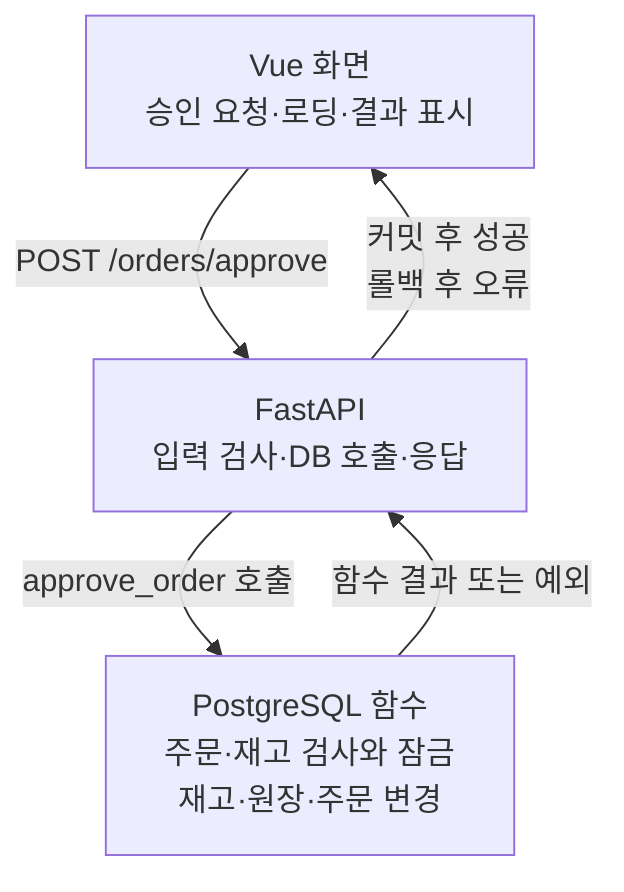
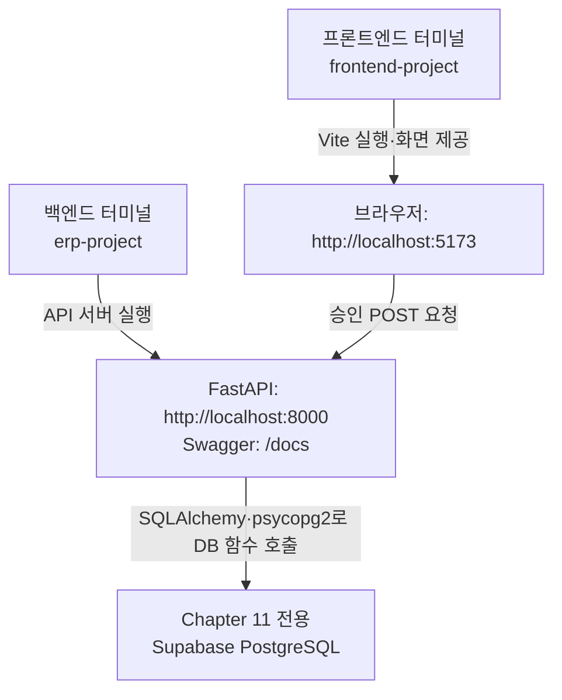
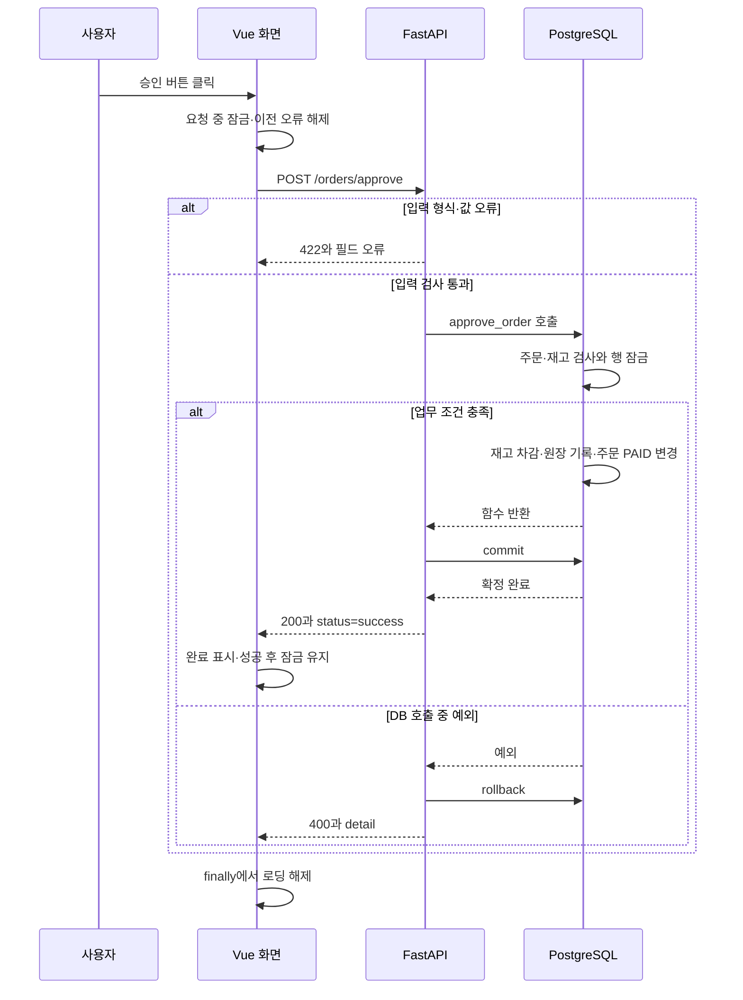

# Chapter 11. DB-API-화면 3층 연동 실습: 설계를 동작하는 코드로

> **실습 키트:** [기초 실습 환경 준비](01A_foundation_lab_setup.md#kit-download)
> 아직 준비하지 않았다면 [기초 실습 환경 준비](01A_foundation_lab_setup.md)를 먼저 완료하세요.

## 11.0 이 챕터에서 얻는 것

AI와 주문 승인 기능을 DB → API → 화면으로 연결하고, 화면의 결과가 실제 저장 결과와 일치하는지 확인합니다.
DB에서 정상 저장과 중간 실패의 취소를 확인한 뒤, API와 화면을 연결합니다. 재고 부족에서는 오류가 표시되고 DB 값이 유지되는지 봅니다.
마지막에는 AI의 안내로 업무 요구가 구현된 코드를 확인하고, 직접 본 결과로 완성한 기능을 설명합니다.
이 장의 `PAID`와 화면의 `isPaid`는 승인 완료를 나타내는 실습용 이름이며, 실제 결제 연동은 포함하지 않습니다.

**진행 순서:** 환경 준비 → 업무 조건 합의 → 단계별 AI 구현·직접 실행·코드 확인 → 최종 AI 검토 → 업무 보고.
각 실습 직후 핵심 코드를 살펴보고 결과가 나온 이유를 이해합니다. 기록에는 정상 승인과 재고 부족에서 본 사실, DB 중간 실패에서 취소를 확인한 결과만 남깁니다.
기초 키트의 `practice-workspace/ch11/observation_record.md`를 열어 두세요. 실제 관찰값은 독자가 직접 적습니다.

이 장을 마치면 다음을 할 수 있습니다.

- 업무 요청에서 언제 거절하고, 무엇을 함께 저장하며, 언제 완료로 표시할지 정합니다.
- 정상 승인과 재고 부족 상황에서 화면과 API 응답이 DB 결과와 맞는지 확인합니다.
- 관찰한 결과가 나온 이유를 DB·API·화면의 실제 코드에서 찾습니다.
- 회의에서 약속한 내용 중 직접 확인한 결과와 아직 확인하지 못한 범위를 설명합니다.

Vue 화면에는 고정 주문 정보와 승인 결과가 표시됩니다. 실제 저장 결과는 Supabase SQL Editor에서
조회하고, 요청·응답은 브라우저 개발자 도구의 Network에서 확인합니다. 화면의 완료 메시지와 DB 값을
함께 대조하는 것이 이번 실습의 기준입니다.

### [진행 기준] 실습 단계별 완료 결과

**먼저 실행을 준비합니다.** 키트와 Chapter 11 전용 DB 연결을 준비하고 주문 담당자의 요청을 듣습니다.

**DB에서 승인 처리를 만듭니다.** 정상 저장과 중간 실패의 취소를 확인한 뒤 같은 시작값에서 API를 연결합니다.

**API를 거쳐 화면까지 연결합니다.** API 시험 화면인 Swagger에서 요청을 보내고, 이어서 담당자가 사용할 화면에서 같은 결과를 확인합니다.

**재고가 부족할 때도 확인합니다.** 오류와 DB 값 유지를 확인한 뒤 만든 기능을 설명하고 실습을 마칩니다.

위 순서로 11.10까지 진행하면 주문 승인 기능의 연결과 확인을 마칩니다.

이 장은 Vue **Options API**(`data()`와 `methods`로 상태와 함수를 나누는 방식)로 단일 화면을 연결합니다.
중단 후에는 [다시 시작하기](supplements/ch11_environment_setup.md#ch11-resume)의 세 순서로 돌아옵니다.
오류가 나면 [실행 오류 도움말](supplements/ch11_environment_setup.md#ch11-run-help)과 [AI 원인 조사](#ch11-ai-debug)를 사용합니다.

---

## 11.0-ENV 실습 시작 전 환경 구축 (Chapter 11 Supabase 전용)

VS Code에서 기초 실습 키트의 `practice-workspace/ch11/`만 엽니다. `workspace/erp-project/`는
백엔드, `workspace/frontend-project/`는 프론트엔드입니다. Chapter 10의 `erp-mini/`는 복사하지 않습니다.
이 폴더와 DB는 Chapter 11 전용이며, Day 00에서는 별도 저장소를 새 폴더에 준비합니다.

처음 준비한다면 [Chapter 11 환경 준비](supplements/ch11_environment_setup.md)의 1~6단계를 완료한 뒤 돌아오세요.
시작 파일 확인, 패키지 설치, Supabase 전용 프로젝트와 연결값 설정, DB 연결 확인을 순서대로 안내합니다.
이미 준비했다면 설치를 반복하지 말고 아래 완료 기준만 확인합니다.

**준비 완료 기준**

- [ ] 시작 파일 검사에서 `ch11 static verification passed.`와 세 `Test-Path`의 `True`를 확인했다.
- [ ] 프론트엔드의 `npm ci`와 Python 3.12 가상환경의 패키지 설치가 성공했다.
- [ ] 백엔드 `venv`의 Python 버전·경로를 확인하고 `workspace/erp-project/.env`에 전용 DB 연결값을 설정했다.
- [ ] Chapter 11 전용 DB에서 `workspace/sql/00_initialize_lab.sql`의 표식 등록을 마쳤다.
- [ ] [DB 연결 확인](supplements/ch11_environment_setup.md#ch11-db-check)에서 `1`이 출력됐고, 두 서버의 포트 `8000`·`5173`을 사용할 수 있다.

실제 `.env`와 비밀값은 AI 대화·Git·화면 캡처에 포함하지 않습니다.
연결 확인의 `1`은 DB와 통신했다는 뜻입니다. 주문 테이블·승인 함수는 11.2에서 만듭니다.
두 서버 실행도 뒤의 API·화면 실습에서 진행합니다.

<a id="ch11-after-environment"></a>

---

## 11.1 전체 그림 먼저: 우리가 만들 것

**업무 회의: 주문 승인을 언제 완료로 볼 것인가**

아래 회의는 학습용 가상 상황입니다. 실제 프로젝트에서 정하지 않은 업무 기준은 담당자에게 확인해야 합니다.

> **주문 담당자:** 상품 3개를 주문한 건을 승인하려고 합니다. 버튼을 누르면 재고에서도 빠져야 합니다.
>
> **개발자:** 재고에서 3개를 빼고, 재고가 얼마나 바뀌었는지 원장에 `-3`을 남기겠습니다.
> 주문도 승인 완료로 바꾸겠습니다. **재고·원장·주문은 함께 저장하겠습니다.**
>
> **재고 담당자:** 재고가 2개뿐이면요? 승인만 되거나 재고가 음수가 되면 곤란합니다.
>
> **개발자:** **재고가 부족하면 승인하지 않고, 아무 값도 바꾸지 않겠습니다.** 화면에는 이유를 보여 드리겠습니다.
>
> **주문 담당자:** 버튼을 누르고 나면 처리가 끝났는지도 알아야겠네요.
>
> **개발자:** 처리 중에는 기다리는 표시를 하고, **저장이 끝난 뒤 성공 응답을 받으면 승인 완료로 표시하겠습니다.**
> 실패하면 이유를 보여 주고 다시 요청할 수 있게 하겠습니다.
>
> **주문 담당자:** 그럼 정상 승인과 재고 부족을 직접 보여 주시고, 어디서 처리하는지도 설명해 주세요.
>
> **개발자:** 먼저 DB에서 승인 처리를 만들고, API를 거쳐 화면까지 연결하겠습니다. 말씀하신 결과를 하나씩 확인하겠습니다.

**세 약속을 DB·API·화면으로 연결하기**

회의에서 정한 거절 조건·함께 저장할 데이터·완료 시점이 각 층에서 어떻게 이어지는지 봅니다.



<a id="ch11-business-conditions"></a>

**[짧은 실습] 회의의 약속을 내 말로 정리하기**

업무 담당자가 아래 한 문장만 전달했다면 어떤 조건이 빠졌을까요? 읽기용 요청이므로 그대로 AI에게 구현을 맡기지 않습니다.

> 주문 승인 버튼을 누르면 재고를 차감하고 완료 표시를 해 주세요.

회의를 바탕으로 다음 세 질문에 자기 말로 답합니다. 파일명이나 SQL 문법은 쓰지 않아도 됩니다.

- **함께 저장할 것:** 재고 차감·원장 기록·주문 완료 중 하나만 빠져도 되는지 생각합니다.
- **승인하지 않을 때:** 재고가 부족하면 값과 화면이 어떻게 되어야 하는지 정합니다.
- **완료를 표시할 때:** 버튼을 누른 순간과 저장 성공을 확인한 순간을 구분합니다.

정리한 조건은 [관찰 기록](#ch11-manual-record)의 **내가 정한 승인 조건**에 세 줄로 적습니다.
뒤의 생성 프롬프트와 비교해 조건을 보완하고, 11.6에서 실제 코드·실행 결과와 대조합니다.

> **실습 3원칙**
>
> 1. 결과를 모르는 요청은 다시 보내지 않고 마지막 응답과 DB 값을 확인합니다.
> 2. 실험 전에 해당 절의 시작 상태를 확인합니다.
> 3. 예측값이 아니라 직접 관찰한 값만 기록합니다.

현재 화면의 버튼 잠금은 서버의 재승인 방지가 아닙니다. 같은 주문을 다시 요청하면 재고가 또 차감될 수 있으므로
실습에서 안내한 시작값 복원과 요청 순서를 따릅니다.

**같은 승인에서 한 층씩 더 확인하기**

같은 주문을 DB → API → 화면 순서로 승인하지만, 각 단계에서 추가하는 근거는 다릅니다.
시작값을 복원하는 이유는 같은 조건에서 새로 연결한 층을 비교하기 위해서입니다.

**DB에서는 저장 결과를 봅니다.** 주문·재고·원장의 변화와 세 쓰기의 위치를 연결합니다.

**API에서는 요청과 응답을 봅니다.** 성공 응답과 DB 결과를 대조하고 저장 확정 뒤 응답하는 코드를 찾습니다.

**화면에서는 담당자가 보는 결과를 봅니다.** 완료 표시와 성공 응답·DB 결과가 일치하는지 확인합니다.

**재고 부족에서는 거절 결과를 봅니다.** 오류가 표시되고 DB 값이 유지되는지 확인합니다.

<a id="ch11-manual-record"></a>

**실습 직후 같은 이름의 항목에 기록하기**

`practice-workspace/ch11/observation_record.md`에는 다음 다섯 항목이 미리 준비되어 있습니다.
각 실습을 마친 뒤 같은 이름의 항목을 채우세요. 한 칸에 실제로 본 값을 한두 줄로 적으면 됩니다.
DB 값은 **주문 상태 / 재고 / 원장 건수** 순서로 적습니다.

- **DB 정상 승인:** 승인 전후의 DB 값과 원장 증감량을 적습니다.
- **DB 중간 실패:** 오류 사유와 실패 후 DB 값, 임시 제약을 제거한 결과를 적습니다.
- **API 정상 승인:** 응답 상태 코드와 본문, 승인 후 DB 값을 적습니다.
- **화면 정상 승인:** 완료 메시지와 버튼 상태, API 응답, 승인 후 DB 값을 적습니다.
- **재고 부족:** 화면 오류와 버튼 상태, API의 거절 사유, 요청 전후의 DB 값을 적습니다.

예를 들어 DB에서 정상 승인을 직접 확인했다면 `승인 전: CREATED / 10 / 0`, `승인 후: PAID / 7 / 1`,
`원장 증감량: -3`처럼 적습니다. 실제 값이 다르면 그 값을 적고, 아직 실행하지 않은 칸은 비워 둡니다.
이전 양식에 기록한 값이 있다면 지우지 말고 해당 항목으로 옮깁니다.

AI에게 아래의 업무 요청을 보내면 키트의 `AGENTS.md`와 연결 명세를 읽고 구현합니다.
독자는 결과를 실행해 보고 기록한 뒤, 마지막에 AI의 안내로 코드를 살펴봅니다.

<a id="ch11-ai-debug"></a>

**막혔을 때:** 현재 단계와 증상을 한 문장으로 정리해 [AI 원인 조사](supplements/ch11_environment_setup.md#ch11-ai-debug-help)를 요청하세요.
예를 들어 “응답은 200인데 화면에 완료 표시가 없습니다”처럼 자신이 본 현상을 알려 주면 됩니다.

---

## 11.2 STEP 1: 주문·재고·원장을 함께 저장하기 (Supabase SQL Editor)

> **[반드시 따라하기]** 테이블·함수를 만들고 정상 저장과 중간 실패의 취소를 확인합니다.

**시작 상태:** 전용 DB 연결 확인을 마쳤고, 이 절의 테이블·고정 데이터는 아직 만들기 전입니다.

### 이번에 만드는 것

“승인하면 재고 3개를 빼고, 원장에 남기고, 주문을 승인 완료로 바꾸겠습니다.” 이제 회의에서 약속한 처리를 DB에 만듭니다.
주문·재고·원장이 모두 저장되거나, 실패하면 앞선 변경도 취소되는 성질을 **원자성**이라고 합니다.
**트랜잭션**은 이처럼 함께 확정(commit)하거나 취소(rollback)할 작업의 단위입니다. 세 변경을 하나로 묶어 보겠습니다.

### AI에게 요청하기

아래 업무 요청을 AI에게 보냅니다. 테이블과 함수의 이름·필드·검사 조건은 키트의 연결 명세를 사용합니다.

> **[AI 프롬프트: 주문 승인 DB 만들기]**
>
> ```text
> AGENTS.md와 connection_spec.md를 먼저 읽고, 회의에서 정한 주문 승인 처리를 만들어 주세요.
> 재고가 충분하면 주문 수량만큼 차감하고, 원장에 기록하고, 주문을 승인 완료로 바꿔 주세요.
> 세 변경은 함께 저장되어야 합니다. 재고가 부족하면 아무 값도 바꾸지 않고 이유를 알려 주세요.
> 키트의 연결 명세와 기존 파일을 확인해 필요한 테이블·함수 생성 SQL을 답변으로 작성해 주세요.
> SQL은 제가 실행하겠습니다. 기존 데이터 삭제나 샘플 데이터 추가는 하지 마세요.
> 회의의 요청이 SQL 어디에 들어 있는지 핵심 위치와 이유를 짧게 설명해 주세요.
> ```

**실행 전에 볼 것:** AI가 생성한 대상이 주문·재고·원장 테이블과 승인 함수인지 확인합니다.
기존 데이터 삭제나 샘플 INSERT가 들어 있다면 실행하지 말고 이유를 확인하세요.
SQL이 길어 위치를 찾기 어렵다면 회의의 요청을 처리하는 부분을 AI에게 짚어 달라고 요청합니다.
아래에서 직접 실행한 뒤 세 값이 바뀌는 핵심 코드를 살펴봅니다.

### 직접 실행하기

**실행 위치:** Chapter 11 전용 Supabase SQL Editor와 VS Code입니다. 아직 두 개발 서버는 실행하지 않습니다.
`CREATED·10·0`은 **주문 상태·재고·원장 건수** 순서입니다.
이번에는 테이블과 데이터를 만든 뒤 `CREATED·10·0 → PAID·7·1 → CREATED·10·0`을 확인합니다.

**(1) 생성 SQL 실행**

Chapter 11 전용 프로젝트의 SQL Editor에서 새 쿼리 탭을 열고, 확인한 AI 생성 SQL 전체를 붙여 넣어 한 번 실행합니다.
오류 없이 완료되면 다음으로 진행합니다. [전체 참조 SQL](#ch11-db-reference)은 실패 원인을 조사할 때만 비교하며 함께 실행하지 않습니다.

<a id="ch11-sql-record"></a>

**(2) 성공한 SQL 실행본 보존**

방금 SQL Editor에서 성공한 테이블·함수 생성 SQL을 그대로 복사해 보존합니다.
다음 단계에서 AI가 이 실행본을 읽고 API를 연결하므로, 실제로 적용한 내용을 남겨 두는 것입니다.

1. VS Code에서 `workspace/erp-project/sql/` 폴더를 만들고 `01_approve_order.executed.sql` 파일에 저장합니다.
2. 고정 데이터 INSERT·승인 호출·초기화 SQL은 이 파일에 섞지 않습니다. 연결 주소와 비밀번호도 넣지 않습니다.
3. `observation_record.md`의 **실제 실행한 SQL**에 파일의 상대 경로와 적용 순서, 성공 여부를 적습니다.

이후 API를 만들 때 AI가 이 파일을 읽습니다. 함수를 수정해 다시 적용했다면 이전 파일은 보존하고,
성공한 변경 SQL을 `02_approve_order.executed.sql`처럼 다음 번호로 저장합니다. 저장한 파일을 다시 실행하지는 않습니다.

**(3) 고정 상품과 주문 등록**

새 쿼리 탭에서 아래 SQL 전체를 최초 한 번만 실행합니다.

```sql
INSERT INTO stock (product_id, quantity) VALUES ('PROD-100', 10);
INSERT INTO orders (order_id, product_id, quantity, status)
VALUES ('00000000-0000-0000-0000-000000000001', 'PROD-100', 3, 'CREATED');
```

오류 없이 등록됐다면 다음 조회에서 실제 값을 확인합니다.

<a id="ch11-db-state-check"></a>
<a id="ch11-state-query"></a>

**(4) 상태 조회 탭 준비와 시작값 확인**

새 쿼리 탭에 아래 조회 SQL만 입력하고 실행합니다. 이후 이 탭을 **상태 조회 탭**이라고 부릅니다.
탭을 열어 두고, 값이 필요할 때 이 조회만 다시 실행합니다.

```sql
SELECT o.status AS order_status, s.quantity AS current_stock,
       (SELECT COUNT(*) FROM stock_ledger
        WHERE product_id = 'PROD-100') AS ledger_count
FROM orders o
JOIN stock s ON s.product_id = o.product_id
WHERE o.order_id = '00000000-0000-0000-0000-000000000001';
```

**확인할 결과:** 다음 한 행이 나와야 합니다. 행이 없다면 다음 승인 호출을 하지 말고 (3)의 등록 결과부터 확인합니다.

| order_status | current_stock | ledger_count |
| :--- | ---: | ---: |
| CREATED | 10 | 0 |

**(5) 수량 3 정상 승인**

**실행 전 예측:** 재고 10개에서 3개를 승인하면 재고와 원장은 어떻게 바뀔까요?
새 쿼리 탭에서 아래 함수를 한 번 호출합니다.

```sql
SELECT approve_order('00000000-0000-0000-0000-000000000001', 'PROD-100', 3);
```

상태 조회 탭으로 전환해 조회 SQL을 실행합니다.

| order_status | current_stock | ledger_count |
| :--- | ---: | ---: |
| PAID | 7 | 1 |

다른 새 탭에서 아래 조회를 실행합니다. 이후 이 탭을 **원장 조회 탭**이라고 부릅니다.

```sql
SELECT qty_change FROM stock_ledger WHERE product_id = 'PROD-100';
```

한 행에 `-3`이면 재고 3개 차감과 원장 기록이 일치합니다. **DB 정상 승인**의 승인 전·승인 후·원장 증감량을 채웁니다.

### [실습 공통] 테스트 데이터 초기화 SQL <a id="reset-sql"></a>

**(6) 다음 실습을 위해 시작값으로 복원**

지금은 방금 성공한 승인을 확인했으므로 아래 SQL을 실행합니다. 이후에는 각 실험에서 초기화를 안내할 때만 사용합니다.
새 쿼리 탭에 아래 SQL 전체를 입력합니다. 이후 이 탭을 **초기화 탭**이라고 부릅니다.
Chapter 11 전용 프로젝트인지 확인한 뒤 실행합니다.

> [!IMPORTANT]
> **[Supabase SQL Editor에서 실행]**
> ```sql
> BEGIN;
> -- 주문 상태 복원 (CREATED) + 재고 복원 (10개) + 원장 초기화
> UPDATE orders SET status = 'CREATED'
>   WHERE order_id = '00000000-0000-0000-0000-000000000001';
> UPDATE stock SET quantity = 10 WHERE product_id = 'PROD-100';
> DELETE FROM stock_ledger WHERE product_id = 'PROD-100';
> COMMIT;
> ```

상태 조회 탭에서 조회를 다시 실행해 복원을 확인합니다.

| order_status | current_stock | ledger_count |
| :--- | ---: | ---: |
| CREATED | 10 | 0 |

테이블과 함수는 유지하며 고정 주문 상태, 상품 재고와 해당 상품의 원장 기록만 되돌렸습니다.
**조회 탭과 초기화 탭은 그대로 열어 둡니다.** 이후 본문에서 탭 이름을 안내하면 해당 SQL Editor 탭을 사용합니다.

**다른 실험에서 이 SQL을 찾아왔다면** 초기화 후 상태 조회로 결과를 확인하고 읽던 실험으로 돌아갑니다.
DB 복원과 Vue 화면 새로고침은 별개이며, **같은 화면 재시도에서는 새로고침하지 않습니다.**
정상 진행 중에는 이어지는 중간 실패 실험과 코드 확인을 마친 뒤 11.3으로 넘어갑니다.

<a id="ch11-db-atomicity"></a>

### 중간에 실패하면 앞선 변경은 어떻게 될까요?

**시작 상태:** 초기화를 마친 DB `CREATED·10·0`. 서버나 화면은 아직 필요하지 않습니다.
정상 승인은 세 쓰기가 모두 성공한 경우였습니다. 이번에는 재고를 차감한 뒤 원장 기록에서 일부러 실패시킵니다.

**(1) 원장 기록을 잠시 막기**

SQL 실행본에서 재고 변경 → 원장 기록 → 주문 완료 순서를 확인합니다. 원장 기록의 실패를 성공으로 바꾸는 예외 처리가 있다면
먼저 AI와 해당 구현을 확인합니다. 이 실험은 예외가 호출자에게 전달되는 함수를 대상으로 합니다.
새 쿼리 탭에서 아래 SQL만 실행합니다. `-3` 기록을 허용하지 않는 임시 검사 조건입니다.

```sql
ALTER TABLE stock_ledger
  ADD CONSTRAINT tmp_block_ledger CHECK (qty_change <> -3);
```

추가에 성공했을 때만 다음으로 갑니다. 이미 같은 이름이 있다면 아래 제거 SQL로 정리한 뒤 시작 상태부터 확인합니다.

**(2) 함수를 호출하고 남은 값 확인하기**

앞의 추가 SQL과 함께 실행하지 말고, 별도 쿼리로 다음 호출만 한 번 실행합니다.

```sql
SELECT approve_order('00000000-0000-0000-0000-000000000001', 'PROD-100', 3);
```

예상 결과는 `tmp_block_ledger` 제약 위반 오류입니다. 상태 조회 탭에서 조회를 다시 실행하면
주문은 `CREATED`, 재고는 `10`, 원장은 `0건`이어야 합니다. 재고를 바꾸는 코드가 먼저 실행됐지만 그 변경도 남지 않았습니다.

**(3) 임시 조건 제거하고 다음 단계로 가기**

결과가 예상과 달라도 아래 SQL은 따로 실행해 임시 조건을 제거합니다. 실험을 중단했다가 돌아온 경우에도 먼저 제거합니다.

```sql
ALTER TABLE stock_ledger DROP CONSTRAINT IF EXISTS tmp_block_ledger;
```

제거 성공과 상태 조회의 `CREATED·10·0`을 확인합니다. 값이 다르면 초기화하기 전에 원인을 확인하세요.
**DB 중간 실패**의 오류 사유·실패 후 DB 값·임시 제약 제거 결과를 채웁니다.

여러 쓰기를 하나의 작업으로 묶어 모두 저장하거나, 실패하면 앞선 변경까지 취소하는 성질을 **원자성**이라고 합니다.
이번에는 PostgreSQL이 실패한 함수 호출의 앞선 재고 변경을 취소했습니다. API를 거치지 않았으므로 API의 `rollback()`을 실행한 실험은 아닙니다.

<a id="ch11-understand-db"></a>

### 이번에 이해한 것

**질문 하나:** 세 쓰기는 어디에 있으며, 원장 기록이 실패했을 때 앞선 재고 변경은 어떻게 됐나요?
**검색 단서:** SQL 실행본에서 `UPDATE stock`, `INSERT INTO stock_ledger`, `UPDATE orders`를 차례로 검색합니다.
방금 보존한 SQL 실행본을 열어 아래 역할을 찾습니다. 참조 함수의 핵심은 다음 세 쓰기이며,
이 조각만 따로 실행하지 않습니다.

```sql
UPDATE stock SET quantity = quantity - p_qty WHERE product_id = p_product_id;
INSERT INTO stock_ledger (product_id, qty_change, reason)
VALUES (p_product_id, -p_qty, '주문 승인 처리 (' || p_order_id || ')');
UPDATE orders SET status = 'PAID' WHERE order_id = p_order_id;
```

관찰한 재고 `10 → 7`·원장 `-3`·주문 `PAID`를 각 쓰기에 연결하세요.
그 앞에서 수량·주문 일치·재고를 검사하는 곳도 짚습니다. 생성물의 문법이 달라도 같은 역할이면 됩니다.
세 쓰기 사이에 일부만 확정하는 커밋은 없으며, 호출한 트랜잭션에서 함께 확정·취소합니다.

**검사한 재고가 도중에 바뀌면 어떨까요?** `FOR UPDATE`는 조회한 주문과 재고 행을 트랜잭션이 끝날 때까지 잠급니다.
다른 요청이 같은 행을 변경하려면 기다려야 하므로 재고를 검사하는 동안 그 값이 바뀌는 것을 막습니다.
처리가 끝난 뒤 들어오는 같은 주문의 재승인을 거절하는 기능은 별도로 필요합니다.

**이번에 확인한 것:** 정상 호출에서는 세 값이 함께 저장됐고, 원장 기록 실패에서는 앞선 재고 변경도 취소됐습니다.

**다음 단계 조건:** 정상 저장과 중간 실패의 취소를 확인하고, 임시 제약을 제거해 `CREATED·10·0`이 남았다면 11.3으로 넘어갑니다.
고정 주문 UUID·상품·수량은 뒤의 API와 화면에서도 그대로 사용합니다.

---

## 11.3 STEP 2: DB 함수를 호출하는 API 만들기 (FastAPI)

> **[반드시 따라하기]** DB 함수를 호출하는 API를 만들고 Swagger에서 확인합니다.

<a id="ch11-api-prepare"></a>

**시작 상태:** DB `CREATED·10·0`. 아래에서 백엔드 서버를 실행합니다.

### 이번에 만드는 것

DB에서 승인 처리가 되는 것을 확인했습니다. 이제 화면에서도 이 처리를 요청할 수 있게 API를 연결하겠습니다.
API는 요청 형식·수량을 검사하고, 주문 일치·재고 판단과 저장은 앞에서 만든 DB 함수에 맡깁니다.
호출 결과를 응답으로 바꾸는 데 집중하는 구조를 **Thin Layer API(처리 책임을 좁힌 API)**라고 부릅니다.
이 실습에서 DB 함수에 맡기는 이유는 재고 검사와 세 쓰기를 한곳에서 처리해 일부만 저장되지 않게 하기 위해서입니다.
API에는 요청을 받고 결과를 돌려주는 일을 남깁니다. 모든 업무 계산을 DB에 넣어야 한다는 뜻은 아닙니다.

이 장은 DB 응답을 기다리는 동기 호출을 사용하며, API 경로 함수는 일반 `def`로 작성합니다.

브라우저는 화면과 API의 주소가 다르면 응답을 읽어도 되는지 확인합니다. 여기서는 포트 `5173`과 `8000`이 달라 다른 출처로 취급됩니다.
**CORS**는 API가 응답을 읽도록 허용할 화면의 출처를 알려 주는 설정이며, 이 장에서는 `http://localhost:5173`을 허용합니다.
로그인이나 업무 권한 검사와는 다른 역할입니다.

**예상 구현 위치:** `workspace/erp-project/api/main.py`. 시작 키트의 기존 프로젝트에 API를 추가합니다.

### AI에게 요청하기

앞에서 성공한 SQL 실행본을 읽고 API를 연결하도록 요청합니다. 조사와 구현·검사는 한 요청으로 진행합니다.

> **[AI 프롬프트: 승인 처리를 API로 연결하기]**
>
> ```text
> AGENTS.md와 connection_spec.md, 앞에서 실행한 SQL과 관찰 기록을 읽고 승인 API를 만들어 주세요.
> 화면에서 승인 요청을 보내면 앞에서 만든 DB 함수가 처리하게 해 주세요.
> 저장이 끝난 뒤 성공을 응답하고, 잘못된 요청이나 재고 부족은 이유를 알려 주세요.
> 키트 명세의 요청·응답과 허용 범위를 지키며 조사·구현·검사를 진행해 주세요.
> 바꾼 파일과 검사 결과, 실행을 막는 문제만 짧게 알려 주세요.
> ```

**실행 전에 볼 것:** diff(변경 전후의 차이)에서 예상한 백엔드 API 파일이 바뀌었고 구문 검사가 통과했는지 확인합니다.
Git이 없는 폴더라면 AI에게 변경 전후 비교를 요청합니다.
명세 충돌이나 검사 문제가 보고됐다면 해결한 뒤 실행합니다. DB 저장 결과는 아래 Swagger에서 직접 확인합니다.

### 직접 실행하기

API 단계부터 백엔드 서버를, 화면 단계부터 프론트엔드 서버도 실행합니다.
터미널 명령은 각 절에 표시된 실행 폴더에서 입력합니다.



<a id="ch11-api-run"></a>

**실행 위치: 백엔드 터미널 → Swagger.** DB는 `CREATED·10·0`에서 시작합니다.
성공 응답과 `PAID·7·1`을 확인한 뒤 DB를 복원하고, 백엔드 서버는 켜 둡니다.

1. **백엔드 터미널**에서 아래 첫 명령으로 실행 폴더를 맞춘 뒤 기존 `venv`의 Python으로 서버를 켭니다.
   프론트엔드도 같은 방식으로 폴더를 옮긴 뒤 실행합니다. 키트를 다른 곳에 설치했다면 경로를 바꾸세요.

   ```powershell
   Set-Location C:\erp-book\foundation-lab-kit\practice-workspace\ch11\workspace\erp-project
   Remove-Item Env:DATABASE_URL -ErrorAction SilentlyContinue
   & .\venv\Scripts\python.exe -m uvicorn api.main:app --reload
   ```

   `Remove-Item`은 현재 터미널에 남아 있는 이전 DB 연결값을 해제합니다. `.env` 파일을 지우는 명령은 아닙니다.
   `load_dotenv()`는 기존 환경값을 덮어쓰지 않으므로, 이번 백엔드 폴더의 `.env`를 사용하려고 먼저 해제하는 것입니다.
   macOS·Linux에서는 `ch11/`에서 `cd workspace/erp-project`로 이동하고 `unset DATABASE_URL`을 실행한 뒤
   `./venv/bin/python -m uvicorn api.main:app --reload`로 서버를 실행합니다.

2. `http://localhost:8000/docs`에서 `POST /orders/approve`를 펼치고 **Try it out**을 누릅니다.
   SQL Editor의 **상태 조회 탭**에서 `CREATED·10·0`인지 확인한 뒤 아래 본문을 입력합니다.

   ```json
   {
     "order_id": "00000000-0000-0000-0000-000000000001",
     "product_id": "PROD-100",
     "qty": 3
   }
   ```

3. **실행 전 예측:** 성공 응답은 DB 함수가 반환한 직후와 커밋이 끝난 뒤 중 언제 보내야 할까요?
   회의에서 정한 완료 시점을 떠올린 뒤 **Execute를 한 번만** 누릅니다. 응답 뒤 이 절에서 코드의 순서를 확인합니다.
   응답 `200`·`{"status":"success"}`와 DB 상태 `PAID·7·1`을 대조합니다.
4. <a id="ch11-api-reset"></a>SQL Editor의 **초기화 탭**에서 SQL을 실행하고, **상태 조회 탭**에서 `CREATED·10·0`을 확인합니다. 백엔드 서버는 켜 둡니다.

<a id="ch11-understand-api"></a>

### 이번에 이해한 것

**질문 하나:** 저장 확정과 성공 응답 중 무엇이 먼저인가요?
**검색 단서:** API에서 `commit`, `rollback`, `return`을 검색해 확정·취소·성공 응답의 위치를 찾습니다.
생성한 API를 열어 DB 호출·커밋·성공 반환의 순서를 찾습니다. 참조 코드에서는 다음과 같습니다.

```python
db.execute(
    text("SELECT approve_order(:id, :pid, :q)"),
    {"id": request.order_id, "pid": request.product_id, "q": request.qty}
)
db.commit()
return {"status": "success"}
```

`text()`는 실행할 SQL 객체를 만들고, `:id` 같은 매개변수에 값을 따로 전달합니다.
요청값을 SQL 문장에 직접 이어 붙이지 않습니다. 성공 응답은 `commit()` 뒤에 반환합니다.
함수의 `BEGIN~END`는 실행문을 묶는 블록이며 커밋 명령이 아닙니다.
**API 정상 승인**의 응답 상태 코드와 본문, 승인 후 DB 값을 채웁니다.

**이번에 확인한 것:** 완료 시점 — API로도 저장 결과를 확인하고, 코드에서 커밋 뒤 성공 응답하는 순서를 찾았습니다.

**다음 단계로:** 성공 응답과 DB 결과를 확인하고 시작값으로 복원했다면, 서버를 켜 둔 채 11.4로 넘어갑니다.

**같은 실패 응답이어도 거절한 곳이 다릅니다.** 잘못된 UUID나 수량 0은 Pydantic(요청값의 형식과 범위를 검사하는 도구)이
DB 함수를 호출하기 전에 `422`로 거절합니다. 요청 형식이 맞더라도 재고가 부족하면 DB 함수에서 예외가 발생하고, 이 API는 이를 `400`으로 돌려줍니다.
이 학습용 API는 DB 예외 문자열을 `detail`에 담고 연결 실패 같은 서버 오류도 `400`으로 반환하므로, 상태 코드와 함께 사유를 읽어야 합니다.

---

## 11.4 STEP 3-A: 승인 API를 호출하는 화면 만들기

> **[반드시 따라하기]** 로딩·성공·오류 처리를 포함한 주문 승인 화면을 한 번 생성합니다.

<a id="ch11-ui-prepare"></a>

**시작 상태:** DB `CREATED·10·0`, 백엔드 서버 실행 중.

### 이번에 만드는 것

API에서도 승인 결과를 확인했습니다. 이제 담당자가 버튼을 눌러 그 결과를 볼 수 있게 화면을 만들겠습니다.
회의에서 정한 대로 처리 중에는 기다리는 표시를 하고, 저장 성공은 완료로, 실패는 이유와 함께 보여 줍니다.
이 절에서 화면을 연결하고 이어지는 11.5에서 정상 승인을 한 번 실행합니다.

### AI에게 요청하기

키트는 Vue Options API와 Axios(브라우저에서 API를 호출하는 라이브러리)를 사용합니다.
화면의 고정 주문과 요청 형식은 연결 명세에 있으므로 업무 동작을 중심으로 요청합니다.

> **[AI 프롬프트: 담당자가 사용할 승인 화면 만들기]**
>
> ```text
> AGENTS.md와 connection_spec.md를 읽고, 담당자가 사용할 주문 승인 화면을 만들어 주세요.
> 키트의 고정 주문 정보를 보여 주고, 승인 버튼을 누르면 앞에서 만든 API를 호출해 주세요.
> 처리 중에는 추가 클릭을 막고, 저장 성공 응답을 받으면 완료로 표시하고 버튼 잠금을 유지해 주세요.
> 실패하면 이유를 보여 주고 다시 요청할 수 있게 하며, 새 요청을 시작할 때 이전 오류를 지워 주세요.
> 키트 명세의 오류 안내와 기존 화면·의존성을 지키며 시작 화면에 연결하고 빌드까지 확인해 주세요.
> 바꾼 파일과 빌드 결과, 실행을 막는 문제만 짧게 알려 주세요.
> ```

**실행 전에 볼 것:** 주문 카드를 만들고 `src/App.vue`에 연결했는지 변경 요약을 확인합니다.
예상 위치는 `workspace/frontend-project/src/components/ApproveOrder.vue`와 `src/App.vue`입니다.
빌드가 통과하면 화면을 엽니다. 빌드 성공과 실제 화면 동작은 별도로 확인합니다.
키트의 `workspace/_starter/App.vue`는 시작 화면 복원용이며 개인 작업의 백업은 아닙니다.

### 직접 실행하기

<a id="ch11-ui-run"></a>

1. 11.3의 백엔드 서버는 실행한 채 둡니다. VS Code에서 프론트엔드용 터미널을 별도로 열거나 설치 때 사용한 터미널을 선택합니다.
   아래 첫 명령으로 실행 폴더를 맞춘 뒤 서버를 켭니다. 키트를 다른 곳에 설치했다면 경로를 바꾸세요.

   ```powershell
   Set-Location C:\erp-book\foundation-lab-kit\practice-workspace\ch11\workspace\frontend-project
   npm.cmd run dev -- --port 5173 --strictPort
   ```

   macOS·Linux에서는 `ch11/`에서 `cd workspace/frontend-project`로 이동한 뒤
   `npm run dev -- --port 5173 --strictPort`로 실행합니다.

   이미 5173에서 실행 중이라면 다시 실행하지 않습니다. 포트가 사용 중이면 해당 터미널을 먼저
   확인하세요. `--strictPort`는 다른 포트로 자동 변경되는 것을 막아 API의 허용 주소와 맞춥니다.
2. `http://localhost:5173`에서 주문·상품·수량과 승인 버튼이 보이는지 확인합니다.
   이어지는 11.5의 실행 절차에서 요청·로딩·성공 결과를 확인합니다.

카드가 보이면 이어서 정상 승인을 실행합니다.

---

## 11.5 STEP 3-B: 요청 중 버튼 잠금과 성공·오류 표시 확인하기

> **[반드시 따라하기]** 11.4에서 만든 화면의 상태와 실제 API·DB 결과를 확인합니다.

### 이번에 만드는 것

“저장이 끝난 뒤 승인 완료로 표시하겠습니다.” 담당자가 사용할 화면에서 이 약속을 확인합니다.
정상 승인을 한 번 실행하고, 완료 표시·성공 응답·실제 저장 결과를 대조합니다.
응답·화면·DB 값을 기록한 뒤 아래 코드에서 결과가 나온 이유를 찾습니다.

### 직접 실행하기

<a id="ch11-ui-check"></a>

**시작 상태:** 두 서버 실행 중, DB `CREATED·10·0`.

**실행 전 예측:** 재고 10개에서 3개를 승인하면 어떤 값이 남고 화면에는 무엇이 보여야 할까요?

1. **준비:** 상태 조회 탭의 DB 값이 `CREATED·10·0`인지 확인하고 Vue 페이지를 새로고침합니다.
   Chrome·Edge에서는 `F12` 또는 `Ctrl+Shift+I`로 개발자 도구를 열고 **Network(네트워크)** 탭을 선택합니다.
   Network 상단 도구 모음의 속도 제한 메뉴에서 **No throttling(제한 없음)**을 선택합니다.
2. **실행:** Network 목록의 지우기 버튼으로 이전 기록을 비웁니다.
   [주문 승인 API 호출]을 한 번 누릅니다.
3. **응답 확인:** Network에서 승인 요청의 주소·본문·응답을 확인합니다.

   목록에서 `approve` 중 **Method가 POST인 요청**을 선택합니다. 메서드 열이 보이지 않으면 요청을 열어 Headers의 General에서 확인합니다.
   `OPTIONS`가 함께 보일 수 있는데, 이는 브라우저가 CORS 허용 여부를 미리 묻는 요청입니다. 승인 처리는 `POST`에서 확인합니다.
   아래 탭 이름은 브라우저에 따라 조금 다를 수 있습니다.

   | 볼 곳 | 정상 승인에서 확인할 값 |
   | :--- | :--- |
   | Headers의 General | Request URL은 `http://localhost:8000/orders/approve`, Method는 POST, Status Code는 200 |
   | Payload | 고정 주문의 `order_id`, `product_id: PROD-100`, `qty: 3` |
   | Response | `{"status":"success"}` |

4. **결과 관찰:** 같은 요청의 응답이 `200`이고 본문에 `status=success`가 있는지 확인합니다.
   Vue 화면에 완료 메시지가 나타나고 버튼이 잠긴 채 유지되는지 봅니다. SQL Editor에서도 DB가 `PAID·7·1`로 바뀌었는지 확인합니다.
   11.2에서 준비한 원장 조회 탭에서 `SELECT qty_change FROM stock_ledger WHERE product_id = 'PROD-100';`를 실행해 증감량 `-3`도 확인합니다. 버튼 색상이나 CSS 값까지 참조와 같을 필요는 없습니다.
   성공했을 때 화면은 다음과 같이 보입니다. 디자인이 달라도 완료 메시지와 잠긴 버튼이 있으면 됩니다.

   

   

   SQL Editor의 Results에서 `order_status=PAID`, `current_stock=7`, `ledger_count=1`을 확인합니다.
5. **기록:** [관찰 기록](#ch11-manual-record)의 **화면 정상 승인**의 완료 메시지와 버튼 상태, API 응답, 승인 후 DB 값을 채웁니다.

**내 말로 설명:** “무엇이 함께 저장됐으며, 화면에서 언제 완료를 확인했나요?”에 자신의 관찰값으로 답합니다.
아래 코드를 읽으며 자신이 본 완료 표시가 어떤 조건에서 나타났는지 연결해 봅니다.

<a id="ch11-understand-ui"></a>

### 이번에 이해한 것

**질문 하나:** 성공 응답은 어디서 화면의 완료 표시로 이어지나요?
**검색 단서:** 화면에서 `status`, `success`, `isPaid` 또는 같은 역할의 상태를 찾습니다.
참조 화면은 성공 응답을 확인한 뒤 완료 상태를 바꿉니다.

```javascript
if (response.status === 200 && response.data.status === 'success') {
  this.isPaid = true;
}
```

이 조건이 성공 응답 뒤 완료 표시로 이어지는지 코드에서 확인합니다. 별도 설명문은 기록하지 않습니다.

**방금 확인한 DB·API·화면 연결을 그림으로 읽기**

요청과 응답의 순서를 확인하세요.



입력 오류와 DB 오류에서는 완료 상태로 바꾸지 않습니다. 성공 후에는 로딩만 해제되고 완료 상태의 잠금은 유지됩니다.

**이번에 확인한 것:** 화면 연결 — 성공 응답을 받은 뒤 완료 표시가 나타났고 DB 결과도 일치했습니다.

**다음 단계로:** 화면의 완료 표시와 성공 응답이 DB 결과와 맞았다면, 11.6에서 재고 부족 상황을 확인합니다.

---

## 11.6 검증: 내가 만든 것이 제대로 동작하는가

> **[반드시 따라하기]** 재고 부족에서 오류가 표시되고 DB 값이 유지되는지 확인합니다.

“재고가 2개뿐이면 승인하지 않고 아무 값도 바꾸지 않겠습니다.” 이제 이 상황을 직접 눌러 확인합니다.
결과는 열린 `observation_record.md`의 **재고 부족**에 적습니다.
재고 부족 결과를 기록한 뒤 재고를 복원하고 한 번 다시 요청하며 마칩니다.

**시작 준비:** 두 서버가 실행 중이고 11.5의 결과가 `PAID·7·1`로 남아 있습니다.
SQL Editor에는 **상태 조회 탭**과 **초기화 탭**이 열려 있습니다. Vue 화면과 Network도 열어 둡니다.

### 직접 실행하기: 실패와 재시도

<a id="ch11-check-shortage"></a>

**이번에 확인할 것:** 재고가 부족하다는 응답을 받았을 때 화면에도 오류가 나타나고, DB 값은 그대로 남는지 봅니다.

**(1) 재고 2개로 준비**

1. SQL Editor의 **초기화 탭**에서 SQL을 실행합니다.
2. 별도의 새 쿼리 탭에서 아래 SQL을 실행해 재고를 2개로 줄입니다.

   ```sql
   UPDATE stock SET quantity = 2 WHERE product_id = 'PROD-100'
   RETURNING product_id, quantity;
   ```

3. **상태 조회 탭**에서 `CREATED·2·0`을 확인합니다.
4. Vue 페이지를 새로고침하고 Network 기록을 비웁니다. 화면의 요청 수량은 3을 유지합니다.

**(2) 재고 부족 요청과 결과 확인**

**실행 전 예측:** 재고 2개에서 3개를 승인하면 데이터가 바뀔까요?
승인 버튼을 한 번 누르고 다음 결과를 확인합니다.

- Network: 승인 POST의 응답이 `400`이고 `detail`에 재고 부족 사유가 있습니다.
- Vue: 오류 메시지가 보이고 완료 표시 없이 버튼을 다시 사용할 수 있습니다.
- 상태 조회 탭: 조회를 실행하면 `CREATED·2·0` 그대로입니다.


**(3) 기록과 코드 확인**

**재고 부족**의 화면 오류와 버튼 상태, 응답 상태 코드와 오류 사유, 요청 전후 DB 값을 채웁니다.
DB가 요청 전과 같은 `CREATED·2·0`이었는지 실제 조회 결과를 적습니다.
SQL 실행본에서 재고 검사가 첫 쓰기보다 앞에 있는지 확인하고, DB 값이 유지된 결과와 연결해 봅니다.

<a id="ch11-check-retry"></a>

**(4) 재고를 복원하고 마무리**

초기화 탭에서 SQL을 실행해 `CREATED·10·0`으로 복원합니다. 오류 화면은 새로고침하지 않고 승인 버튼을 한 번 누릅니다.
이전 오류가 사라지고 화면에 완료가 표시되는지 봅니다. 성공 응답을 받고 DB도 `PAID·7·1`로 바뀌었다면 마칩니다. 별도 기록은 추가하지 않습니다.

**이번에 확인한 것:** 재고가 부족하면 첫 쓰기 전에 거절돼 DB가 유지되고, 화면에 오류가 표시됩니다.
**종료 상태:** DB `PAID·7·1`, 화면은 완료 상태입니다. 추가 초기화 없이 아래 AI 검토로 이어갑니다.

**기록 확인:** [11.1에서 시작한 기록](#ch11-manual-record)에 정상 승인과 재고 부족의 실제 결과, DB 중간 실패의 메모가 남았는지 확인합니다.

<a id="ch11-ai-review"></a>

### 2차 확인: AI와 기록·코드 검토하기

이제 회의에서 요청한 동작이 어디에 구현됐는지 AI에게 안내받습니다. 같은 대화에서 아래 프롬프트를 실행하세요.
새 대화에서도 SQL 실행본과 관찰 기록을 읽으면 이어갈 수 있습니다.

> **[AI 검토 프롬프트]**
>
> ```text
> Chapter 11의 AGENTS.md와 연결 명세, 관찰 기록을 읽어 주세요.
> 회의에서 약속한 함께 저장·재고 부족 거절·저장 성공 뒤 완료 표시가 현재 코드 어디에 구현됐는지 안내해 주세요.
> 실제 파일 위치와 핵심 코드 몇 줄을 보여 주고, DB 중간 실패의 취소를 포함해 제가 관찰한 결과와 연결하여 쉽게 설명해 주세요.
> 기록과 구현이 다르면 제가 확인할 부분만 짚어 주세요.
> ```

**독자가 마칠 일:** 안내받은 코드를 열어 자신이 본 결과와 연결해 봅니다. 실제 관찰값을 잘못 적었다면 그 부분만 고칩니다.
구현 문제가 발견되면 원인·최소 수정 범위를 확인한 뒤 수정하고 관련 실험을 다시 합니다.
SQL을 바꿨다면 성공한 새 실행본을 보존합니다.

<a id="ch11-code-review"></a>

안내에서 이해되지 않은 곳만 [DB의 세 쓰기](#ch11-understand-db),
[API의 확정·응답 순서](#ch11-understand-api), [화면 잠금](#ch11-understand-ui)으로 돌아가 살펴봅니다.
코드 위치와 설명을 관찰 기록에 다시 옮길 필요는 없습니다.

---

<a id="ch11-defense-scope"></a>

## 11.7 이 기능의 방어막 적용 여부

7A에서 배운 네 방어막을 이번 구현에 대입해 봅시다. 아래는 키트의 참조 구현과 연결 명세를 기준으로 한 요약입니다.
AI가 생성한 코드에서도 같은 역할을 하는 부분을 확인하세요.

| 7A의 방어막 | 이번 구현 | 이 실습에서 확인한 범위 |
| :--- | :--- | :--- |
| 트랜잭션 | DB 함수의 세 쓰기를 함께 확정하거나 취소합니다. API는 성공 시 commit, 예외 시 rollback을 호출합니다. | 정상 저장과 DB 직접 호출의 중간 실패 취소를 확인했습니다. API를 통한 중간 실패 실험은 별도입니다. |
| 동시성 제어 | `FOR UPDATE`로 검사할 주문과 재고 행을 잠급니다. | 코드에서 잠금을 확인했습니다. 동시 요청 실험은 하지 않았습니다. |
| 멱등성 | 서버에서 같은 주문의 재승인을 막는 처리는 없습니다. | 화면의 버튼 잠금만으로 다른 화면이나 API의 재요청까지 막지는 못합니다. |
| 상태 전이 검사 | 현재 주문 상태를 보고 재승인을 거절하는 검사는 없습니다. | 상태값 CHECK는 허용된 값만 검사하며, `PAID` 주문의 재승인을 막지 못합니다. |

인증과 회사별 접근 제한도 이번 구현에 포함하지 않았습니다.
화면의 잠금, API의 입력 검사, DB의 저장 처리는 각각 다른 문제를 막는다는 점을 기억하세요.

---

<a id="ch11-completion"></a>

## 11.8 마무리: 완성 체크리스트

관찰 기록과 AI의 코드 안내를 보며 다음을 확인합니다.

- [ ] DB·API·화면에서 정상 승인을 실행했고, 응답·완료 표시·저장 결과가 일치했다.
- [ ] 재고 부족에서 오류가 표시되고 DB 값이 유지되는 것을 직접 확인했다.
- [ ] DB 중간 실패에서 재고 변경도 취소됐음을 확인하고 임시 제약을 제거했다.
- [ ] AI가 안내한 코드를 열어 결과가 나온 흐름을 설명할 수 있다.

결과가 다르거나 아직 실행하지 않았다면 해당 부분을 확인한 뒤 마칩니다.

<a id="ch11-business-report"></a>

**직접 본 결과로 업무 보고하기**

회의의 담당자에게 결과를 설명할 수 있도록 AI에게 짧은 보고 초안을 요청합니다.

> **[업무 보고 프롬프트]**
>
> ```text
> observation_record.md의 실제 관찰값으로 회의 담당자에게 전할 짧은 업무 보고를 이 대화에 작성해 주세요.
> 정상 승인과 재고 부족의 결과, DB 중간 실패에서 앞선 재고 변경도 취소된 결과를 설명해 주세요.
> 직접 실행한 결과만 확인했다고 표현하고, 코드로만 살펴봤거나 아직 확인하지 못한 범위는 구분해 주세요.
> 기록에 없는 숫자나 검증 결과를 채우지 말고, 파일은 수정하지 마세요.
> ```

초안의 숫자와 확인 범위가 자신이 본 사실과 맞는지 읽고, 자기 말로 설명해 봅니다.
DB 중간 실패의 취소는 SQL Editor에서 확인했습니다. API를 통한 같은 실패 처리와 추가 클릭 차단은 별도로 실행 검증하지 않았으며,
인증·회사 격리·서버 재승인 방지는 구현하지 않았습니다. 보고에서도 이 범위를 지킵니다.

**Core 완료:** 정상 승인과 재고 부족의 결과를 보고, DB 중간 실패에서 앞선 변경도 취소되는 것을 확인했습니다.
이 결과가 코드에서 어떻게 이어지는지 설명할 수 있다면 [11.9 종료 절차](#ch11-finish)로 이동합니다.

---

<a id="ch11-finish"></a>

## 11.9 [실습] Chapter 11 종료 상태 확인

실행 결과를 기록하고 업무 보고의 내용까지 확인했다면 다음 순서로 마칩니다.

1. 백엔드·프론트엔드 터미널에서 각각 `Ctrl+C`로 서버를 종료합니다.
   가상환경을 활성화했다면 같은 터미널에서 아래 명령을 실행하거나 창을 닫습니다.

```powershell
deactivate
```

2. `practice-workspace/ch11/`의 API·화면 코드, 실제 실행한 SQL과 `observation_record.md`를 저장합니다.
   폴더와 DB는 복습용으로 보존합니다.
3. [Day 00 — 실습 시작 가이드](days/day_00_starter_kit.md)에 따라 별도의 `franchise-erp` 폴더에
   새 저장소를 준비합니다. Chapter 11의 `.env`·DB 데이터는 복사하지 않습니다.

---

## 11.10 챕터 11 요약 및 마무리

주문 승인 기능을 DB → API → 화면으로 연결했습니다.
DB에서 주문은 `PAID`, 재고는 `7`, 원장은 `1건`이며 증감량은 `-3`인 것을 확인했습니다. API에서도 성공 응답과 같은 저장 결과를 확인했습니다.
화면에서는 성공 응답 뒤 완료 표시가 나타났고, 재고 부족에서는 오류가 표시되며 DB `CREATED·2·0`이 유지됐습니다.
이로써 회의에서 약속한 정상 저장·재고 부족 거절·저장 성공 뒤 완료 표시를 직접 확인했습니다.
DB에서는 원장 기록을 실패시켜 앞선 재고 변경도 취소되는 원자성을 확인했습니다.
직접 본 결과를 기록하고, AI의 안내로 업무 요청이 구현된 코드와 연결했습니다.

Day에서는 이 작은 예제를 더 많은 업무로 넓힙니다. 화면은 `<script setup>`을 사용하는 **Composition API** 방식도 만나게 됩니다.
이 장에서 `data()`와 `methods`로 나눴던 상태와 함수를 다른 문법으로 구성하지만, 요청을 보내고 결과를 표시하는 역할은 같습니다.
백엔드도 `main.py` 한 파일에서 업무별 API를 받는 `routers/`와 업무 판단을 담는 `services/`로 나뉩니다.
파일이 늘어나도 요청 → 서버 검사 → 저장 결과 → 화면 반영의 흐름을 따라가면 됩니다.

[Day 00](days/day_00_starter_kit.md)에서 새 저장소를 준비하세요. 2권에서는 Day 30까지 완성한 모놀리스를 재설계합니다.

---

<a id="ch11-reference-section"></a>

## 11.11 [선택 참조] 코드 비교·복구와 심화 복습

더 궁금한 질문이 생기면 아래에서 하나를 고릅니다. 연결된 자료에 설명을 요청할 프롬프트와 실험·복원 절차가 있습니다.

<a id="ch11-mid-write"></a>
<a id="ch11-check-input"></a>

| 더 알아보고 싶은 질문 | 사용할 심화 자료 |
| :--- | :--- |
| DB에서 본 중간 실패를 API와 화면으로 확인하면 어떨까? | [중간 실패의 API·화면 처리](supplements/ch11_review.md#ch11-mid-write) |
| 버튼을 잠그면 서버의 재승인도 막힐까? | [화면 잠금과 서버 재승인](supplements/ch11_review.md#ch11-reapprove) |
| 응답을 받지 못하면 다시 눌러도 될까? | [통신 오류와 저장 결과](supplements/ch11_review.md#ch11-network-error) |

다른 질문은 [심화 자료의 전체 목록](supplements/ch11_review.md)에서 찾습니다.

**막힌 코드만 비교·복구하기**

원인이 불분명하면 [AI 원인 조사](#ch11-ai-debug)로 좁힙니다. 참조 코드로 복구할 때는
전체 파일을 덮어쓰기 전에 차이와 수정 이유를 확인하고, 변경한 부분의 실험을 다시 합니다.

<a id="ch11-db-reference"></a>

- [DB 테이블·함수 참조와 SQL 보존](supplements/ch11_review.md#ch11-db-reference)

<a id="ch11-api-reference"></a>

- [API 참조](supplements/ch11_review.md#ch11-api-reference)

<a id="ch11-ui-basic-reference"></a>
<a id="ch11-ui-state-reference"></a>

- [화면·앱 연결 참조](supplements/ch11_review.md#ch11-ui-state-reference)

## 11.12 [선택 읽기] 현재 구조가 깨지는 순간

업무가 늘어나면 수정 위치·호출자 권한·화면 상태는 어떻게 달라질까요?
[구조의 한계 하나 읽기](supplements/ch11_review.md#ch11-expansion)에서 궁금한 문제 하나를 고릅니다.

## 11.13 [선택 읽기] Day 프로젝트 구조 예고 및 2권 연결 고리

<a id="ch11-day-source-map"></a>

<a id="ch11-day-transition"></a>

[Chapter 11과 Day의 구조 비교](supplements/ch11_review.md#ch11-day-transition)와
[실제 소스 지도·2권 연결](supplements/ch11_review.md#ch11-day-source-map)을 필요한 때 읽습니다.
