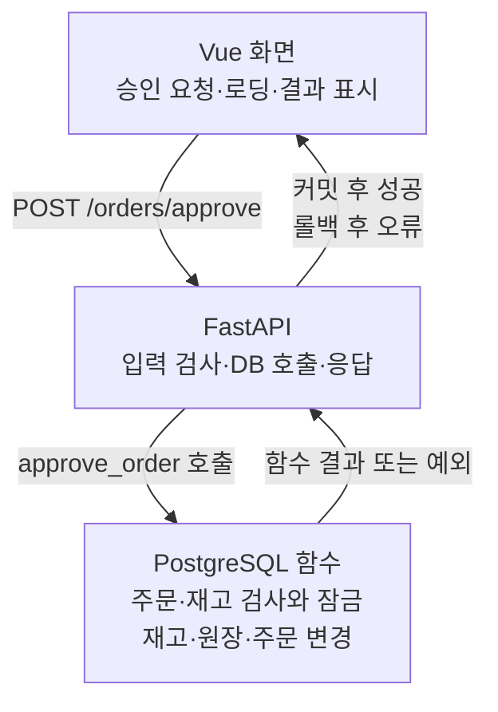
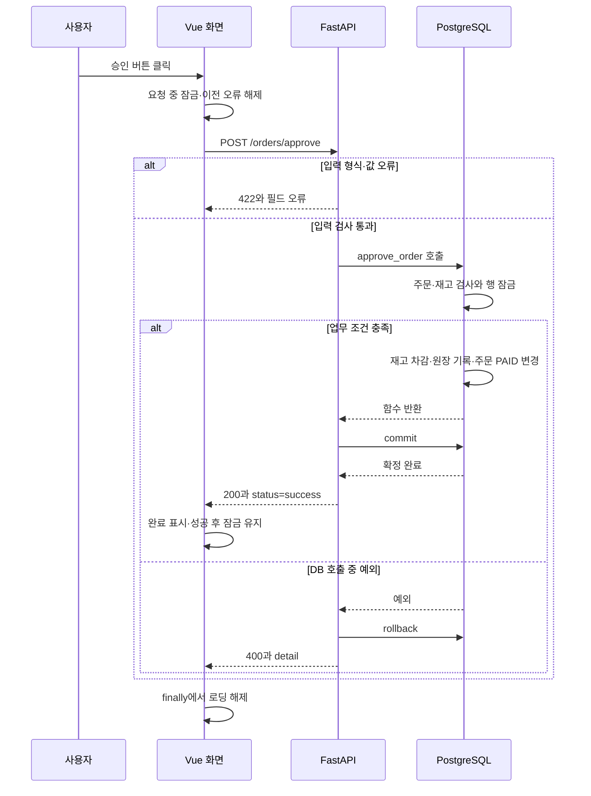
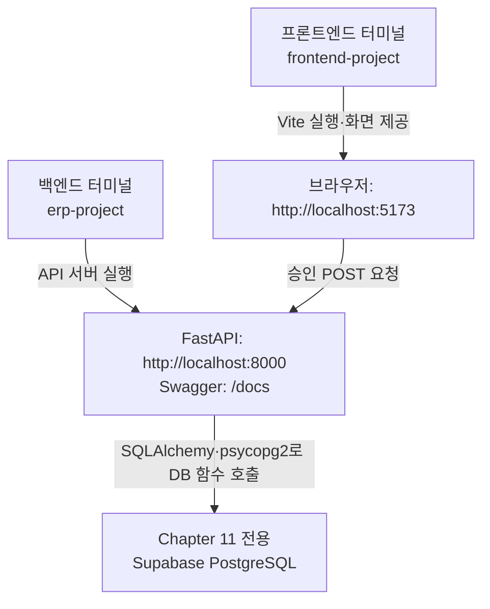

# Chapter 11. DB-API-화면 3층 연동 실습: 설계를 동작하는 코드로

> **실습 키트:** [기초 실습 환경 준비](01A_foundation_lab_setup.md#kit-download)
> 아직 준비하지 않았다면 [기초 실습 환경 준비](01A_foundation_lab_setup.md)를 먼저 완료하세요.

## 11.0 이 챕터에서 얻는 것

주문 담당자와 승인 조건을 정하고, AI와 주문 승인 한 건을 DB 함수 → FastAPI → Vue 화면으로
연결합니다. 독자는 화면에서 직접 승인 요청을 보내고, API 응답과 DB에 남은 값을 확인합니다.
마지막에는 AI의 검토와 실제 코드를 대조하고, 회의에서 약속한 결과를 자신의 관찰값으로 설명합니다.
이 장의 `PAID`와 화면의 `isPaid`는 승인 완료를 나타내는 실습용 이름이며, 실제 결제 연동은 포함하지 않습니다.

**진행 순서:** 환경 준비 → 업무 조건 합의 → 단계별 AI 구현·직접 실행·코드 확인 → 최종 AI 검토 → 업무 보고.
각 실습 직후 핵심 코드 한 곳을 찾아 결과가 나온 이유를 설명합니다. 같은 관찰표를 최종 검토와 보고에 사용합니다.
기초 키트의 `practice-workspace/ch11/observation_record.md`를 열어 두세요. 실제 값과 설명은 독자가 직접 적습니다.

이 장을 마치면 다음을 할 수 있습니다.

- 업무 요청에서 거절 조건·함께 저장할 데이터·완료 시점을 정합니다.
- 화면의 성공·실패·재시도를 API 응답과 주문·재고·원장의 저장 결과로 확인합니다.
- 관찰한 결과가 나온 이유를 DB·API·화면의 실제 코드에서 찾습니다.
- 회의의 약속별로 확인한 결과와 미검증 범위를 구분해 보고합니다.

Vue 화면에는 고정 주문 정보와 승인 결과가 표시됩니다. 실제 저장 결과는 Supabase SQL Editor에서
조회하고, 요청·응답은 브라우저 개발자 도구의 Network에서 확인합니다. 화면의 완료 메시지와 DB 값을
함께 대조하는 것이 이번 실습의 기준입니다.

### [진행 기준] 실습 단계별 완료 결과

| 경로 | 할 일 | 다음으로 넘어갈 기준 |
| :--- | :--- | :--- |
| **Core 준비 (11.0-ENV~11.1)** | 시작 키트·의존성·DB 연결값 준비, 업무회의의 세 약속 정리 | 실행 준비와 승인 조건 확인 |
| **Core DB (11.2)** | 테이블·함수 생성 후 정상 승인 실행 | 세 쓰기와 결과 연결, 시작 상태 복원 |
| **Core API (11.3)** | Swagger(브라우저에서 API를 시험하는 화면)에서 승인 요청 | 성공 응답·DB 결과와 커밋 순서 연결 |
| **Core 화면 (11.4~11.5)** | API 연결과 화면 상태 처리 | 요청·로딩·성공 확인, 두 잠금 상태 구분 |
| **Core 검증·완료 (11.6·11.8)** | 실패·재시도·입력 오류 실행, AI 검토와 직접 대조 | 세 약속의 근거로 업무 보고·최종 자가 체크 완료 |
| **Core 종료 (11.9~11.10)** | 서버 종료·결과 보존, 요약 확인 | Chapter 11 결과를 남기고 Day 00으로 이동 |
| **선택 복습 (11.7·11.11~11.13)** | 방어 장치·참조 코드·구조의 한계·Day 프로젝트 미리보기 | Core 완료 후 필요한 주제만 읽기 |

표의 **Core**는 이 장을 끝내는 데 꼭 필요한 경로입니다. 각 절의 **[반드시 따라하기]**가
필수 실습이고, **[선택 읽기]**와 심화 프롬프트는 선택 복습입니다.
DB 함수·FastAPI·Vue 연동을 이미 직접 검증할 수 있다면 이 장을 건너뛰어도 됩니다.

한 번에 끝내지 않아도 됩니다. **환경 준비 → DB 승인 성공 → API 승인 성공 → 화면과 검증**의
네 구간으로 나누고, 구간마다 완료 기준을 확인한 뒤 쉬어 가세요. 걸리는 시간은 설치 상태와
AI의 응답에 따라 다르므로 시간보다 완료 기준으로 진도를 판단합니다.

> [!NOTE]
> 이 장은 Vue **Options API**(`data()`와 `methods`로 상태와 함수를 나누어 쓰는 방식)로 단일 화면을 연결합니다. Day 프로젝트의 Composition API는
> [선택 복습의 문법 미리보기](supplements/ch11_review.md#ch11-composition-preview)에서 볼 수 있습니다. 지금 두 방식을 함께 구현할 필요는 없습니다.

**중단 후 재개:** [환경 준비 문서의 재개 순서](supplements/ch11_environment_setup.md#ch11-resume)로 확인합니다.
마지막 완료 단계·DB 상태·다음 실험은 관찰 기록에 남기고, 결과를 모르는 요청은 반복하지 않습니다.

---

## 11.0-ENV 실습 시작 전 환경 구축 (Chapter 11 Supabase 전용)

VS Code에서 키트의 `practice-workspace/ch11/`을 엽니다. Chapter 10 폴더는 복사하지 않습니다.
[Chapter 11 환경 준비](supplements/ch11_environment_setup.md)에서 시작 파일·의존성 설치·전용 DB 연결을 한 번에 마칩니다.
이미 설치한 가상환경·의존성은 지우거나 다시 만들지 않습니다.

<a id="ch11-supabase-project"></a>

연결값 입력 단계로 돌아왔다면 [환경 준비 4단계](supplements/ch11_environment_setup.md#ch11-supabase-project)를 엽니다.
실제 `.env`·연결값은 AI가 읽거나 출력하지 못하게 하고, 채팅·Git·관찰 기록에 포함하지 않습니다.

**돌아올 기준:** 시작 파일 검사, 의존성 설치, Chapter 11 전용 DB 표식과 연결 확인의 `1`을 확인했습니다.
아직 주문 테이블·승인 함수가 없는 것이 정상입니다. 아래 복원 안내를 읽고 11.1부터 진행합니다.

<a id="ch11-after-environment"></a>

### [실습 공통] 테스트 데이터 초기화 SQL <a id="reset-sql"></a>

STEP 1에서 테이블과 고정 주문을 만든 뒤 사용합니다. 각 실험에서 초기화를 안내하면
Chapter 11 전용 DB인지 확인하고 아래 SQL 전체를 실행합니다. 테이블·함수는 유지하며
고정 주문 상태·상품 재고·해당 상품의 원장만 복원합니다.

> [!IMPORTANT]
> **[Supabase SQL Editor에서 실행]**
> ```sql
> BEGIN;
> -- 주문 상태 복원 (CREATED) + 재고 복원 (10개) + 원장 초기화
> UPDATE orders SET status = 'CREATED'
>   WHERE order_id = '00000000-0000-0000-0000-000000000001';
> UPDATE stock SET quantity = 10 WHERE product_id = 'PROD-100';
> DELETE FROM stock_ledger WHERE product_id = 'PROD-100';
> COMMIT;
> ```

<a id="ch11-state-query"></a>

**상태 조회:** 아래 SQL로 주문 상태·재고·원장 건수를 요청 전후에 비교합니다.
초기화 직후에는 `CREATED·10·0`인 한 행이어야 합니다. 행이 없으면 STEP 1의 고정 주문·상품 등록을 확인합니다.

```sql
SELECT o.status AS order_status, s.quantity AS current_stock,
       (SELECT COUNT(*) FROM stock_ledger
        WHERE product_id = 'PROD-100') AS ledger_count
FROM orders o
JOIN stock s ON s.product_id = o.product_id
WHERE o.order_id = '00000000-0000-0000-0000-000000000001';
```

**DB 복원과 화면 새로고침은 별도입니다.** 새 실험은 DB 복원 결과를 확인하고 페이지를 새로고침해
시작합니다. 단, **오류 후 같은 화면에서 재시도할 때는 DB만 복원하고 새로고침하지 않습니다.**
화면의 완료 표시가 사라졌다고 DB까지 초기화된 것은 아닙니다.

---

## 11.1 전체 그림 먼저: 우리가 만들 것

**업무 회의: 주문 승인을 언제 완료로 볼 것인가**

아래 회의는 학습용 가상 상황입니다. 실제 프로젝트에서 정하지 않은 업무 기준은 담당자에게 확인해야 합니다.

> **주문 담당자:** 상품 3개를 주문한 건을 승인하려고 합니다. 버튼을 누르면 무엇이 바뀌나요?
>
> **개발자:** 저장된 주문과 요청의 상품·수량이 같은지 확인하고, 재고가 충분하면 3개를 차감하겠습니다.
> 재고 원장에는 `-3`을 기록하고, 주문 상태를 승인 완료로 바꾸겠습니다. 재고 원장은 재고가 얼마나
> 늘거나 줄었는지 남기는 기록입니다. **정상 승인에서는 주문 상태·재고·원장이 함께 저장되는 것**이 첫 번째 약속입니다.
>
> **재고 담당자:** 재고가 2개뿐인데 3개를 승인하려 하면요? 주문만 완료되거나 재고가 음수가 되면 안 됩니다.
>
> **개발자:** 재고가 부족하면 저장 전에 거절하겠습니다. 수량이 0이거나 주문 ID 형식이 잘못된 요청도
> API에서 거절하겠습니다. **재고 부족·잘못된 입력에서는 데이터가 바뀌지 않는 것**이 두 번째 약속입니다.
>
> **주문 담당자:** 처리 중에 버튼을 여러 번 누를 수도 있습니다. 실패했는데 완료로 보이면 곤란하고요.
>
> **개발자:** 요청 중에는 버튼을 잠그겠습니다. 저장 확정 뒤 성공 응답을 받은 경우에만 완료로 표시하고,
> 현재 화면의 버튼 잠금을 유지하겠습니다. 실패하면 이유를 보여 주고 다시 요청할 수 있게 하겠습니다.
> 다음 요청을 시작할 때 이전 오류를 지우겠습니다. **처리 중·성공·실패·재시도를 구분하는 것**이 세 번째 약속입니다.
>
> **재고 담당자:** 그러면 같은 주문이 두 번 승인되는 문제도 해결되나요?
>
> **개발자:** 이번 버튼 잠금은 현재 화면의 추가 클릭을 막습니다. 새로고침하거나 다른 곳에서 API를 호출하면
> 같은 주문의 재고가 다시 차감될 수 있습니다. 서버의 중복 승인 방지는 이번 실습에 포함하지 않습니다.
>
> **주문 담당자:** 세 약속이 지켜졌는지는 무엇으로 보고하나요?
>
> **개발자:** 정상 승인·재고 부족·같은 화면에서 재시도를 직접 실행하겠습니다. 입력 오류와 통신 오류도
> 확인하고, 화면·응답·DB 전후값을 기록하겠습니다. AI 검토 뒤 실제 코드와 대조해 확인한 결과와
> 실행하지 못한 항목을 나누어 보고하겠습니다.

회의의 세 약속을 구현·테스트·최종 판정에 같은 기준으로 사용합니다.

| 회의에서 정한 약속 | 직접 확인할 결과 | 확인할 위치 |
| :--- | :--- | :--- |
| 정상 승인 시 함께 저장 | 재고 10개에서 3개 승인 후 주문 `PAID`·재고 7개·원장 1건, 증감량 `-3` | Vue 화면·Network 응답·SQL Editor 조회 |
| 재고 부족·잘못된 입력 거절 | 재고 2개에서 승인 거절 후 값 유지, 수량 0·잘못된 UUID도 거절 후 값 유지 | Vue 화면 또는 Swagger·응답·SQL Editor 조회 |
| 화면의 처리 상태 구분 | 요청 중 잠금·성공 후 완료, 실패 후 재시도와 이전 오류 해제, 통신 오류 안내 | Vue 화면·Network 요청 기록 |

재고 부족은 첫 쓰기 전에 거절되는 사례입니다. 저장 도중 실패했을 때 앞선 변경까지 취소되는 결과는
[선택 실험](supplements/ch11_review.md#ch11-mid-write)에서 확인합니다. 인증·회사 격리·서버 중복 승인 방지는 미구현이며, 동시 요청의
처리 결과도 필수 실습에서 검증하지 않습니다. 세 약속의 결과를 보고할 때 이 범위를 함께 구분하세요.

**세 약속을 DB·API·화면으로 연결하기**

Supabase는 클라우드 PostgreSQL과 관리 화면을 제공합니다. 이 장에서는 로컬 DB 설치 대신
Supabase를 사용해 주문·재고·원장을 함께 저장하고, 그 결과를 API와 화면으로 연결합니다.



요청과 응답의 순서를 확인하세요.



입력 오류와 DB 오류에서는 완료 상태로 바꾸지 않습니다. 성공 후에는 로딩만 해제되고 완료 상태의 잠금은 유지됩니다.
이 그림은 기본 처리 순서입니다. 커밋 중 연결이 끊기면 저장 결과를 확인하지 못할 수 있습니다.
`rollback()` 호출이나 오류 응답만으로 취소됐다고 단정하지 말고 DB 상태를 확인합니다.
연결 장애에서는 롤백 자체도 실패할 수 있으므로 모든 장애가 같은 400 응답으로 끝난다고 보장하지 않습니다.

API 단계부터 백엔드 서버를, 화면 단계부터 프론트엔드 서버도 실행합니다.
터미널 명령은 각 절에 표시된 실행 폴더에서 입력합니다.



<a id="ch11-business-conditions"></a>

**[짧은 실습] 회의의 약속을 내 말로 정리하기**

업무 담당자가 아래 한 문장만 전달했다면 어떤 조건이 빠졌을까요? 읽기용 요청이므로 그대로 AI에게 구현을 맡기지 않습니다.

> 주문 승인 버튼을 누르면 재고를 차감하고 완료 표시를 해 주세요.

앞의 회의에서 이 빈칸을 어떻게 채웠는지 떠올려 보세요. AI에게 묻기 전에 다음 세 질문에
자기 말로 답합니다. 파일명이나 SQL 문법은 쓰지 않아도 됩니다.

| 빠진 결정 | 회의를 바탕으로 정리할 조건 |
| :--- | :--- |
| 어떤 요청을 거절해야 할까요? | 수량이 잘못됐거나 저장된 주문과 다르거나 재고가 부족할 때의 처리 |
| 무엇을 함께 저장해야 할까요? | 재고만 바뀌고 주문 상태나 원장 기록이 빠져도 되는지 |
| 언제 완료라고 표시해야 할까요? | 버튼 클릭·DB 함수 반환·저장 확정과 성공 응답 중 완료로 판단할 시점 |

정리한 조건은 [관찰 기록](#ch11-manual-record)의 **내가 정한 승인 조건**에 세 줄로 적습니다.
아직 실행한 결과가 아니므로 `Pass`로 표시하지 않습니다. 뒤의 생성 프롬프트와 비교해 빠진 조건을 보완하고,
11.6에서 실제 코드·실행 결과와 대조합니다.

**AI와 작업하는 순서**

`practice-workspace/ch11/`을 연 저장소 접근형 AI를 사용합니다. SQL 생성부터 최종 검토까지 같은
대화를 유지하면 편리하지만, 새 대화에서도 보존한 SQL 실행본과 관찰 기록으로 이어갈 수 있습니다.
관련 파일 전문을 직접 찾아 붙여 넣을 필요는 없습니다.

1. 각 STEP의 프롬프트로 `AGENTS.md`·시작 파일·연결 명세·변경 범위를 조사하게 합니다.
2. API·화면의 조사 결과를 아래 예상 위치와 비교하고, 각 절의 적용 요청을 보냅니다. 범위 밖 변경은 적용 전에 이유를 확인합니다.
3. 핵심 확인 질문으로 생성물을 판정하고 직접 실행합니다. 조건이 같다면 변수명·문법·CSS 차이 때문에 전체 코드를 교체하지 않습니다.
4. 실행 결과는 11.6의 관찰 기록에 남깁니다. 실패하면 원인과 최소 수정 범위를 조사하고, 참조 코드로 복구했다면 사용한 코드와 이유도 적습니다.
5. 마지막에 AI 검토 결과를 실제 코드·SQL·관찰값과 대조합니다. 회의의 세 약속별로 확인한 결과와
   미검증 범위를 자신의 말로 정리하고, 11.8의 자가 체크를 완료합니다.

각 실험의 **실행 전 예측** 질문에는 AI에게 묻기 전에 자기 말로 짧게 답해 보세요. 별도 답안은 만들지 않습니다.
예상과 실제 결과가 다르면 코드에서 이유를 찾고, 관찰 기록에는 실제 결과와 차이가 난 이유를 남깁니다.

| 역할 | AI가 확인할 예상 위치 | 확인 기준 |
| :--- | :--- | :--- |
| 작업 규칙 | `AGENTS.md`, `workspace/`와 두 프로젝트의 `AGENTS.md` | 실습 경계와 비밀정보 보호 |
| DB 정의 | STEP 1의 생성 SQL, 실행 후 보존한 `workspace/erp-project/sql/`의 SQL 실행본 | 연결 명세에 맞게 생성하고 실제 실행한 정의를 보존 |
| API | `workspace/erp-project/api/main.py` | 요청 검사·DB 호출·커밋·롤백 |
| 화면 | `workspace/frontend-project/src/components/ApproveOrder.vue`, `src/App.vue` | 컴포넌트 생성·앱 등록·요청과 화면 상태 처리 |
| 실행 환경 | 두 프로젝트의 의존성 파일, 프론트엔드 `src/main.js` | 기존 설정·의존성 유지 |
| 자동 검증 | Chapter 11 폴더에서 조사 | 없으면 `테스트 없음`, 미실행은 `Not Run` |

diff는 변경 전후의 차이를 보여 주는 비교 결과입니다. Git을 쓰지 않는 폴더에서는 변경 전후 비교를 요청합니다.
참조 코드는 비교·복구용입니다.
심화 질문에서도 `.env`·비밀값 읽기와 DB 접속은 AI에 허용하지 않으며, SQL 실행은 독자가 직접 합니다.

---

## 11.2 STEP 1: 주문·재고·원장을 함께 저장하기 (Supabase SQL Editor)

> **[반드시 따라하기]** 테이블·함수를 만들고 정상 승인 결과를 확인합니다.

### 이번에 만드는 것

회의의 첫 번째 약속인 **주문 상태·재고·원장의 함께 저장**과 두 번째 약속인 **잘못된 요청 거절**을
DB 함수에 반영합니다. 주문·재고·원장 테이블과 함수를 만들고 정상 승인 결과부터 확인합니다.
**원자성**은 함께 바뀌어야 할
데이터를 일부만 저장하지 않는 성질입니다. **트랜잭션**은 여러 쓰기를 한 묶음으로 처리해
모두 확정(commit)하거나 모두 취소(rollback)하는 단위입니다. 이 장에서는 DB 함수의 쓰기를 하나의 트랜잭션으로 묶습니다.

### AI에게 요청하기

**AI 조사·생성:** 다음 프롬프트를 같은 AI 대화에서 실행합니다. 테이블·함수 이름은
후속 API와 초기화 도구를 연결하기 위한 실습 명세입니다.

**프롬프트를 읽는 기준:** [11.1에서 정한 조건](#ch11-business-conditions) 중 거절할 요청과 함께 저장할 데이터를
찾아보세요. 재고에서 3개를 빼면 원장에도 `-3`을 기록하고 주문을 승인 완료로 바꾸며, 세 변경은 전부 저장되거나 전부 취소되어야 합니다.
내가 정한 조건이 아래 프롬프트의 어디에 반영됐는지 찾아보고, 빠진 조건이 있다면 실행 전에 보완합니다.

아래의 DDL은 테이블 구조를 만드는 SQL입니다. PK는 행을 구별하는 기본 키, FK는 다른 테이블의
행을 참조하는 외래 키이며, UUID는 주문 ID에 쓰는 식별자 형식입니다. 이름과 타입은 뒤의 코드가
같은 데이터를 찾기 위한 약속이므로 그대로 제공합니다.
`FOR UPDATE`는 처리 중인 행을 다른 요청이 동시에 바꾸지 못하게 잠그는 구문입니다.
함수가 끝나도 잠금이 바로 풀리는 것은 아니며, 호출한 트랜잭션이 확정·취소될 때까지 유지됩니다.
11.2에서는 SQL Editor에서 실행하고, 11.3부터는 API가 함수를 호출한 뒤 확정·취소합니다.

> **[AI 프롬프트: 테이블 DDL 및 원자성 함수 생성]**
>
> ```text
> Chapter 11 폴더를 열었습니다. AGENTS.md와 저장소에서 DB 준비·초기화 도구와 시작 파일을 조사하세요.
> 파일 수정·DB 접속·.env와 비밀값 읽기 및 출력은 하지 마세요.
> 현재 제공된 SQL과 없는 정의를 구분해 보고하고, 다음 연결 명세와 업무 조건에 맞는 PostgreSQL(Supabase) SQL을 답변으로 작성하세요.
> 아래 테이블·함수 이름은 이후 API와 초기화 도구가 사용하는 실습 명세입니다.
> 
> 1. 핵심 테이블 생성:
>    - stock:
>      * product_id (PK, 문자열)
>      * quantity (정수, 0 이상 제약조건)
>      * corp_id (회사 소속 식별 필드, 문자열, 기본값 'HQ'; 접근 통제는 별도)
>    - orders:
>      * order_id (PK, UUID)
>      * product_id (FK)
>      * quantity (정수, 1 이상 제약조건)
>      * status (문자열, 'CREATED', 'PAID' 중 하나)
>      * created_at (타임스탬프)
>      * corp_id (회사 소속 식별 필드, 문자열, 기본값 'HQ'; 접근 통제는 별도)
>    - stock_ledger:
>      * ledger_id (PK, 자동증가)
>      * product_id (FK)
>      * qty_change (정수)
>      * reason (문자열)
>      * created_at (타임스탬프)
>      * corp_id (회사 소속 식별 필드, 문자열, 기본값 'HQ'; 접근 통제는 별도)
>    - 현재고(stock.quantity)·주문 수량(orders.quantity)·주문 상태(orders.status)·원장 증감량(stock_ledger.qty_change)은 NULL로 저장할 수 없어야 함.
>    - 세 테이블의 corp_id도 NULL을 허용하지 않으며, 값을 생략하면 기본값 'HQ'를 사용.
> 
> 2. 주문 승인(approve_order) DB 함수 작성:
>    - 호출 형식은 approve_order(UUID, VARCHAR, INTEGER). 주문 ID, 상품 ID, 수량을 받음.
>    - 수량이 NULL 또는 0 이하이거나, 주문이 없거나, 요청 상품·수량이 저장된 주문과 다르면 쓰기 전에 거절.
>    - 검사한 주문이 처리 도중 바뀌지 않도록 해당 주문 행을 잠금.
>    - stock 테이블에서 product_id의 행을 FOR UPDATE로 비관적 락을 걸고 현재 재고 확인.
>    - 재고가 부족하면 쓰기 전에 예외로 거절.
>    - 재고가 충분하면:
>      * stock의 quantity 차감
>      * stock_ledger에 qty_change를 음수로 기록
>      * orders의 status를 'PAID'로 변경.
>    - 이번 실습에는 인증·회사 접근 통제·중복 승인 방지를 추가하지 않음.
>      같은 주문을 재요청하면 재고가 충분한 동안 다시 차감될 수 있음을 보고.
>    - 함수 내부에서 커밋하지 않으며, 호출자가 한 트랜잭션으로 확정·취소할 수 있어야 함.
>
> 회의의 두 약속인 정상 승인 시 함께 저장과 잘못된 요청 거절을 어떻게 반영했는지 짧게 설명하세요.
> 입력 거절 위치·첫 쓰기·잠금 범위·호출자에게 맡긴 처리는 실행 전 확인할 수 있게 요약하세요.
> 기존 데이터를 삭제하는 SQL과 샘플·시드 데이터 INSERT는 추가하지 말고, 아직 실행하지 않은 결과를 성공으로 보고하지 마세요.
> ```

NULL은 값이 없음을 나타냅니다. `CHECK`로 수량 범위나 상태값을 제한해도 NULL까지 막지는 못하므로,
위 필수 값에는 `NOT NULL`도 있는지 생성 SQL에서 확인하세요.

**실행 전 확인:** 생성 SQL을 실행하기 전에 AI의 요약과 SQL을 다음 기준으로 대조합니다.

- 생성 대상이 위 세 테이블과 승인 함수이며, 기존 데이터 삭제나 샘플 INSERT가 포함되지 않았나요?
- 필수 값의 `NOT NULL`과 수량·상태의 제약조건이 있나요?
- 잘못된 수량·주문 불일치·재고 부족을 쓰기 전에 거절하고, 주문 상태·재고·원장을 함께 저장하나요?
- 주문·재고 행을 잠그고, 함수 안에서 일부 변경만 먼저 확정하지 않나요?

확인할 위치가 불분명하면 AI에게 해당 조건의 SQL 위치와 이유를 짧게 짚어 달라고 요청합니다.
조건이 맞으면 아래 순서로 직접 실행합니다. 상세 SQL 패턴은 화면 테스트 뒤
[이 절의 핵심 코드](#ch11-understand-db)에서 관찰값과 연결합니다.

### 직접 실행하기

**실행 위치: Chapter 11 전용 Supabase SQL Editor.** 테이블·함수 생성과 고정 데이터 등록을 마친 뒤
`CREATED·10·0 → PAID·7·1`을 확인하고, 마지막에 `CREATED·10·0`으로 복원합니다.

1. Supabase에서 **Chapter 11 전용 프로젝트 → SQL Editor → 새 쿼리**를 엽니다.
   조건을 만족한 생성 SQL을 한 번 실행합니다. 성공했다면 아래 [SQL 실행본 보존 절차](#ch11-sql-record)에
   따라 실행한 내용을 파일로 남깁니다. [전체 참조 SQL](#ch11-db-reference)은 비교·복구용이며 생성 SQL과 둘 다 실행하지 않습니다.
2. 테이블·함수가 만들어졌다면 아래 SQL로 고정 상품·주문을 등록합니다. 최초 한 번만 실행합니다.

   ```sql
   INSERT INTO stock (product_id, quantity) VALUES ('PROD-100', 10);
   INSERT INTO orders (order_id, product_id, quantity, status)
   VALUES ('00000000-0000-0000-0000-000000000001', 'PROD-100', 3, 'CREATED');
   ```

3. [상태 조회](#ch11-state-query)에서 `CREATED·10·0`을 확인합니다.
   **실행 전 예측:** 3개를 승인하면 재고 수량과 원장의 증감량은 각각 얼마가 되고, 주문 상태는 어떻게 바뀔까요?
   예상한 뒤 다음 함수를 한 번 호출합니다.

   ```sql
   SELECT approve_order('00000000-0000-0000-0000-000000000001', 'PROD-100', 3);
   ```

4. 같은 상태 조회에서 `PAID·7·1`을 확인합니다. 원장의 차감 수량도 아래 조회로 확인합니다.

   ```sql
   SELECT qty_change FROM stock_ledger WHERE product_id = 'PROD-100';
   ```

   한 행에 `-3`이면 재고 3개 차감과 원장 기록이 일치합니다. 실패 경로는 11.6에서 확인합니다.
5. [초기화 SQL](#reset-sql)을 실행하고 상태 조회가 `CREATED·10·0`으로 돌아왔는지 확인합니다.

<a id="ch11-understand-db"></a>

### 이번에 이해한 것

**질문 하나:** 주문·재고·원장을 바꾸는 세 쓰기는 어디인가요?
방금 보존한 SQL 실행본을 열어 아래 역할을 찾습니다. 참조 함수의 핵심은 다음 세 쓰기이며,
이 조각만 따로 실행하지 않습니다.

```sql
UPDATE stock SET quantity = quantity - p_qty WHERE product_id = p_product_id;
INSERT INTO stock_ledger (product_id, qty_change, reason)
VALUES (p_product_id, -p_qty, '주문 승인 처리 (' || p_order_id || ')');
UPDATE orders SET status = 'PAID' WHERE order_id = p_order_id;
```

관찰한 재고 `10 → 7`·원장 `-3`·주문 `PAID`를 각 쓰기에 연결하세요.
그 앞에서 수량·주문 일치·재고를 검사하는 곳도 짚습니다. 생성물의 문법이 달라도 같은 역할이면 됩니다.
세 쓰기 사이에 일부만 확정하는 커밋은 없으며, 호출한 트랜잭션에서 함께 확정·취소합니다.
SQL Editor에서의 정상 실행은 확인했지만, 이 결과만으로 중간 실패의 취소나 동시 요청까지 검증한 것은 아닙니다.

**다음 단계 조건:** 정상 승인 결과와 시작 상태 복원을 확인했다면 11.3으로 넘어갑니다.
고정 주문 UUID·상품·수량은 뒤의 API와 화면에서도 그대로 사용합니다.

<a id="ch11-sql-record"></a>

**SQL 실행본 보존하기**

AI 답변과 SQL Editor에서 실제 실행한 내용이 다를 수 있습니다. 1번에서 성공한 테이블·함수 생성 SQL을
SQL Editor에서 복사해 파일 하나로 직접 저장합니다. 이후 API 연결과 AI 검토가 이 파일을 근거로
삼으므로 건너뛰지 않습니다.

1. VS Code에서 `ch11/` 기준 `workspace/erp-project/sql/` 폴더를 만들고,
   `01_approve_order.executed.sql` 파일에 실행한 SQL을 저장합니다. 이 폴더는 백엔드의 수정 허용 범위 안에 있으며,
   키트가 미리 제공하는 폴더가 아닙니다. 고정 데이터 INSERT·승인 호출·초기화 SQL은 이 파일에 섞지 않습니다.
2. 실행하지 않은 AI 제안이나 실패한 SQL을 실행본으로 저장하지 않습니다. 연결 문자열·비밀번호·대시보드 화면도 넣지 않습니다.
3. 이후 함수를 수정해 성공적으로 실행했다면 이전 파일을 보존하고 `02_approve_order.executed.sql`처럼
   번호를 늘려 해당 변경 SQL을 저장합니다. 검토할 때는 번호순으로 읽고 마지막으로 적용한 정의를 확인합니다.
4. `observation_record.md`에 실행본의 상대 경로·실행 순서·성공 여부를 직접 기록합니다.
   참조 SQL로 복구했다면 실제 실행한 내용을 같은 방식으로 보존하고 복구 이유도 기록합니다.

새 AI 대화에서는 이 실행본과 관찰 기록을 읽혀 마지막 완료 단계를 확인하게 합니다.
파일을 읽었다는 이유로 SQL을 다시 실행하지 않습니다.

> **[막혔을 때]** 외래 키는 다른 테이블의 값을 참조하는 연결입니다. 참조 오류가 나면
> 부모인 `stock`이 먼저 생성됐는지 확인하세요. 고정 데이터 등록에서 중복 키 오류가 나면 같은 ID의 데이터가 이미 있는지,
> 생성 SQL에 샘플 INSERT가 포함됐거나 등록 명령을 다시 실행했는지 확인합니다. 이미 만든 테이블이나 고정 데이터를 다시 등록하지 말고,
> 현재 상태와 실패 위치부터 조사합니다. 복구가 필요하면 [참조 SQL](#ch11-db-reference)과 비교합니다.

---

## 11.3 STEP 2: DB 함수를 호출하는 API 만들기 (FastAPI)

> **[반드시 따라하기]** DB 함수를 호출하는 API를 만들고 Swagger에서 확인합니다.

### 이번에 만드는 것

회의에서 약속한 저장과 거절 결과를 화면에 전달할 API를 만듭니다.
API는 요청 형식·양수 수량을 검사하고, 주문 일치·재고 판단과 저장은 DB 함수에 맡깁니다.
호출 결과를 응답으로 바꾸는 데 집중하는 구조를 **Thin Layer API(처리 책임을 좁힌 API)**라고 부릅니다.

이 장의 SQLAlchemy·psycopg2 호출은 DB 응답을 기다리는 동안 실행을 멈추는 동기 방식입니다.
따라서 경로 함수를 일반 `def`로 작성해 FastAPI가 작업 스레드에서 실행하게 합니다.
`async def`라는 선언만으로 동기 DB 호출이 비동기로 바뀌지는 않습니다.

이 API는 `http://localhost:5173`에서 열린 화면의 호출을 받아야 합니다. 화면과 API는 포트가 달라
서로 다른 출처입니다. 브라우저는 기본적으로 다른 출처의 응답을 JavaScript가 읽는 것을 제한합니다.
서버가 허용할 출처·요청 방식을 응답 헤더로 알려 주는 규칙이 **CORS**입니다.
이 장의 JSON POST에서는 브라우저가 먼저 `OPTIONS` 요청으로 허용 여부를 확인하고, 허용되면 실제 요청을 보냅니다.
Swagger는 API와 같은 출처(`http://localhost:8000`)에서 열리지만, 11.4의 Vue 화면에는 CORS 설정이 필요합니다.

### 프로젝트 디렉터리 구조

`workspace/erp-project/`의 기존 의존성을 사용해 `api/main.py`를 생성합니다.
`api/__init__.py`와 `requirements.txt`는 시작 키트에 있습니다. 별도 프로젝트를 만들거나
프론트엔드 파일·DB 정의를 변경하지 않습니다.

### AI에게 요청하기

**AI 조사·생성:** 먼저 다음 프롬프트로 API 연결에 필요한 근거와 변경 범위를 조사합니다.

> **[AI 프롬프트: FastAPI Thin Layer API 작성]**
>
> ```text
> Chapter 11의 AGENTS.md와 백엔드 시작 파일·의존성·테스트 유무를 조사하세요.
> 보존한 SQL 실행본과 관찰 기록에서 주문 승인 DB 함수를 확인하고, API를 연결할 위치·변경 범위·이유를 보고하세요. 아직 수정하지 마세요.
> 실행본이나 실행 여부가 미확인이면 연결을 추측하지 말고 누락된 근거를 알려 주세요.
> DB 접속과 .env·연결 문자열·비밀값 읽기 및 출력은 하지 마세요.
>
> [회의에서 정한 업무 결과]
> 정상 승인에서는 주문 상태·재고·원장이 함께 저장되고, 잘못된 요청에서는 데이터가 바뀌지 않아야 합니다.
> 화면이 저장 확정 전 완료로 표시되지 않도록 응답 시점을 지켜 주세요.
>
> [완성할 동작]
> - FastAPI + SQLAlchemy로 POST /orders/approve를 제공합니다.
> - 본문은 order_id(UUID), product_id(문자열), qty(1 이상 정수)입니다.
> - 수량 0·음수·잘못된 UUID는 DB 호출 전 422로 거절합니다.
> - 업무 처리는 approve_order DB 함수에 맡기고, 성공 시 커밋한 뒤 HTTP 200과 {"status":"success"}를 반환합니다.
> - 예외 처리에서는 rollback()을 호출하고 학습용 400의 detail로 원인을 전달하는 구조를 사용합니다.
>   다만 커밋 중 연결 장애에서는 저장 결과 미확인·롤백 실패 가능성이 있으므로 취소를 보장했다고 설명하지 않습니다.
> - http://localhost:5173의 Vue 화면에서 호출할 수 있어야 합니다.
>
> [변경 경계와 완료 보고]
> 현재 작업 규칙의 단일 API 파일 구조를 유지하며, DB 정의·의존성·프론트엔드는 바꾸지 않습니다.
> 런타임은 백엔드 로컬 .env의 DATABASE_URL을 사용하며 실제 값을 코드에 넣지 않습니다.
> 연결 주소는 psycopg2 드라이버 형식으로 .env에 설정되어 있습니다. 터미널에 남은 이전 DATABASE_URL은
> 독자가 실행 전에 해제하므로, 코드에서 연결값을 출력하거나 다른 위치의 설정을 읽지 마세요.
> 동기 SQLAlchemy·psycopg2 호출에 맞게 경로 함수를 일반 def로 작성해 DB 대기가 이벤트 루프를 막지 않게 합니다.
> 인증·중복 승인 방지·다른 업무 API는 추가하지 않습니다. 범위 밖 변경은 적용 전에 이유를 보고하세요.
> 적용 뒤 변경 파일·diff·구문 검사·입력 검사 결과와 화면 실습을 막는 문제를 짧게 보고하세요.
> 실제 DB 실행은 독자가 수행합니다.
> ```

**조사 결과 확인과 구현 승인:** 조사 결과를 11.1의 예상 위치표와 비교하세요.
SQL 실행본·관찰 기록이 확인되고, 변경 대상이 백엔드의 단일 API 파일인지 확인합니다.
계획에서 다음 질문의 답도 확인하세요.

- 잘못된 입력을 DB 함수 호출 전에 거절하나요?
- 주문 상태·재고·원장 저장은 앞서 실행한 DB 함수에 맡기나요?
- 저장을 확정한 뒤 성공 응답을 보내고, 실패하면 취소한 뒤 오류를 보내나요?

변경할 파일과 세 처리 방식이 회의의 조건에 맞으면 같은 AI 대화에서 다음 적용 요청을 보냅니다.

```text
앞서 정한 동작·변경 경계·비밀정보 보호 조건을 지키며, 확인한 범위에서 API의 최소 변경을 적용해 주세요.
변경 전후 diff와 구문·입력 검사 결과를 보고하고, 실행하지 못한 검증은 Not Run으로 남겨 주세요.
```

**실행 전 확인:** 변경 파일과 diff가 승인 범위에 있고 구문·입력 검사가 통과했는지 확인합니다.
실패했거나 실행하지 못한 항목은 AI에게 원인과 다음 행동을 설명하게 하고, 실행에 필요한 문제부터 해결하세요.
DB 연결과 저장 결과는 아래 Swagger 실습에서 직접 확인합니다. 상세 호출·확정·취소 코드는
[이 절의 확정·응답 순서](#ch11-understand-api)에서 읽습니다.

**오류 응답의 학습 범위:** 이 API는 원인을 관찰하기 쉽게 DB 예외 문자열 전체를 `detail`에 담고,
연결 실패 같은 서버 오류도 `400`으로 반환합니다. 그러므로 `400`만 보고 재고 부족이라고 판단하지 말고
`detail`의 사유를 읽으세요. 실제 서비스에서 이 응답을 어떻게 바꾸는지는 11.7에서 다룹니다.

### 직접 실행하기

**실행 위치: 백엔드 터미널 → Swagger.** DB는 `CREATED·10·0`에서 시작합니다.
성공 응답과 `PAID·7·1`을 확인한 뒤 DB를 복원하고, 백엔드 서버는 켜 둡니다.

1. **백엔드 터미널**에서 기존 `venv`의 Python으로 실행합니다. 현재 폴더는
   `practice-workspace/ch11/workspace/erp-project/`여야 합니다.

   ```powershell
   Remove-Item Env:DATABASE_URL -ErrorAction SilentlyContinue
   & .\venv\Scripts\python.exe -m uvicorn api.main:app --reload
   ```

   첫 명령은 [환경 준비의 연결 확인](supplements/ch11_environment_setup.md#ch11-db-check)에서 설명한 것과 같은 이유로 실행합니다. 새 터미널을 열었다면 다시 적용합니다.
   macOS·Linux에서는 `unset DATABASE_URL`을 실행한 뒤
   `./venv/bin/python -m uvicorn api.main:app --reload`로 서버를 실행합니다.

2. `http://localhost:8000/docs`에서 `POST /orders/approve`를 펼치고 **Try it out**을 누릅니다.
   [상태 조회](#ch11-state-query)로 `CREATED·10·0`인지 확인한 뒤 아래 본문을 입력합니다.

   ```json
   {
     "order_id": "00000000-0000-0000-0000-000000000001",
     "product_id": "PROD-100",
     "qty": 3
   }
   ```

3. **실행 전 예측:** 성공 응답은 DB 함수가 반환한 직후와 커밋이 끝난 뒤 중 언제 보내야 할까요?
   회의에서 정한 완료 시점을 떠올린 뒤 **Execute를 한 번만** 누릅니다. 응답 뒤 이 절에서 코드의 순서를 확인합니다.
   응답 `200`·`{"status":"success"}`와 DB 상태 `PAID·7·1`을 대조합니다.
   확인하려고 다시 요청하지 마세요. 같은 주문을 다시 보내면 재고가 한 번 더 차감됩니다.
4. [초기화 SQL](#reset-sql)을 실행하고 `CREATED·10·0`으로 복원됐는지 확인합니다.

<a id="ch11-understand-api"></a>

### 이번에 이해한 것

**질문 하나:** 저장 확정과 성공 응답 중 무엇이 먼저인가요?
생성한 API를 열어 DB 호출·커밋·성공 반환의 순서를 찾습니다. 참조 코드에서는 다음과 같습니다.

```python
db.execute(
    text("SELECT approve_order(:id, :pid, :q)"),
    {"id": request.order_id, "pid": request.product_id, "q": request.qty}
)
db.commit()
return {"status": "success"}
```

`text()`는 실행할 SQL 객체를 만들고, `:id` 같은 매개변수에 값을 따로 전달합니다.
요청값을 SQL 문장에 직접 이어 붙이지 않습니다. 성공 응답은 `commit()` 뒤에 반환합니다.
함수의 `BEGIN~END`는 실행문을 묶는 블록이며 커밋 명령이 아닙니다.
관찰 기록의 정상 승인 행에 이번에 확인한 API 위치와 순서를 덧붙입니다.
같은 실험을 화면에서 확인할 때 이 기록을 이어 쓰면 됩니다.

**다음 단계 조건:** 성공 응답·DB 결과·복원을 확인했다면 서버를 실행한 채 11.4로 넘어갑니다.
입력 오류의 거절 결과는 11.6에서 확인합니다.

> **[막혔을 때]** `No module named 'api'`가 나오면 현재 폴더가 `erp-project/`인지,
> 기존 `venv`의 Python을 사용했는지, `api/main.py`가 있는지(`Test-Path api/main.py`)를 차례로 확인합니다.
> `400`의 `detail`에 연결 오류가 보이면 [환경 준비의 연결 확인](supplements/ch11_environment_setup.md#ch11-db-check)부터 다시 실행합니다.
> 패키지 설치 오류는 [가상환경·설치 안내](supplements/ch11_environment_setup.md#ch11-python-setup)로 돌아가 확인하고, API 동작 차이는 [참조 API](#ch11-api-reference)와 비교합니다.
> 연결값은 AI에 전달하지 않습니다.

---

## 11.4 STEP 3-A: 승인 API를 호출하는 화면 만들기

> **[반드시 따라하기]** 로딩·성공·오류 처리를 포함한 주문 승인 화면을 한 번 생성합니다.

### 이번에 만드는 것

회의의 세 번째 약속인 **처리 중·성공·실패·재시도 구분**을 화면에 반영합니다.
고정 주문을 API에 보내고 결과를 표시하며, 요청 중 버튼 잠금과 성공·실패 표시까지
함께 만듭니다. 이 절에서는 화면 연결을 준비하고, 11.5에서 한 번의 정상 요청으로 동작을 관찰합니다.

### AI에게 요청하기

**AI 조사·생성:** 먼저 다음 프롬프트로 화면의 변경 범위를 조사합니다.
Vue Options API와 키트에 포함된 Axios(브라우저에서 API를 호출하는 라이브러리)를 사용하며 별도 UI 라이브러리는 설치하지 않습니다.

> **[AI 프롬프트: 주문 승인 화면과 상태 처리 구현]**
>
> ```text
> Chapter 11의 AGENTS.md와 프론트엔드 시작 화면·앱 등록 위치·의존성을 조사하세요.
> 이번 단계에서 만들거나 바꿀 파일과 이유를 보고하고, 아직 수정하지 마세요.
> DB 접속과 .env·비밀값 읽기 및 출력은 하지 마세요.
>
> [회의에서 정한 업무 결과]
> 요청 중 추가 클릭을 막고, 저장 확정 뒤 성공 응답을 받은 경우에만 완료로 표시합니다.
> 실패하면 원인을 보여 주고 다시 요청할 수 있어야 하며, 다음 요청 때 이전 오류를 지웁니다.
>
> [화면에서 완료할 동작]
> - Vue Options API와 기존 Axios로 주문 ID·상품 ID·수량을 보여주는 단일 카드 화면을 만듭니다.
> - 값은 주문 00000000-0000-0000-0000-000000000001, 상품 PROD-100, 수량 3입니다.
> - [주문 승인 API 호출]을 누르면 POST http://localhost:8000/orders/approve로
>   order_id, product_id, qty를 보냅니다.
> - 요청 대기 중에는 '처리 중...'을 표시하고 추가 클릭을 막습니다.
> - 200의 status=success를 확인한 경우에만 화면 안에 완료 메시지와 '승인 완료' 버튼을 표시하고 잠금을 유지합니다.
> - 실패하면 완료 상태로 바꾸지 않고 응답의 detail을 화면 안에 표시하며, 다시 요청할 수 있어야 합니다.
> - 응답이 없는 통신 오류에는 '응답을 받지 못했습니다. 다시 요청하기 전에 DB에서 처리 결과를 확인하세요.'를 표시합니다.
>   응답이 없다는 이유만으로 저장 실패를 단정하거나 즉시 재시도를 권하지 않습니다. 다음 요청을 시작할 때 이전 오류를 지웁니다.
> - 앱의 시작 화면에서 이 카드를 볼 수 있도록 연결합니다. 기존 개인 작업은 보존하고 변경을 최소화합니다.
> - 버튼은 키보드로도 사용할 수 있어야 하며, 좁은 화면에서 주문 정보와 결과를 읽을 수 있어야 합니다.
> - 현재 화면의 잠금을 서버의 중복 승인 방지로 설명하지 않습니다.
>
> [변경 경계와 완료 보고]
> API·DB·의존성·다른 화면은 변경하지 말고, 범위 밖 변경은 적용 전에 파일과 이유를 보고하세요.
> 별도 CSS 라이브러리는 설치하지 않습니다. 생성 코드의 변수명과 스타일은 현재 프로젝트에 맞게 정하세요.
> 적용 뒤 변경 파일·diff·빌드 결과와 화면 테스트를 막는 문제를 짧게 보고하세요.
> 브라우저에서 직접 확인하지 않은 결과는 Not Run으로 남기세요.
> ```

**조사 결과 확인과 구현 승인:** 조사한 변경 파일을 아래 예상 위치표와 비교합니다.
주문 카드와 시작 화면 연결 범위이며, API·DB·의존성을 바꾸지 않는지 확인하세요.
계획에서 요청 중 잠금·성공 후 완료·실패 후 재시도와 이전 오류 해제를 구분했는지도 확인합니다.
범위와 동작이 회의의 약속에 맞으면 같은 AI 대화에서 다음 적용 요청을 보냅니다.

```text
앞서 정한 화면 동작·변경 경계·비밀정보 보호 조건을 지키며, 확인한 범위에서 화면의 최소 변경을 적용해 주세요.
변경 전후 diff와 빌드 결과를 보고하고, 브라우저에서 직접 확인하지 않은 결과는 Not Run으로 남겨 주세요.
```

**예상 위치표:** 빈 파일을 직접 만들 필요는 없습니다. 적용 뒤에는 이 위치에서 생성 결과를 확인합니다.

| 역할 | 예상 위치 | 확인할 것 |
| :--- | :--- | :--- |
| 주문 카드와 요청 처리 | `workspace/frontend-project/src/components/ApproveOrder.vue` | 고정 입력·API 요청·상태 표시 |
| 시작 화면 연결 | `workspace/frontend-project/src/App.vue` | 컴포넌트 import와 등록·화면 배치 |

키트의 `workspace/_starter/App.vue`는 시작 화면 복원용이며 개인 작업의 백업은 아닙니다.
막혔을 때는 [전체 참조 코드](#ch11-ui-state-reference)와 비교합니다.

**화면 테스트를 시작할 준비가 됐나요?** 변경 파일·diff가 승인 범위에 있고 빌드가 통과했는지 확인합니다.
빌드 통과는 화면이 올바르게 동작한다는 뜻이 아닙니다. 동작은 11.5~11.6에서 직접 확인합니다.

### 직접 실행하기

1. 11.3의 백엔드 서버는 실행한 채 둡니다. 프론트엔드 터미널에서 다음 명령을 실행합니다.
   자신의 키트 설치 위치가 다르면 경로를 바꾸세요.

   ```powershell
   Set-Location C:\erp-book\foundation-lab-kit\practice-workspace\ch11\workspace\frontend-project
   npm.cmd run dev -- --port 5173 --strictPort
   ```

   이미 5173에서 실행 중이라면 다시 실행하지 않습니다. 포트가 사용 중이면 해당 터미널을 먼저
   확인하세요. `--strictPort`는 다른 포트로 자동 변경되는 것을 막아 API의 허용 주소와 맞춥니다.
2. `http://localhost:5173`에서 주문·상품·수량과 승인 버튼이 보이는지 확인합니다.
   **아직 버튼을 누르지 않습니다.** 요청·로딩·성공 결과는 11.5에서 한 번에 확인합니다.

**다음 단계 조건:** 카드가 시작 화면에 보이면 코드를 교체하지 않고 11.5로 넘어갑니다.
화면이 비어 있다면 브라우저 콘솔과 앱의 컴포넌트 등록부터 확인합니다.

---

## 11.5 STEP 3-B: 요청 중 버튼 잠금과 성공·오류 표시 확인하기

> **[반드시 따라하기]** 11.4에서 만든 화면의 상태와 실제 API·DB 결과를 확인합니다.

### 이번에 만드는 것

11.4에서 만든 화면에서 정상 승인을 한 번 실행합니다. 화면의 변화·응답·실제 저장 결과를 먼저
기록하고, 바로 아래에서 그 결과를 만드는 화면 코드를 확인합니다.

**화면에서 확인할 것**

이번에는 회의의 첫 번째 약속인 **함께 저장**과 세 번째 약속인 **화면의 처리 상태 구분**을 확인합니다.
요청 중에는 '처리 중...'과 버튼 잠금, 성공 뒤에는 완료 메시지와 잠금 유지를 관찰하세요.

### 직접 실행하기

**시작 상태:** 두 서버를 켠 상태에서 DB는 `CREATED·10·0`,
화면은 새로고침한 상태로 시작합니다. 성공 응답·완료 표시·DB `PAID·7·1`을 함께 확인합니다.

**실행 전 예측:** 재고 10개에서 3개를 승인하면 어떤 값이 남을까요? 응답이 끝난 뒤 버튼은 다시 누를 수 있어야 할까요?

1. **시작 상태 확인:** SQL Editor의 [상태 조회](#ch11-state-query)로 `CREATED·10·0`을 확인합니다. 다르면 [초기화 SQL](#reset-sql)을
   실행합니다. Vue 페이지를 새로고침해 화면도 시작 상태로 돌립니다.
2. **실행:** 개발자 도구의 **Network** 기록을 비우고 네트워크 속도를 `Slow 3G`로 설정합니다.
   [주문 승인 API 호출]을 한 번 누르고 대기 중 버튼이 '처리 중...'으로 잠기는지 확인합니다.
3. **요청 관찰:** 대기 중 추가 클릭을 시도해도 Network의 승인 POST가 한 건인지 확인합니다. `OPTIONS`는 세지 않습니다.
   요청 주소는 `http://localhost:8000/orders/approve`, 본문은 고정 주문 UUID·`PROD-100`·`qty: 3`이어야 합니다.
4. **결과 관찰:** Network에서 같은 요청의 응답 `200`·`status=success`를 확인합니다.
   Vue 화면의 완료 메시지·버튼 잠금 유지와 SQL Editor의 DB 상태 `PAID·7·1`을 대조합니다.
   11.2의 원장 조회로 이번 승인 기록의 증감량도 `-3`인지 확인합니다. 버튼 색상이나 CSS 값까지 참조와 같을 필요는 없습니다.
   성공했을 때 화면은 다음과 같이 보입니다. 디자인이 달라도 완료 메시지와 잠긴 버튼이 있으면 됩니다.

   
5. **기록:** 네트워크 속도를 `No throttling`으로 되돌리고 이 결과를 [11.6 관찰 기록](#ch11-manual-record)의
   정상 승인 행에 남깁니다. POST 수·응답·버튼 상태·DB 전후값·원장의 증감량을 적습니다.
   확인하려고 새 성공 요청을 보내지 않습니다.

**내 말로 설명:** “무엇이 함께 저장됐으며, 화면에서 언제 완료를 확인했나요?”에 자신의 값으로 답합니다.
정상 승인 행의 관찰값을 먼저 적습니다. 아래 코드를 확인한 뒤 같은 행의 이유·코드 칸을 채우며, AI 검토와 업무 보고에도 이 행을 사용합니다.

> **설명 예시:** 요청 중 버튼이 잠겼고 승인 POST는 한 건이었습니다. 성공 응답 뒤 완료 표시가 나타났으며,
> 주문은 `CREATED → PAID`, 재고는 `10 → 7`, 원장은 `0 → 1`건으로 바뀌고 `-3`이 기록됐습니다.

예시의 수치 대신 자신이 확인한 값을 사용합니다.

<a id="ch11-understand-ui"></a>

### 이번에 이해한 것

**질문 하나:** 요청 중 잠금과 성공 후 잠금은 어떻게 구분하나요?
실제 화면 코드를 열고 요청을 시작하는 곳, 성공 응답을 확인하는 곳, 버튼 조건을 찾습니다.
참조 화면에서는 다음 조건을 사용합니다.

```html
:disabled="isLoading || isPaid"
```

요청 중에는 `isLoading`이, HTTP 200과 `status=success`를 확인한 뒤에는 `isPaid`가 잠금을 유지합니다.
`finally`에서 로딩을 해제해도 완료 상태는 남으므로 성공 뒤 버튼은 다시 활성화되지 않습니다.
생성물의 변수명이 다르면 같은 역할을 하는 상태를 찾으면 됩니다.
정상 승인 행의 관찰값 옆에 화면의 코드 위치와 이유를 한 문장으로 적습니다.

**다음 단계 조건:** 정상 승인·로딩 잠금·DB 결과를 확인했다면 11.6으로 넘어갑니다.
재고 부족 오류와 같은 화면에서 재시도는 그 절차에 따라 검증합니다.

> **[막혔을 때]**
>
> - 화면의 요청 오류는 Network에서 실제 주소·본문·응답부터 확인합니다. CORS 오류는 현재 페이지가
>   API에서 허용한 `http://localhost:5173`인지, 404는 요청 주소가 맞는지, 422는 오류 필드가 무엇인지 확인합니다.
> - 로딩이 멈췄다면 요청이 아직 `Pending`인지 먼저 봅니다. 참조 코드에는 요청 제한 시간이 없어 응답 전에는
>   `finally`에 도달하지 않습니다. 결과를 모르는 요청은 반복 전송하지 말고 DB 상태부터 조회합니다.
> - 응답이 끝났는데 상태가 다르면 생성 코드의 로딩 해제·성공 판정·오류 표시를 [참조 코드](#ch11-ui-state-reference)와
>   비교합니다. 전체 파일을 바꾸기 전에 최소 수정 범위를 확인하고, 바꾼 코드로 관련 실험을 다시 수행합니다.

---

## 11.6 검증: 내가 만든 것이 제대로 동작하는가

> **[반드시 따라하기]** 관찰 기록표 하나에 실행 결과를 모으고 AI 검토 뒤 직접 대조합니다.

### 직접 실행하기: 실패와 재시도

11.5에서 정상 승인 결과를 남겼다면 같은 요청을 다시 보내지 않습니다. 이어서 회의의 두 번째 약속인
**재고 부족·잘못된 입력 거절**과 세 번째 약속 중 **실패 후 재시도**를 확인합니다.
각 테스트는 **시작 상태 → 실행 → 관찰 → 내 말로 설명** 순서로 진행합니다.

**실험 순서와 시작 상태:** 아래 표의 결과는 예상값입니다. 요청은 실행 위치 열의 화면에서 보내고,
각 요청 직전·직후에 SQL Editor의 [상태 조회](#ch11-state-query)로 DB 값을 확인해
[관찰 기록표](#ch11-manual-record)에 남깁니다. 두 서버를 켠 채 시작하며, 마지막 통신 오류 실험에서만 API를 종료합니다.

| 실험 | 실행 위치 | 요청 전 DB | 화면 준비 | 확인할 결과 |
| :--- | :--- | :--- | :--- | :--- |
| 정상 승인 | 11.5의 결과 사용 | `CREATED·10·0` | 11.5에서 확인함 | 200·완료 표시·`PAID·7·1` |
| 재고 부족 | Vue 화면 | 초기화 후 재고를 줄여 `CREATED·2·0` | 새로고침 | 400·재고 부족 표시·DB 불변 |
| 같은 화면에서 재시도 | Vue 화면 | DB만 복원해 `CREATED·10·0` | 오류 화면 유지, 새로고침하지 않음 | 200·이전 오류 해제·`PAID·7·1` |
| 수량 0 | Swagger | `PAID·7·1` | Vue 화면 조작 없음 | 422·qty 오류·DB 불변 |
| 잘못된 UUID | Swagger | `PAID·7·1` | Vue 화면 조작 없음 | 422·order_id 오류·DB 불변 |
| 통신 오류 | API 종료 후 Vue 화면 | `PAID·7·1` | 새로고침 | HTTP 응답 없음·대체 오류 표시·DB 불변 |

1. **정상 승인:** 11.5의 결과와 자신의 설명을 그대로 사용합니다. 아직 실행 전이라면 그 절로 돌아가 진행하세요.
2. **재고 부족 — 시작 상태:** [초기화 SQL](#reset-sql)로 DB를 되돌리고 페이지를 새로고침합니다.
   이어서 전용 DB에서 아래 SQL로 재고를 2개로 줄이고 `CREATED·2·0`을 확인합니다.

   ```sql
   UPDATE stock SET quantity = 2 WHERE product_id = 'PROD-100'
   RETURNING product_id, quantity;
   ```

   **실행 전 예측:** 재고 2개에서 3개를 승인하려 하면 화면에는 무엇이 표시되고, DB 값은 어떻게 될까요?
   **실행:** 키보드로 요청합니다. `Tab`으로 승인 버튼에 이동해 포커스 표시가 보이는지 확인하고,
   `Enter` 또는 `Space`로 한 번 실행하세요. 고정 주문·`PROD-100`·`qty: 3` 요청을 확인합니다.
   **관찰:** Network에서 400 응답과 재고 부족 사유를, Vue 화면에서 오류 표시와
   완료 표시 없이 다시 누를 수 있는 버튼을 확인합니다. SQL Editor의 DB는 `CREATED·2·0` 그대로여야 합니다.
   오류 박스에는 "재고가 부족합니다. (현재 재고: 2, 요청 수량: 3)" 앞뒤로 드라이버 이름과 `CONTEXT`,
   `[SQL: ...]`, 안내 링크가 한 문단으로 이어져 보입니다. 이 API가 DB 예외 문자열 전체를 `detail`에
   담아 보내기 때문입니다. 지금은 재고 부족 사유가 들어 있는지만 확인하세요. 나머지는 사용자에게
   보여 주면 안 되는 내부 정보이며, 11.7에서 한계로 다룹니다.

   

   수량은 3으로 유지하세요. `999`처럼 바꾸면 재고 검사보다 주문 수량 불일치 검사가 먼저 걸립니다.
   마지막으로 이 오류 화면에서 개발자 도구로 화면 너비를 작은 휴대폰 크기인 `375px`로 줄여,
   주문 정보와 버튼, 오류 문구가 잘리지 않고 읽히는지 봅니다. 새 요청 없이 확인만 하고 원래 너비로 돌립니다.
   **이번에 이해한 것 — 어디에서 거절됐나요?** 재고 부족 행과 관찰표의 키보드·좁은 화면 결과를 적습니다.
   “실패 안내 외에 무엇을 보고 데이터가 바뀌지 않았다고 판단했나요?”에 답해 보세요.
   DB 함수의 재고 검사와 첫 쓰기의 순서를 열어 보세요. 재고 부족 행에 거절 위치와 값이 유지된 이유를 한 문장으로 적습니다.
3. **같은 화면에서 재시도 — 시작 상태:** 오류 화면을 유지하고, DB만 초기화 SQL로 `CREATED·10·0`으로 되돌립니다.
   **실행 전 예측:** DB만 복원하면 화면의 이전 오류도 바로 사라질까요, 다음 요청 때 지워질까요?
   **실행:** 페이지를 새로고침하지 않고, 오류가 남아 있는 화면에서 한 번 요청합니다.
   **관찰:** Vue 화면에서 다음 요청 시작 시 이전 오류가 지워지고, 성공 뒤 완료 표시와 버튼 잠금이 나타나는지 봅니다.
   Network의 응답 200·`status=success`와 SQL Editor의 DB `PAID·7·1`도 확인합니다.
   **기록·이번에 이해한 것:** 화면 코드에서 요청 시작 시 이전 오류를 지우는 곳과 성공 응답 뒤 완료 상태로 바꾸는 곳을 찾습니다.
   재시도 행에 이전 오류가 사라진 시점과 성공 근거를 적습니다. DB 복원과 화면 새로고침을 구분하세요.
4. **입력 오류 — 시작 상태:** DB `PAID·7·1`을 확인하고, Swagger의 `POST /orders/approve`에서 고정 주문·상품·수량 3을 기준으로 준비합니다.
   **실행 전 예측:** 수량 0이나 잘못된 UUID를 보내면 성공 응답이 올까요? DB 값은 바뀔까요?
   **실행:** 먼저 `qty`만 `0`으로 바꿔 요청합니다. 다음에는 `qty`를 3으로 되돌리고 `order_id`만
   `invalid-uuid-string`으로 바꿔 요청합니다. 두 오류는 별도로 확인하며, 각 요청 전후 DB는
   `PAID·7·1`로 같아야 합니다.
   **관찰:** 아래 표를 참고해 Swagger에서 각각 422와 거절된 필드를 확인하고, SQL Editor에서 전후값을 대조합니다.
   **기록·이번에 이해한 것:** API 요청 모델에서 UUID와 수량 범위를 검사하는 곳을 찾습니다.
   두 오류 행에 각각 응답·DB 값·코드 위치를 적고, DB 함수 호출 전 거절된 이유를 한 문장으로 설명합니다.

422는 요청 형식·값이 맞지 않아 거절됐다는 뜻입니다. 응답의 `detail` 배열에서 오류 위치인
`loc`와 원인인 `msg`를 읽습니다. 전체 JSON을 외우지 말고 어떤 필드가 거절됐는지 확인하세요.

| 요청 | 오류 위치 예시 | 확인할 원인 |
| :--- | :--- | :--- |
| `qty: 0` | `["body", "qty"]` | 수량은 1 이상이어야 함 |
| 잘못된 주문 UUID | `["body", "order_id"]` | UUID 형식이 아님 |

**응답 없는 통신 오류 — 위 입력 오류 실험 뒤에 진행**

1. **시작 상태:** SQL Editor에서 DB `PAID·7·1`을 확인합니다. 백엔드 터미널에서 `Ctrl+C`로 API를
   종료하고, 프론트엔드 서버는 켜 둡니다. Vue 페이지를 새로고침합니다.
2. **실행 전 예측·실행:** API가 꺼져 있으면 어떤 안내가 필요할까요? 승인 버튼을 한 번 누릅니다.
3. **관찰:** Network에서 HTTP 응답이 오지 않은 실패를 확인합니다. Vue 화면에는 재요청 전에 DB 결과를 확인하라는 메시지가 보이고,
   완료 표시 없이 로딩이 끝나야 합니다. SQL Editor에서 DB가 `PAID·7·1` 그대로인지 확인합니다.
4. **기록·이번에 이해한 것:** 화면 코드의 응답 없는 오류 처리와 로딩 해제를 찾고 통신 오류 행을 채웁니다.
   400 응답과 HTTP 응답 없음의 차이, 재요청 전에 DB를 확인해야 하는 이유를 적으세요.
5. **서버 복구:** 11.3의 절차로 API를 다시 실행합니다. **이 주문은 이미 승인됐으므로 같은 화면에서 다시
   요청하지 마세요.** 서버에 중복 승인 방지가 없어 재고가 충분하면 한 번 더 차감됩니다.

이 실험은 서버에 접속하지 못한 경우만 다룹니다. 저장을 마친 뒤 응답만 사라지는 경우는 포함하지 않습니다.
응답이 없으면 저장 여부를 응답만으로 알 수 없으므로, 실제 오류에서도 DB 상태부터 조회합니다.
이미 `PAID`라면 다시 승인하지 않습니다. 이번 실험은 API를 미리 종료해 요청이 도달하지 않았다는 사실을 알고 있는 경우입니다.

**이번 실습에서 확인한 범위**

수량 `3`은 정상값, `0`은 허용 최솟값 `1`의 바로 아래 값입니다. 잘못된 UUID는 형식 오류입니다.
각 입력이 어느 검사에서 거절됐는지 실제 코드로 구분합니다.
양수지만 주문과 다른 수량과 중간 쓰기 실패는 [선택 복습](supplements/ch11_review.md#ch11-mismatch)에서 확인할 수 있습니다.
DB 직접 호출의 잘못된 수량·주문 없음·상품 불일치·음수 수량·동시 요청·커밋 장애는 Core에서 실행하지 않았습니다.
코드에 검사나 잠금이 있다는 사실만으로 이 사례들이 검증됐다고 기록하지 않습니다.

<a id="ch11-manual-record"></a>

**관찰표 하나로 마치기**

`practice-workspace/ch11/observation_record.md`의 **실험과 이해** 표를 사용합니다.
이전 키트의 표가 다르면 기존 값을 보존하고 없는 행·코드 근거 칸만 추가합니다. 파일이 없을 때만 아래 표를 새로 만듭니다.

| 실험 | 실제 응답·화면·DB 전후값 | 이해한 이유·확인한 코드 | 판정 |
| :--- | :--- | :--- | :---: |
| 정상 승인·요청 중 추가 클릭 | | | Not Run |
| 재고 부족 | | | Not Run |
| 같은 화면에서 재시도 | | | Not Run |
| 수량 0 | | | Not Run |
| 잘못된 UUID | | | Not Run |
| 통신 오류 | | | Not Run |
| 키보드·좁은 화면 | | | Not Run |

실행 직후 관찰값을 적고, 코드를 읽은 뒤 같은 행에 이유를 한 문장으로 덧붙입니다.
코드 위치는 실제 파일·함수 또는 `파일:행:열`로 적습니다.
두 입력 오류의 응답과 판정은 각각 남깁니다. 실행한 결과와 근거가 맞으면 `Pass`, 다르면 `Fail`,
미실행·근거 부족은 `Not Run`입니다. 선택 실험은 행을 추가해 필수 결과와 구분합니다.

### 2차 확인: AI와 기록·코드 검토하기

각 단계에서 찾은 코드와 자신의 설명을 마지막으로 점검합니다. AI의 답을 실제 실행의 대체 근거로 삼지 않습니다.
같은 대화에서 아래 프롬프트를 실행합니다. 새 대화에서도 SQL 실행본과 관찰 기록을 근거로 진행할 수 있습니다.

> **[AI 검토 프롬프트]**
>
> ```text
> Chapter 11의 AGENTS.md, observation_record.md, 보존한 SQL 실행본과 실제 API·화면 코드를 읽으세요.
> 파일 수정·DB 접속·.env와 비밀값 읽기·출력은 하지 마세요.
> SQL 실행본은 적용 순서로 읽고, 실제 적용 여부가 미확인이면 보존본 기준 검토라고 밝혀 주세요.
>
> 회의의 세 약속을 기준으로 다음 세 가지를 검토하세요.
> 1. 기록한 응답·화면·DB 전후값과 코드가 충돌하는가?
> 2. 독자가 적은 이유·승인 조건에 오해가 있는가?
> 3. 실행하지 않은 항목이나 근거가 부족한 항목을 Pass로 판정했는가?
>
> 정상 승인, 재고 부족, 같은 화면 재시도, 수량 0, 잘못된 UUID, 통신 오류를 각각 확인하세요.
> 요청 중 추가 클릭·키보드·좁은 화면의 관찰도 확인하세요.
> 문제 있는 행에만 기록의 실제 값, 실제 코드 위치, 이유와 다음 행동을 짧게 적으세요.
> 기록이 없으면 대신 설명하거나 값을 채우지 말고 누락을 알려 주세요.
> 전체 코드 재발췌·별도 업무 보고서 작성·구현 변경은 하지 마세요.
> 코드의 존재와 실행으로 확인한 결과를 구분하고, 자동 테스트가 없으면 '테스트 없음'으로 적으세요.
> 중간 실패 롤백·동시성·응답 유실·중복 승인 방지·회사 격리를 정상 결과만으로 통과시키지 마세요.
> 문제가 없으면 검토 범위와 미확인 범위만 요약하세요. 검토를 실제 DB·브라우저 실행으로 표현하지 마세요.
> ```

**독자가 마칠 일:** AI가 지적한 코드만 직접 열고 관찰값과 비교합니다. 설명이 틀렸다면 같은 행을 고칩니다.
기록이 없다면 예상값으로 채우지 말고 해당 실험을 수행하거나 `Not Run`으로 남깁니다.
판정이 다르면 조건과 근거를 비교하고, 필요하면 해당 쟁점만 새 대화에서 다시 조사하게 합니다.
구현 문제는 원인·최소 수정 범위를 따로 확인한 뒤 수정하고 관련 실험을 다시 합니다.
SQL을 바꿨다면 성공한 새 실행본을 보존합니다. 결과를 모르는 승인 요청을 반복 전송하지 않습니다.

<a id="ch11-code-review"></a>

코드 확인은 각 실습 직후에 마칩니다. 놓친 곳만 [DB의 세 쓰기](#ch11-understand-db),
[API의 확정·응답 순서](#ch11-understand-api), [화면 잠금](#ch11-understand-ui)으로 돌아가 확인하세요.
전체 코드를 다시 발췌하거나 이미 맞게 설명한 행을 다시 쓰지 않습니다.

---

## 11.7 이 기능의 방어막 적용 여부

**[선택 읽기]** [방어 장치 비교표](supplements/ch11_review.md#ch11-defense)에서 각 장치가 보호하는 범위를 복습합니다.
Core에서는 현재 화면 잠금·입력 거절·정상 저장을 확인했습니다. 서버 중복 승인 방지·인증·회사 격리는 구현하지 않았습니다.

---

<a id="ch11-completion"></a>

## 11.8 마무리: 완성 체크리스트

새 요청 없이 관찰표를 읽고 다음을 확인합니다. 별도 보고서를 만들지 않습니다.

- [ ] 필수 일곱 행에 실제 관찰값·이유·확인한 코드가 있고 판정이 `Pass`다.
- [ ] 정상 승인 행에 주문·재고·원장 건수와 증감량, POST 수·버튼 상태를 남겼다.
- [ ] 두 입력 오류를 따로 확인하고 API 검사와 DB의 재고 검사를 구분했다.
- [ ] AI가 지적한 부분을 실제 코드에서 확인하고, 틀린 설명만 같은 표에서 보완했다.

`Fail`·`Not Run`인 필수 항목은 완료로 보고하기 전에 실행·근거를 보완합니다.
선택 실험을 수행하지 않은 것은 Core 완료를 막지 않습니다.

<a id="ch11-business-report"></a>

**같은 표로 업무 보고하기**

회의의 질문에 기존 관찰표를 보며 답합니다.

| 담당자의 질문 | 사용할 기록 |
| :--- | :--- |
| 정상 승인에서 무엇이 함께 저장됐나요? | 주문·재고·원장 변화, 세 쓰기와 커밋 뒤 응답 위치 |
| 재고 부족·입력 오류에서는요? | 각 거절 사유·DB 전후값·검사 위치 |
| 화면에서 처리 결과를 구분했나요? | 요청 중 잠금·성공·오류·재시도·통신 오류, 키보드·좁은 화면 |

표 아래 **최종 판정**과 **확인하지 못한 범위**를 직접 적습니다.
인증·회사 격리·서버 중복 승인 방지는 미구현이며, 동시 요청·저장 후 응답 유실은 미검증입니다.
중간 쓰기 실패의 취소는 선택 실험 수행 여부에 따라 구분합니다.

**마지막 코드 읽기:** 이미 승인한 주문을 다시 요청하면 현재 서버는 거절할까요?
실제 요청 없이 SQL 실행본에서 현재 주문 상태를 검사하는지 확인하고, 관찰 기록의 마지막 질문에 답합니다.
행 잠금·화면 잠금이 서버의 재승인 방지와 같은 것인지도 코드 근거로 설명하세요.

**Core 완료:** 위 판단과 보고를 마쳤다면 [11.9 종료 절차](#ch11-finish)로 이동합니다.

---

## [Day 00 전환 준비 트랙] 기초 실습 결과 보존하기 (11.9)

<a id="ch11-finish"></a>

## 11.9 [실습] Chapter 11 종료 상태 확인

11.8에서 관찰 기록의 최종 판정과 확인하지 못한 범위를 남겼는지 확인하고, Chapter 11의 폴더와 DB는 복습용으로 보존합니다.
삭제·이름 변경·데이터 복사 없이
Day 00에서 별도 프로젝트를 준비하세요.

<a id="ch11-day-transition"></a>

**Day 프로젝트에서 달라지는 점**

| 항목 | Chapter 11 | Day 프로젝트 |
| :--- | :--- | :--- |
| 작업 폴더 | `ch11/workspace/erp-project/`·`frontend-project/` | Day 00에서 별도로 준비하는 `franchise-erp/backend/`·`frontend/` |
| 실행 방식 | 백엔드·프론트엔드 개발 서버를 개별 실행 | Day 1부터 저장소 루트의 Docker Compose로 실행 |
| DB 접근 | SQLAlchemy 세션으로 PostgreSQL에 직접 연결하고 API에서 commit/rollback | 주요 업무는 Supabase Data API·RPC 사용. 여러 쓰기의 저장 조건은 해당 DB 함수에서 확인 |
| Vue 작성 방식 | Options API의 `data()`·`methods` | 주로 Composition API의 `<script setup>` 사용 |
| 인증·권한 | 구현하지 않음 | Day 2부터 로그인·JWT와 업무별 권한 검사 도입 |

RPC는 DB 함수를 원격 호출하는 방식입니다. 도구가 달라져도
**요청 → 서버 검사 → 저장 결과 → 화면 반영**을 대조하는 원칙은 같습니다.

**Day 진입 전, 세 질문으로 확인하기**

지금 만든 API·SQL 실행본·화면 파일을 열고 아래 세 곳을 직접 짚어 보세요. 새 요청이나 추가 기록은 필요 없습니다.
생성물의 이름이 달라도 같은 역할을 찾으면 됩니다. 막히면 [단계별 코드 확인](#ch11-code-review)으로 돌아갑니다.

| 질문 | 11장 코드에서 찾을 곳 | Day에서 이어서 확인할 것 |
| :--- | :--- | :--- |
| 잘못된 요청은 어디서 거절하나요? | API 요청 모델의 UUID·수량 검사, DB 함수의 주문 일치·재고 검사 | 입력 검사에 로그인·권한·업무 상태 검사가 어떻게 더해지는가 |
| 함께 저장하는 범위와 확정 시점은 어디인가요? | SQL 실행본의 세 쓰기와 API의 `commit()` 뒤 성공 반환 | RPC의 DB 함수에서 여러 쓰기의 검사·저장이 한 트랜잭션으로 처리되는가 |
| 성공 뒤 화면은 무엇을 기준으로 바뀌나요? | 화면의 성공 응답 확인·완료 상태 변경·버튼 잠금 | 해당 업무에서 성공 후 어떤 데이터를 다시 조회하는가 |

예를 들어 본사 입고에서는 API의 `ConfirmInboundRequest`, `fn_confirm_hq_inbound` 호출과 해당 DB 함수,
입고 화면의 성공 후 조회를 같은 질문으로 읽게 됩니다. 실제 위치는 [11.13의 소스 지도](#ch11-day-source-map)에서 선택 복습할 수 있습니다.
지금 Day 소스를 준비하거나 구현할 필요는 없습니다. 새로고침은 화면 상태만 초기화하며, 11장의 승인 시 재고 차감을 입고에 그대로 적용하지 않습니다.

### 1단계. 실행 중인 서버 종료

백엔드와 프론트엔드를 실행한 두 터미널에서 각각 `Ctrl+C`를 눌러 서버를 종료합니다. 종료 뒤
브라우저에서 `http://localhost:8000/docs`와 `http://localhost:5173`이 더 이상 열리지 않는지
확인합니다.

### 2단계. Chapter 11 결과 보존

```powershell
Set-Location C:\erp-book\foundation-lab-kit\practice-workspace\ch11

Test-Path workspace/erp-project/api/main.py
Test-Path workspace/frontend-project/src/components/ApproveOrder.vue
```

두 결과가 `True`인지 확인합니다. 폴더 이름을 바꾸거나 실제 비밀값이 든 `.env`를 복사하지 않습니다.

### 3단계. [필수] Day 00 새 작업 폴더로 이동

두 프로젝트의 위치를 구분하세요.

```text
C:\erp-book\
├─ foundation-lab-kit\  # Chapter 2~11 조사·실습 결과
└─ franchise-erp\       # Day 00~30 전용 새 프로젝트
```

[Day 00 — 실습 시작 가이드](days/day_00_starter_kit.md)에 따라 `franchise-erp`를 준비합니다.

### 4단계. Day 00 진입 전 체크리스트

- [ ] 두 서버를 종료하고 Chapter 11 결과를 원래 폴더에 보존했다.
- [ ] 폴더 이름을 바꾸거나 `.env`·Supabase 데이터를 새 프로젝트에 복사하지 않았다.
- [ ] [Day 00](days/day_00_starter_kit.md)의 저장소 준비 절차로 이동한다.

체크를 마쳤다면 Day 00으로 이동하세요. 다음 초기화 안내는 선택입니다.

처음부터 다시 실습할 때만 [전체 객체·로컬 시작 파일 초기화](supplements/ch11_review.md#ch11-reset-objects)를 확인합니다.
이번 장을 완료하고 Day 00으로 이동할 때는 삭제나 초기화를 실행하지 않습니다.

---

## 11.10 챕터 11 요약 및 마무리

업무 조건을 정하고 AI와 DB·API·화면을 연결했습니다. 실행 결과 직후 코드를 찾아 이유를 설명했고,
같은 관찰표로 AI 검토와 업무 보고를 마쳤습니다. Day에서도 요청·검사·저장·화면 반영을 같은 방식으로 추적합니다.
[Day 00](days/day_00_starter_kit.md)에서 새 저장소를 준비하세요. 2권은 Day 30까지 완성한 모놀리스를 재설계합니다.

---

<a id="ch11-reference-section"></a>

## 11.11 [선택 참조] 코드 비교·복구와 심화 복습

막힌 단계만 비교합니다. 전체 파일을 덮어쓰기 전에 차이·수정 이유를 확인하고, 바꾼 부분의 실험을 다시 합니다.

<a id="ch11-db-reference"></a>

- [DB 테이블·함수 참조와 SQL 보존](supplements/ch11_review.md#ch11-db-reference)

<a id="ch11-api-reference"></a>

- [API 참조](supplements/ch11_review.md#ch11-api-reference)

<a id="ch11-ui-basic-reference"></a>
<a id="ch11-ui-state-reference"></a>

- [화면·앱 연결 참조](supplements/ch11_review.md#ch11-ui-state-reference)

## 11.12 [선택 읽기] 현재 구조가 깨지는 순간

[업무가 늘어날 때 구조를 바꾸는 이유](supplements/ch11_review.md#ch11-expansion)를 선택 복습합니다.
지금 파일 분리·인증·전역 상태를 추가할 필요는 없습니다.

## 11.13 [선택 읽기] Day 프로젝트 구조 예고 및 2권 연결 고리

<a id="ch11-day-source-map"></a>

[Day의 실제 소스 지도와 2권 연결](supplements/ch11_review.md#ch11-day-source-map)을 필요한 때 읽습니다.
Core를 마쳤다면 바로 Day 00으로 이동해도 됩니다.
