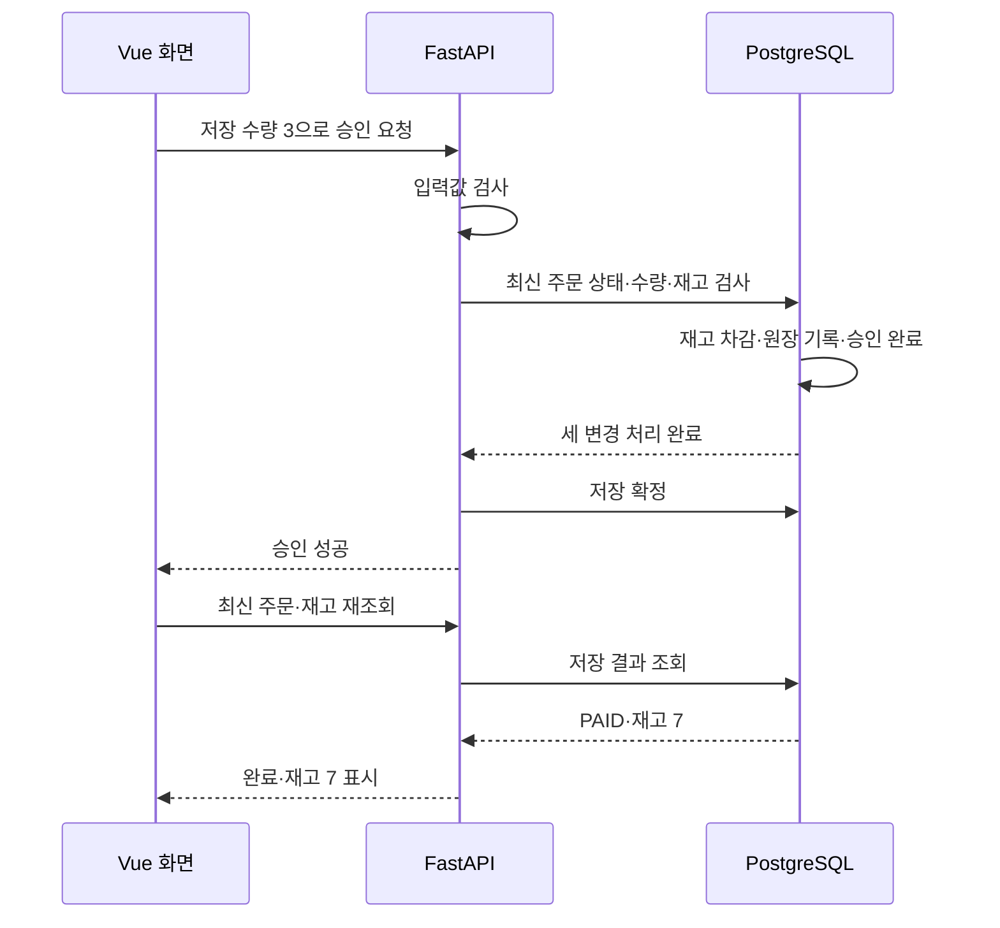
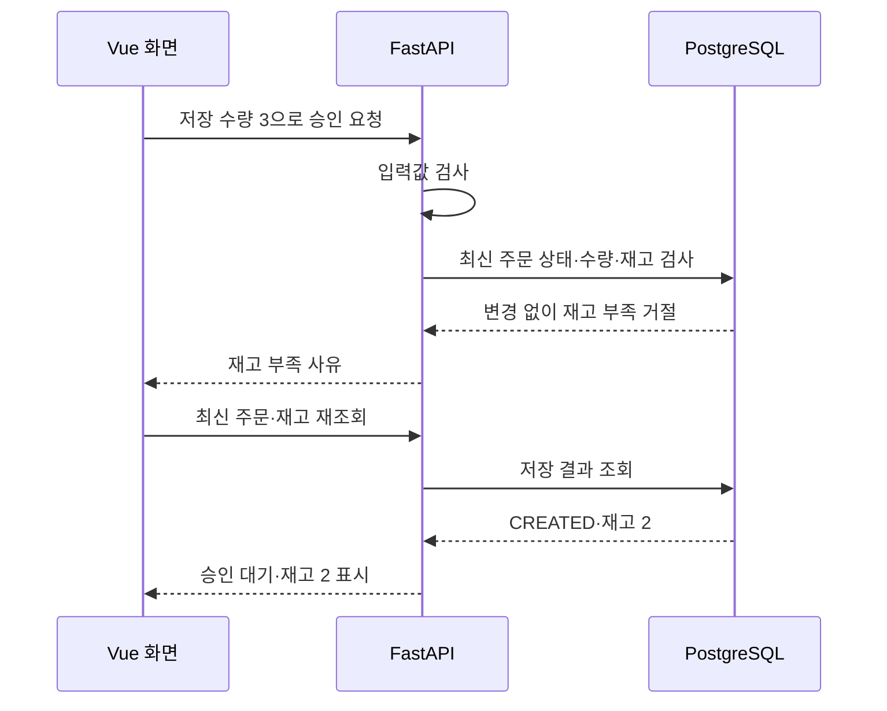

# Chapter 11. AI와 주문 승인 기능 완성하기

> **실습 키트:** [기초 실습 환경 준비](01A_foundation_lab_setup.md#kit-download)

## 11.0 이 챕터에서 얻는 것

이번 장에서는 AI와 Vue·API·DB가 연결된 주문 승인 기능을 만듭니다. 독자는 업무 조건을 정하고,
AI는 구현과 자동 검사를 맡습니다. 작업이 끝나면 독자가 서버를 실행하고 주문 수량을 입력·저장해, 화면에서 정상 승인과 재고 부족을 직접 확인합니다.

목표는 **화면에 표시된 처리 결과가 실제 저장 결과와 일치하는지 판단하는 것**입니다.
예상과 다르면 어떤 주문에서 무엇이 달랐는지 설명하고 AI에게 수정을 요청합니다.

**진행 순서:** 환경 준비 → 업무 회의 → AI 구현·실행 → 정상 승인 → 부족 거절 → 코드 흐름 이해·완료.

| 독자가 맡는 일 | AI가 맡는 일 |
|---|---|
| 승인 조건과 기대 결과 결정 | 프로젝트 규칙과 기존 파일 조사 |
| 전용 DB 생성·로컬 연결값 설정 | SQL·API·화면 구현과 전용 DB 적용 |
| 서버 실행·종료·화면 조작·실제 DB 결과 대조 | 테스트 데이터 준비·자동 검사 |
| 결과 차이 설명·최종 판단 | 오류 조사·수정·관련 검사 재실행 |

트랜잭션과 재승인 방지는 기본 구현에 포함합니다. 다만 중간 실패나 동시 요청을 직접 만드는 별도 실험은 선택입니다.
먼저 두 업무 결과를 확인하고, 그 결과를 만든 코드의 역할을 살펴보겠습니다.

---

## 11.0-ENV 실습 시작 전 환경 준비

<a id="ch11-environment"></a>

### 실습 폴더 열기

1. **기초 실습 키트를 준비합니다.** 새 폴더에 키트를 준비합니다.
2. **실습 폴더를 엽니다.** VS Code에서 **`practice-workspace/ch11/`**를 엽니다.
3. **AI 도구를 확인합니다.** 저장소 파일을 읽고 터미널 명령을 실행할 수 있는 AI 코딩 에이전트를 사용합니다.

이 폴더의 `AGENTS.md`와 `connection_spec.md`가 작업 규칙과 연결 명세입니다. 파일 내용을 대화에 복사할 필요는 없습니다.

백엔드는 `workspace/erp-project/`, 화면은 `workspace/frontend-project/`입니다.
기존 개인 실습 폴더에 새 키트를 덮어쓰거나 Chapter 10 파일을 복사하지 않습니다.
Day 00에서 사용할 ERP 저장소는 이후 별도 폴더에 준비합니다.

<a id="ch11-python-setup"></a>

Python 3.12와 Node.js·npm은 [6장의 개발 환경 준비](book_navigation.md#chapter6)에서 준비한 것을 사용합니다.
프로젝트 가상환경 생성과 패키지 설치는 11.2에서 AI가 기존 의존성 파일을 확인해 수행합니다.
이 장의 실행 명령에 맞춰 가상환경은 `workspace/erp-project/venv/`에 준비합니다.

### 전용 Supabase DB와 연결값 준비

<a id="ch11-supabase-project"></a>

처음 실습한다면 아래 순서로 새 전용 DB를 준비합니다. 기존 Chapter 11 DB를 재사용한다면
먼저 [새 키트에서 기존 DB 재사용하기](supplements/ch11_environment_setup.md#ch11-reuse-database)를 확인하세요.
새 키트를 받는 것만으로 기존 DB의 구조나 실습 결과가 바뀌지는 않습니다.
실습 테이블과 함수까지 비우고 처음부터 시작하려면 [DB 완전 초기화](supplements/ch11_environment_setup.md#ch11-clear-database)를 따릅니다.

1. **새 전용 프로젝트를 만듭니다.**

   [Supabase 대시보드](https://supabase.com/dashboard)에서 개인 실습 조직을 선택하고,
   `erp-chapter11-lab`처럼 용도를 알아볼 수 있는 이름으로 **새 전용 프로젝트**를 만듭니다.
   생성 화면의 요금 조건을 확인하고 DB 비밀번호를 안전하게 보관하세요.
   이번에는 기존 업무 테이블이나 승인 함수가 없는 DB에서 시작합니다.

2. **연결 URI를 확인합니다.**

   프로젝트가 준비되면 **Connect → Session pooler**에서 한 줄짜리 연결 URI를 확인합니다.
   이 키트는 DB 이름 `postgres`, 포트 `5432`를 사용합니다.
   Session pooler는 IPv4 환경에서도 사용할 수 있는 연결 방식입니다. 자세한 구분은
   [Supabase 연결 안내](https://supabase.com/docs/guides/database/connecting-to-postgres/pooling-and-limits)를 참고하세요.

3. **로컬 설정 파일을 만듭니다.**

   VS Code에서 백엔드의 `.env.example`을 열고, 같은 폴더에 **`.env`**라는 이름으로 사본을 저장합니다.

4. **두 연결값을 입력합니다.**

   `.env`의 두 항목을 자신이 만든 전용 프로젝트의 값으로 채웁니다.

   ```dotenv
   DATABASE_URL=<전용 프로젝트의 DB 연결 URI>
   CH11_PROJECT_REF=<같은 프로젝트의 20자리 참조 ID>
   ```

   - **`DATABASE_URL`**: `postgresql://`로 시작하는 연결 주소 전체를 넣고, 주소의 비밀번호 자리도 실제 DB 비밀번호로 채웁니다.
     비밀번호의 특수 문자는 URI 형식에 맞게 인코딩해야 합니다. TLS 암호화 연결을 사용하며 `sslmode=disable`은 허용하지 않습니다.
   - **`CH11_PROJECT_REF`**: 프로젝트 이름이 아니라 고유 ID입니다.
     대시보드 주소 `https://supabase.com/dashboard/project/abcdefghijklmnopqrst`라면
     `abcdefghijklmnopqrst` 부분에 해당합니다. 이 값은 설명용 예시이므로 자신의 ID로 바꾸세요.
     프로젝트의 **Settings → General → Reference ID**에서도 확인할 수 있습니다.
     [Supabase 공식 문서](https://supabase.com/docs/guides/graphql)

두 값은 `.env`에만 저장합니다. AI는 연결값을 열어 출력하지 않고, 실행 도구와 서버가 로컬 설정을 사용합니다.
AI 대화에 DB 주소나 비밀번호를 붙여 넣지 않습니다.

<a id="ch11-db-check"></a>
<a id="ch11-environment-ready"></a>

**준비 완료 기준**

- [ ] VS Code에 `ch11/` 폴더가 열려 있다.
- [ ] Python·Node.js 실행 기반이 준비됐다.
- [ ] 전용 DB의 연결값을 입력한 로컬 `.env`가 준비됐다.

DB 접속·대상 일치·기존 객체 확인은 다음 절에서 AI가 수행합니다. 지금 SQL Editor에서 테이블이나 함수를 만들지 않습니다.

설치·연결이 막히면 [환경·실행 도움말](supplements/ch11_environment_setup.md)을 필요한 항목만 확인합니다.

<a id="ch11-after-environment"></a>

---

## 11.1 업무 회의: 어떤 승인 기능이 필요한가

<a id="ch11-business-conditions"></a>

> 주문 승인 버튼을 누르면 재고를 차감하고 완료 표시를 해 주세요.

이 요청만으로 구현하면 재고가 부족할 때의 동작이나 완료 시점을 AI가 임의로 정할 수 있습니다.
다음은 필요한 조건을 정하는 짧은 가상 회의입니다.

> **주문 담당자:** 주문을 승인하면 재고에서도 주문 수량만큼 빠져야 합니다.
>
> **개발자:** 재고를 줄이고, 원장에 차감 내역을 남기고, 주문을 승인 완료로 바꾸겠습니다. 세 변경은 함께 저장하겠습니다.
>
> **주문 담당자:** 승인하기 전에는 제가 주문 수량을 바꿀 수 있나요?
>
> **개발자:** 승인 대기 중에는 양의 정수로 입력하고 저장할 수 있게 하겠습니다. 수량 저장은 재고나 원장을 바꾸지 않습니다. 저장된 수량을 확인한 뒤 별도로 승인하며, 승인 완료 후에는 수량을 바꾸지 못하게 하겠습니다.
>
> **재고 담당자:** 재고가 부족하면 어떻게 하나요?
>
> **개발자:** 승인하지 않고 데이터도 바꾸지 않겠습니다. 화면에는 재고 부족 사유를 보여 드리겠습니다.
>
> **주문 담당자:** 처리됐는지도 알 수 있어야 합니다. 같은 주문을 또 처리하면 안 되고요.
>
> **개발자:** 저장 성공을 확인한 뒤 최신 주문과 재고를 다시 조회해 표시하겠습니다. 이미 승인된 주문은 서버에서도 다시 처리하지 않겠습니다.

**원장**은 재고가 언제, 어떤 이유로 얼마나 바뀌었는지 남기는 기록입니다.
재고가 3개 줄면 원장에는 증감량 `-3`이 남아야 합니다.

| 상황 | 합의한 동작 |
|---|---|
| 승인 전 수량 변경 | 양의 정수 입력·저장 후 재조회. 재고·원장·승인 상태 유지 |
| 입력값이 아직 저장되지 않음 | 수량을 먼저 저장하도록 안내하고 승인 차단 |
| 재고 충분 | 재고 차감·원장 기록·주문 승인 완료를 함께 저장 |
| 재고 부족 | 승인 거절·데이터 유지·사유 표시 |
| 승인 저장 성공 | 저장된 주문 상태와 현재고를 다시 조회해 완료 표시 |
| 이미 승인한 주문 | 수량 변경·재승인 거절로 저장 결과 보호 |
| 처리 결과 미확인 | 바로 재요청하지 않고 저장 상태부터 확인 |

이 표를 구현과 확인의 기준으로 사용합니다.
미정인 업무 조건은 독자가 결정하고, 파일 위치나 함수 이름은 AI가 프로젝트를 조사해 정합니다.

**직접 확인할 주문은 두 개입니다.**

| 주문 | 상품 | 직접 입력·저장할 수량 | 시작 재고 | 기대 결과 |
|---|---|---:|---:|---|
| 정상 승인용 주문 A | 정상 확인용 상품 | 3 | 10 | 승인 완료·재고 7·원장 1건, 증감량 -3 |
| 재고 부족용 주문 B | 부족 확인용 상품 | 3 | 2 | 승인 거절·재고 2·원장 추가 없음 |

두 주문은 서로 다른 상품을 사용합니다. A를 승인해도 B의 재고는 바뀌지 않으므로 두 사례 사이에 초기화하지 않습니다.
두 주문의 시작 수량은 **1**입니다. 독자가 각 주문의 수량을 **3**으로 바꿔 저장한 뒤 승인합니다.
재고보다 많은 수량도 주문에는 저장할 수 있습니다. 재고 부족 여부는 승인할 때 판단합니다.

---

## 11.2 AI에게 구현과 실행 맡기기

<a id="ch11-api-prepare"></a>
<a id="ch11-ui-prepare"></a>

AI가 프로젝트를 확인하고 DB·API·화면을 연결합니다. 아래 프롬프트를 한 번 보내고, 작업이 끝나면 안내받은 화면을 여세요.

> **[AI 프롬프트: 주문 승인 기능 구현과 실행]**
>
> ```text
> 이 프로젝트의 규칙과 기존 파일을 읽고, 회의에서 정한 주문 승인 기능을 구현해 주세요.
>
> 승인 대기 주문은 제가 수량을 직접 입력하고 별도로 저장할 수 있게 해 주세요.
> 수량은 양의 정수만 허용하고, 수량 저장으로 재고·원장·승인 상태를 바꾸지 마세요.
> 저장 후 DB에서 다시 조회한 수량을 표시하고, 저장하지 않은 입력값이 있으면 승인을 막아 주세요.
> 재고보다 많은 주문 수량도 저장할 수 있지만, 승인할 때는 재고 부족으로 거절해 주세요.
> 승인 완료된 주문은 화면과 서버 모두에서 수량을 바꾸지 못하게 해 주세요.
>
> Vue 화면에서 주문을 승인하면 API를 거쳐 DB에 저장되게 해 주세요.
> 승인은 DB에 저장된 주문 수량을 기준으로 처리하고, 요청 수량과 다르면 거절해 주세요.
> 재고 차감·원장 기록·주문 승인 완료는 함께 저장해 주세요.
> 재고가 부족하면 아무 데이터도 바꾸지 않고 화면에 이유를 보여 주세요.
> 저장이 성공한 뒤 저장된 주문 상태와 현재고를 다시 조회해 표시하고,
> 이미 승인한 주문은 다시 처리하지 마세요.
>
> 정상 승인용 주문 A와 재고 부족용 주문 B를 서로 다른 상품으로 준비해 주세요.
> 두 주문의 시작 수량은 1, 시작 재고는 A가 10, B가 2로 준비해 주세요.
> 제가 각 주문의 수량을 3으로 바꿔 저장한 뒤 승인하겠습니다.
> 필요한 SQL을 파일로 작성해 전용 실습 DB에 적용하고,
> 제공된 자동 검사를 진행해 주세요. 화면 테스트용 서버 실행과 종료는 제가 직접 하겠습니다.
> 자동 검사에 필요한 임시 서버는 검사 뒤 종료하고, 화면 테스트용 서버를 자동으로 시작하지 마세요.
> 자동 검사는 별도 데이터를 사용해 제가 테스트할 A와 B를 시작 상태로 남겨 주세요.
>
> 제가 결정해야 할 업무 조건이 남아 있으면 질문해 주세요.
> 완료되면 제가 접속할 화면 주소와 DB 적용·검사 결과, 남은 문제를 짧게 알려 주세요.
> ```

AI는 키트의 연결 명세에서 화면 정보·오류 처리·기존 의존성과 구현 범위를 확인합니다.
SQL을 복사해 직접 적용하거나 DB·API·Vue별로 다음 프롬프트를 보내지 않아도 됩니다.
도구가 작업 승인을 요청하면 대상이 이번 전용 실습 폴더와 DB인지 확인합니다.
예상하지 못한 기존 객체가 발견되면 보존한 채 차이를 확인하고, 삭제를 기본 해결책으로 삼지 않습니다.

<a id="ch11-sql-record"></a>
<a id="ch11-api-run"></a>
<a id="ch11-ui-run"></a>

### 완료 보고와 시작 화면 확인

AI의 완료 보고에서 다음 다섯 가지를 확인합니다.

| 항목 | 확인할 내용 |
|---|---|
| 구현 | 주문 승인 화면·API·DB 연결 |
| DB 적용 | 전용 실습 DB에 생성 SQL 적용 성공 |
| 검사 | 수량 저장·입력 거절·승인 후 변경 차단·정상·부족·재승인·중간 실패 검사와 빌드 결과 |
| 화면 주소 | 독자가 서버 실행 후 접속할 주소. 기본값은 `http://localhost:5173` |
| 남은 문제 | 실행을 막는 오류와 아직 실행하지 못한 항목 |

`Pass`는 통과, `Fail`은 실패, `Not Run`은 미실행입니다.
**자동 검사 통과와 독자의 화면 확인은 별개입니다.** AI가 자동 검사에 쓴 주문은 A·B와 분리돼야 합니다.

이미 진행한 실습이라면 결과를 지우지 말고 [재개하기](#ch11-resume)로 이어갑니다. 처음 시작한다면 다음을 확인합니다.

서버 실행·상태 확인 명령은 VS Code의 **PowerShell 터미널**에서 입력합니다.
터미널의 현재 폴더가 `ch11/workspace/erp-project/`인지 확인하세요. 두 서버는 백그라운드에서 실행되므로
명령이 끝나 터미널 입력 표시가 돌아와도 계속 동작합니다.

> **[1. 서버 실행]**
>
> ```powershell
> & .\venv\Scripts\python.exe lab.py servers start
> ```
>
> 백엔드 `api`와 프런트엔드 `web` 모두 `state`가 `running`, `http`가 `Pass`인지 확인합니다.

> **[서버 상태 확인]**
>
> ```powershell
> & .\venv\Scripts\python.exe lab.py servers status
> ```
>
> 실행 중인지 다시 확인할 때 사용합니다. 오류가 나면 아래 수정 프롬프트로 AI에게 조사를 요청합니다.

> **[2. 브라우저에서 테스트]**
>
> 브라우저 주소창에 다음 주소를 입력합니다.
>
> ```text
> http://localhost:5173
> ```
>
> 화면이 열리면 아래 시작값을 확인하고 11.3·11.4의 A·B 실습을 진행합니다.

1. **화면을 확인합니다.** 주문 승인 화면이 열려야 합니다.
2. **주문 정보와 입력란을 확인합니다.** A·B의 주문명·상품명·저장된 주문 수량·현재고·승인 대기 상태와 수량 입력란·수량 저장 버튼·승인 버튼이 보여야 합니다.
3. **시작값을 확인합니다.** 두 주문의 저장된 수량은 1, 시작 재고는 A가 10, B가 2여야 합니다.

<a id="ch11-ai-debug"></a>

### 결과가 다르거나 실행이 막혔다면

자신이 본 증상을 설명하면 AI가 코드·서버 로그·DB 상태를 직접 조사합니다.
아래 프롬프트의 첫 줄은 실제 관찰에 맞게 바꾸세요.

> **[AI 수정 프롬프트]**
>
> ```text
> 주문 A를 승인했는데 화면의 현재고가 10으로 남아 있습니다. 기대한 결과는 승인 완료·재고 7입니다.
> 현재 코드·서버 실행 결과·실제 DB 상태를 조사해 원인을 찾아 수정해 주세요.
> 관련 자동 검사를 다시 실행하고, 제가 문제가 있던 상황을 다시 확인할 수 있게 준비해 주세요.
> 기존 결과는 확인 전에 초기화하지 말고, 재준비가 필요한 사례와 이유를 알려 주세요.
> 제공된 고정 검사와 기대값은 바꾸지 마세요.
> ```

AI의 수정 보고 뒤에는 문제가 있던 상황을 직접 다시 확인합니다.
응답이 없었다면 저장됐을 수도 있으므로 같은 승인 버튼을 반복해서 누르기보다 최신 저장 상태부터 확인합니다.

---

## 11.3 재고가 충분할 때 승인하기

<a id="ch11-ui-check"></a>

**실행 전 예측:** 재고가 10개일 때 3개를 승인하면 무엇이 남아야 할까요?

1. **정상 승인용 주문 A**의 저장된 수량 1·현재고 10·승인 대기를 확인합니다.
2. A의 수량 입력란을 **3**으로 바꿉니다. 저장 전에는 승인 버튼을 누를 수 없어야 합니다.
3. **수량 저장**을 누릅니다. 저장된 주문 수량이 **3**으로 표시되고, 현재고 10·승인 대기가 유지되는지 확인합니다.
4. 페이지를 새로고침해 저장된 수량 3이 유지되는지 확인한 뒤 A의 승인 버튼을 한 번 누릅니다. 승인 완료·현재고 **7**이 표시돼야 합니다.
5. 수량 입력란·수량 저장·승인 버튼이 비활성화됐는지 확인하고 페이지를 새로고침합니다. 수량 3·완료 상태·재고 7이 유지돼야 합니다.

이 장의 `CREATED`는 승인 대기, `PAID`는 승인 완료를 뜻하는 실습용 상태 이름입니다. 실제 결제 연동은 포함하지 않습니다.

<a id="ch11-db-state-check"></a>
<a id="ch11-state-query"></a>

### 주문 A의 실제 저장 결과 대조하기

1. **저장 결과를 예상합니다.** 정상 승인을 마친 A의 저장 수량·상태·현재고·원장 건수·증감량을 예상해 봅니다.
2. **조회문을 준비합니다.** 바로 아래의 주문 A 전용 SQL 전체를 복사합니다.
3. **전용 DB에서 실행합니다.** 전용 Supabase 프로젝트의 **SQL Editor → 새 쿼리**에 SQL 전체를 붙여 넣어 실행합니다.

주문·재고·원장 값을 바꾸지 않고 주문 A의 저장 결과만 조회합니다.

```sql
-- 정상 승인용 주문 A만 조회합니다. 데이터는 변경하지 않습니다.
SELECT o.order_name,
       s.product_name,
       o.quantity AS order_quantity,
       o.status AS order_status,
       s.quantity AS current_stock,
       COUNT(l.ledger_id) AS ledger_count,
       SUM(l.qty_change) AS qty_change
FROM public.orders o
JOIN public.stock s ON s.product_id = o.product_id
LEFT JOIN public.stock_ledger l ON l.order_id = o.order_id
WHERE o.order_id = '00000000-0000-0000-0000-000000000001'::UUID
GROUP BY o.order_id, o.order_name, s.product_name, o.quantity, o.status, s.quantity
ORDER BY o.order_id;
```

- **`JOIN`**: 주문과 상품 재고를 연결합니다. `o`, `s`, `l`은 각 테이블을 짧게 부르는 별칭입니다.
- **`LEFT JOIN`**: 연결할 원장이 없어도 주문 자체는 조회 결과에 남깁니다.
- **`COUNT`와 `SUM`**: 주문별 원장 건수와 증감량 합계를 구합니다. `GROUP BY`는 이를 주문별로 묶는 기준입니다.

예상한 값과 실제 조회 결과를 비교합니다. 아래 표에는 결과 중 핵심 열만 표시했습니다.

| order_name | order_quantity | order_status | current_stock | ledger_count | qty_change |
|---|---:|---|---:|---:|---:|
| 정상 승인용 주문 A | 3 | PAID | 7 | 1 | -3 |

- **`order_quantity`**: DB에 저장된 주문 수량입니다.
- **`ledger_count`**: 해당 주문의 원장 건수입니다.
- **`qty_change`**: 해당 주문의 원장 증감량 합계입니다.

원장 건수 `1`과 증감량 합계 `-3`은 A의 차감 기록 한 건이 남았다는 뜻입니다.

**화면의 완료 표시·재고 7과 DB의 `PAID`·재고 7·원장 1건, `-3`이 일치하면 정상 승인 확인이 끝났습니다.**
이 결과를 그대로 두고 B로 넘어갑니다.

---

## 11.4 재고가 부족할 때 요청하기

<a id="ch11-check-shortage"></a>

**실행 전 예측:** 재고가 2개인데 3개를 요청하면 어떤 결과가 나와야 할까요?

1. **재고 부족용 주문 B**의 저장된 수량 1·현재고 2·승인 대기를 확인합니다.
2. B의 수량 입력란을 **3**으로 바꿉니다. 저장 전에는 승인 버튼을 누를 수 없어야 합니다.
3. **수량 저장**을 누릅니다. 재고보다 많은 수량이어도 저장된 주문 수량은 **3**으로 바뀌고, 현재고 2·승인 대기는 유지돼야 합니다.
4. 페이지를 새로고침해 저장된 수량 3을 확인한 뒤 B의 승인 버튼을 한 번 누릅니다. **재고가 부족하다는 사유**가 보이고, 승인 완료로 바뀌지 않아야 합니다.
5. 조회와 처리가 끝난 뒤 수량 3·현재고 2·승인 대기가 유지되는지 봅니다.
6. **조회 전 예측:** 수량 저장은 성공했고 승인은 거절됐습니다. B의 저장 수량·상태·현재고·원장은 어떻게 남아야 할까요?
7. **DB에서 확인합니다.** 바로 아래의 주문 B 전용 SQL 전체를 복사해 전용 Supabase 프로젝트의 **SQL Editor → 새 쿼리**에서 실행합니다.

```sql
-- 재고 부족용 주문 B만 조회합니다. 데이터는 변경하지 않습니다.
SELECT o.order_name,
       s.product_name,
       o.quantity AS order_quantity,
       o.status AS order_status,
       s.quantity AS current_stock,
       COUNT(l.ledger_id) AS ledger_count,
       SUM(l.qty_change) AS qty_change
FROM public.orders o
JOIN public.stock s ON s.product_id = o.product_id
LEFT JOIN public.stock_ledger l ON l.order_id = o.order_id
WHERE o.order_id = '00000000-0000-0000-0000-000000000002'::UUID
GROUP BY o.order_id, o.order_name, s.product_name, o.quantity, o.status, s.quantity
ORDER BY o.order_id;
```

예상한 값과 실제 조회 결과를 비교합니다. 아래 표에는 결과 중 핵심 열만 표시했습니다.

| order_name | order_quantity | order_status | current_stock | ledger_count | qty_change |
|---|---:|---|---:|---:|---:|
| 재고 부족용 주문 B | 3 | CREATED | 2 | 0 | NULL |

원장 건수 `0`과 증감량 합계 `NULL`은 B의 차감 기록이 없다는 뜻입니다.
`LEFT JOIN`이 원장 없는 B도 조회 결과에 남깁니다. SQL Editor에서 `NULL`이 빈칸처럼 보이면 원장 건수 `0`도 함께 확인합니다.

**B는 승인 요청 직전과 같은 수량 3·`CREATED`·재고 2·원장 0건이어야 합니다.** 수량 저장으로 1에서 3이 된 것은 의도한 변경이며, 부족 거절은 그 뒤의 승인 요청이 데이터를 바꾸지 않았다는 뜻입니다.
거절은 업무 조건을 지킨 결과입니다. 반대로 오류 문구만 보이고 재고나 원장이 바뀌었다면 수정이 필요한 문제입니다.

여기서 Core의 두 화면 확인을 마칩니다. 재고를 복원해 추가 승인하는 실험 없이 마지막 절로 갑니다.
예상과 다르면 [AI 수정 요청](#ch11-ai-debug)으로 원인을 확인한 뒤 해당 상황을 다시 실행합니다.

복습할 때 두 주문을 한꺼번에 확인하려면 키트에 제공된 `workspace/erp-project/sql/view_orders.sql`을 사용할 수 있습니다.
[키트의 두 주문 통합 조회 SQL](https://github.com/totobabycomanch-droid/foundation-lab-kit/blob/foundation-kit-v1.3.65/practice-workspace/ch11/workspace/erp-project/sql/view_orders.sql)에서도 같은 파일을 확인할 수 있습니다.

---

## 11.5 결과가 나온 경로 이해하고 마무리하기

<a id="ch11-ai-review"></a>
<a id="ch11-code-review"></a>

두 사례를 확인했다면, 이번에는 결과가 코드의 어디에서 만들어졌는지 연결해 보겠습니다.
아래는 생성물에서 찾아볼 예상 위치입니다. 이름이 달라졌다면 AI에게 같은 역할의 실제 위치를 안내받습니다.

| 볼 곳 | 예상 위치 | 확인할 역할 |
|---|---|---|
| 화면의 요청 전송 | `workspace/frontend-project/src/components/ApproveOrder.vue` | 선택한 주문의 식별자·상품·수량으로 승인 요청 |
| 조건 검사와 함께 저장 | `workspace/erp-project/sql/`의 생성 SQL | 최신 주문 상태·재고 검사, 세 데이터 변경 |
| 저장 후 재조회 | 같은 Vue 컴포넌트와 `workspace/erp-project/api/main.py` | 성공 응답 뒤 DB의 주문·현재고를 다시 조회해 표시 |

### AI에게 세 곳의 연결 설명받기

> **[AI 검증·설명 프롬프트]**
>
> ```text
> 프로젝트 규칙과 실제 생성 코드를 조사해 주문 A 정상 승인과 B 재고 부족이 처리되는 흐름을 짧게 설명해 주세요.
> 저장된 수량으로 승인 요청, 최신 조건 검사와 함께 저장, 저장 후 DB 재조회 세 역할을 찾아
> 실제 파일:행·역할·확인 근거를 3행 표로 보여 주세요. 각 행의 설명은 한 문장으로 제한해 주세요.
> 별도 수량 저장, 서버의 재승인 차단, 저장 확정 뒤 성공 응답도 해당 행의 근거에 포함해 주세요.
> 표 아래에는 코드 확인·기존 자동 검사·제가 전달한 직접 관찰의 근거 범위만 구분해 주세요.
> 긴 코드와 전체 검사 목록은 생략하고, 이번에 실행하지 않은 검사를 재실행했다고 표현하거나 미제공 관찰값을 채우지 마세요.
> ```

필요하면 자신이 본 결과를 한두 문장으로 덧붙입니다.
안내받은 실제 위치 세 곳을 열어 아래 흐름의 역할을 찾습니다. 생성된 함수명이나 변수명이 달라도 업무 흐름을 기준으로 연결하세요.

두 주문 모두 **수량 3 입력 → 수량 저장 → 저장된 수량 재조회**를 마친 뒤 승인합니다.
아래는 저장된 수량으로 승인 버튼을 누른 이후의 흐름입니다.

**A — 정상 승인: 재고 10에서 3개 승인**



**B — 재고 부족: 재고 2에서 3개 요청**



<a id="ch11-understand-ui"></a>

**요청 전송:** 수량 저장과 승인은 별도 요청입니다. 수량 저장은 재고·원장·승인 상태를 바꾸지 않습니다.
화면은 저장 뒤 재조회한 수량으로 승인을 요청하며, 미저장 입력이 있으면 승인을 막습니다.

<a id="ch11-understand-db"></a>

**조건 검사와 함께 저장:** DB는 최신 주문 상태·수량·재고를 확인합니다. 이미 승인된 주문은 다시 처리하지 않습니다.
재고가 충분한 A는 재고 차감·원장 기록·승인 완료를 한 **트랜잭션**, 즉 함께 확정하거나 취소할 작업 단위에서 처리합니다.
세 변경이 모두 저장되거나 실패 시 함께 취소되는 성질이 **원자성**입니다. B의 승인 요청은 첫 쓰기 전에 재고 부족으로 거절됩니다.

<a id="ch11-understand-api"></a>

**저장 확정과 재조회:** API는 저장을 확정한 뒤 성공을 응답하고, 화면은 DB를 다시 조회해 결과를 표시합니다.
저장 성공 뒤 조회만 실패한 경우와, 응답이 없어 저장 여부를 모르는 경우를 구분해야 합니다. 후자는 다시 승인하기 전에 저장 상태부터 확인합니다.

직접 확인한 것은 A의 정상 승인과 B의 부족 거절입니다. B의 거절만으로 저장 중간 실패의 취소나 동시 요청까지 실험한 것은 아닙니다.

<a id="ch11-defense-scope"></a>

화면과 서버는 각각 다음 역할을 맡습니다.

- **화면의 처리 중 잠금**: 추가 클릭을 줄입니다.
- **서버의 상태 검사**: 다른 화면이나 API에서 들어온 재승인도 거절합니다.

이 예제에는 인증과 회사별 접근 제한을 포함하지 않았으며,
`corp_id` 값이 있다는 것만으로 접근이 제한되는 것은 아닙니다. 로컬 실습용 서버로 사용합니다.

<a id="ch11-manual-record"></a>
<a id="ch11-business-report"></a>

### 직접 본 결과로 완료 판단하기

앞서 직접 확인한 A·B 결과와 AI의 설명을 바탕으로 다음 항목을 점검합니다.

<a id="ch11-completion"></a>

- [ ] A·B의 수량을 각각 1에서 3으로 입력·저장하고, 새로고침 뒤에도 수량 3과 승인 전 재고·상태가 유지됨을 확인했다.
- [ ] A를 승인해 완료 표시·재고 7과 DB의 수량 3·`PAID`·원장 1건, `-3`을 직접 확인했다.
- [ ] B를 요청해 부족 사유와 DB의 수량 3·`CREATED`·재고 2·원장 0건 유지를 직접 확인했다.
- [ ] 수량을 저장하기 전에는 승인이 차단되고, A 승인 완료 후에는 수량을 바꿀 수 없음을 확인했다.
- [ ] AI가 안내한 실제 코드에서 요청·조건 검사와 저장·재조회의 역할을 찾았다.
- [ ] AI 자동 검사와 내가 직접 실행한 두 사례, 미실행 범위를 구분할 수 있다.

담당자에게는 두 주문의 결과를 화면으로 짧게 시연하고, 실제 조회값을 근거로 설명하면 됩니다.
이번에 독자가 직접 확인한 업무 결과는 정상 승인과 재고 부족 거절입니다.

<a id="ch11-finish"></a>

### 서버 종료로 실습 마무리하기

코드와 생성 SQL을 저장한 뒤, 서버를 실행했던 `ch11/workspace/erp-project/`의 PowerShell 터미널에서 직접 종료합니다.
실습 폴더와 DB 결과는 복습용으로 남겨 둡니다.

> **[직접 실행 — 서버 종료]**
>
> ```powershell
> & .\venv\Scripts\python.exe lab.py servers stop
> ```
>
> 이 실습 도구가 관리하는 백엔드와 프런트엔드만 종료합니다. 백그라운드 실행이므로 `Ctrl+C` 대신 이 명령을 사용합니다.

> **[직접 실행 — 종료 상태 확인]**
>
> ```powershell
> & .\venv\Scripts\python.exe lab.py servers status
> ```
>
> `api`와 `web` 모두 `state`가 `stopped`인지 확인합니다.
> 브라우저에서도 `http://localhost:5173`을 새로고침해 더 이상 접속되지 않는지 확인합니다.

> **[Core 실습 완료]**
>
> A 정상 승인과 B 재고 부족을 직접 확인하고, 완료 체크리스트 점검과 서버 종료까지 마쳤다면
> **이번 장의 필수 실습은 끝입니다.**
>
> 아래의 재개·재실습·심화 안내는 필요할 때만 참고하세요.

---

### 필요할 때만 — 재개·재실습 안내

<a id="ch11-resume"></a>

#### 중단한 실습을 이어갈 때

같은 `ch11/` 폴더를 열고 아래처럼 요청합니다.

> **[AI 요청 — 중단한 실습 재개]**
>
> ```text
> 프로젝트 규칙을 읽고 현재 SQL 적용 이력·DB의 두 주문·서버 상태를 조사해 중단한 작업을 이어서 진행해 주세요.
> 기존 코드와 실습 결과는 보존하고 필요한 작업만 실행해 주세요. 서버는 제가 직접 실행·종료하겠습니다.
> 자동 검사에 필요한 임시 서버는 검사 뒤 종료하고, 접속할 화면 주소와 남은 문제를 알려 주세요.
> ```

<a id="reset-sql"></a>
<a id="ch11-api-reset"></a>
<a id="ch11-check-retry"></a>

#### 특정 사례를 처음부터 다시 확인할 때

다시 확인할 사례를 지정하면 AI가 대상과 기존 결과를 확인해 해당 사례만 준비합니다.
A와 B 사이의 초기화는 필요하지 않습니다.

> **[AI 요청 — A만 재준비]**
>
> ```text
> 정상 승인용 주문 A만 시작 상태로 재준비해 주세요.
> ```

#### A·B를 모두 처음부터 다시 실습할 때

다음 요청은 두 주문의 기존 승인 결과와 원장을 지웁니다. 결과를 남기고 싶다면 먼저 기록하세요.
같은 버전의 기능 구현이 끝난 환경에서 아래처럼 요청합니다. 이전 버전 DB를 새 키트에서 재사용한다면
[기존 DB 재사용 안내](supplements/ch11_environment_setup.md#ch11-reuse-database)를 먼저 따릅니다.

> **[AI 요청 — A·B 재준비]**
>
> ```text
> 프로젝트 규칙과 현재 DB·서버 상태를 조사하고 Chapter 11 전용 실습 대상인지 확인해 주세요.
> 주문 A와 B의 기존 실습 결과를 지우고 두 사례를 시작 상태로 재준비해 주세요.
> 두 주문의 수량은 1·승인 대기·원장 0건으로, 각 상품의 재고는 A가 10, B가 2로 복원해 주세요.
> 초기화는 두 주문과 해당 상품의 재고·관련 원장으로 제한하고 다른 데이터·테이블·함수·SQL 적용 이력은 보존해 주세요.
> 다른 주문과 상품을 공유하거나 명세와 다른 객체가 있으면 초기화하지 말고 차이를 알려 주세요.
> 제공된 재준비 도구를 사용하고, 완료 후 실제 DB 조회 결과와 화면 주소를 알려 주세요.
> 연결값이나 비밀번호는 출력하지 마세요.
> ```

**재준비 후 확인할 값**

| 주문 | 저장 수량 | 상태 | 현재고 | 원장 건수 | 증감량 합계 |
|---|---:|---|---:|---:|---|
| A | 1 | CREATED | 10 | 0 | NULL |
| B | 1 | CREATED | 2 | 0 | NULL |

재준비가 끝나면 화면을 새로고침하고 [A의 수량 입력](#ch11-ui-check)부터 진행합니다.
AI 없이 직접 초기화하려면 [도구 실행 또는 SQL Editor에서 초기화하기](supplements/ch11_environment_setup.md#ch11-manual-reset)를 참고하세요.

#### DB를 비우고 구현부터 다시 시작할 때

A·B 재준비는 테이블과 함수를 남깁니다. 구현부터 다시 실습하려면
[완전 초기화 안내](supplements/ch11_environment_setup.md#ch11-clear-database)에 따라 실습 테이블·함수·표식·SQL 적용 이력을 함께 제거합니다.
이 작업은 Chapter 11 전용 DB의 모든 실습 결과를 지웁니다. 기존 결과가 필요하다면 먼저 보관하세요.
완전 초기화 후에는 새 키트를 별도 폴더에 준비하고 [환경 준비](#ch11-environment)와 [구현 요청](#ch11-api-prepare)부터 진행합니다.

### 더 알아보고 싶다면

<a id="ch11-reference-section"></a>
<a id="ch11-db-atomicity"></a>
<a id="ch11-mid-write"></a>
<a id="ch11-check-input"></a>

Core를 마친 뒤 궁금한 주제를 골라 추가로 확인할 수 있습니다.

- **API·통신 관찰**: Swagger 직접 호출, Network 분석, 응답 유실 뒤 재조회
- **저장·동시 처리**: 저장 중간 실패, 동시 요청
- **중복 처리 방지**: 화면의 추가 클릭 차단과 서버 재승인 방지 비교

실험을 추가할 때는 독자용 A·B와 분리한 데이터와 정리 방법부터 AI에게 확인하세요.
[선택 복습 안내](supplements/ch11_review.md)에서 궁금한 질문 하나를 고를 수 있습니다.

> **[심화 학습 프롬프트]**
>
> ```text
> 실제 생성 코드를 조사해 승인 업무 규칙을 DB 함수에 둔 이유와 Python 서비스에 둘 때의 차이를 설명해 주세요.
> DB 없이 검사할 수 있는 부분과 실제 PostgreSQL이 필요한 부분을 구분하고, 행 잠금(FOR UPDATE)과 상태 검사가 각각 막는 문제도 짚어 주세요.
> 한 주제만 골라 독자용 A·B와 분리한 데이터로 확인할 실험과 정리 방법을 제안해 주세요. 아직 파일이나 DB는 바꾸지 마세요.
> ```

<a id="ch11-db-reference"></a>
<a id="ch11-api-reference"></a>
<a id="ch11-ui-basic-reference"></a>
<a id="ch11-ui-state-reference"></a>

긴 전체 코드가 필요하면 [키트의 ch11 참조 구현](https://github.com/totobabycomanch-droid/foundation-lab-kit/tree/foundation-kit-v1.3.65/chapter-reference/ch11)을 비교합니다.
로컬 키트의 `chapter-reference/ch11/`에도 있습니다. 개인 생성물을 보존하고 필요한 부분만 비교하며, 적용한 SQL과 참조 SQL을 중복 실행하지 않습니다.

<a id="ch11-day-source-map"></a>
<a id="ch11-day-transition"></a>

다음 [Day 00 — 실습 시작 가이드](book_navigation.md#day00)에서는 별도 ERP 저장소를 새 폴더에 준비합니다.
Chapter 11의 `.env`와 DB 데이터를 복사하지 않습니다.

| Chapter 11 | Day 실습 |
|---|---|
| 기초 실습 키트 | 별도 ERP 저장소 |
| 로컬 Python·Node.js로 서버 실행 | Docker Compose로 실행 환경 준비 |
| 두 주문으로 연결 흐름 확인 | 같은 흐름을 여러 업무로 확장 |

요청 → 조건 검사와 저장 → 저장 결과 조회의 흐름은 Day 실습에서도 판단 기준이 됩니다.
2권에서는 완성한 ERP를 더 안전하고 확장 가능한 구조로 재설계합니다.
