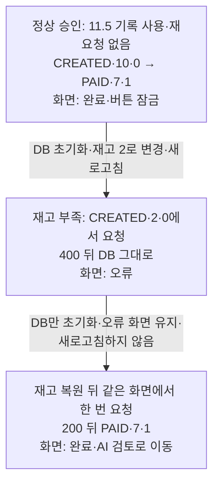

# Chapter 11 환경 준비

처음 준비하는 독자는 [본문 11.0-ENV](../11_chapter11.md#ch11-environment)에서 1~6단계를 순서대로 진행합니다.
이 문서는 기존 환경을 확인하거나 설치·연결 문제를 해결하고, 중단한 실습을 다시 시작할 때 사용합니다.

<a id="ch11-python-setup"></a>

- [본문 3단계: 백엔드 가상환경과 의존성 설치](../11_chapter11.md#ch11-python-setup)

<a id="ch11-supabase-project"></a>

- [본문 4단계: Supabase 연결 정보 설정](../11_chapter11.md#ch11-supabase-project)

<a id="ch11-db-check"></a>

- [본문 5단계: DB 연결 확인](../11_chapter11.md#ch11-db-check)

<a id="ch11-existing-venv"></a>

### 기존 가상환경 확인

> [!NOTE]
> **이 폴더에서 가상환경을 만든 적이 있다면 먼저 확인하세요**
>
> 같은 백엔드 폴더에서 `Test-Path .\venv`를 실행합니다. `False`라면 이 박스를 건너뛰고 아래 생성 명령을 실행합니다.
> `True`라면 `& .\venv\Scripts\python.exe --version`으로 기존 환경의 버전을 확인합니다.
>
> - `Python 3.12.x`라면 생성 명령을 생략하고 (3)부터 이어갑니다.
> - 3.15처럼 다른 버전이면, 새로 연 이 PowerShell에서 아래 명령으로 기존 폴더를 보관한 뒤 생성 명령을 실행합니다.
>   `venv-before-python312`가 이미 있다면 사용하지 않은 다른 보관 이름을 지정하세요.
>
> ```powershell
> Rename-Item -LiteralPath .\venv -NewName venv-before-python312
> ```
>
> 기존 환경의 Python 실행 파일이 없거나 보관 명령에 오류가 나면 생성 명령을 실행하지 말고
> [6장의 가상환경 오류 진단](../06_chapter6.md#ch6-verify-venv)부터 확인합니다.

확인 뒤 [본문 3단계](../11_chapter11.md#ch11-python-setup)의 해당 순서로 이어갑니다.

<a id="ch11-python-help"></a>

### Python 설치·활성화 도움말

아래 (2)~(5)는 [본문 3단계](../11_chapter11.md#ch11-python-setup)의 번호입니다.

> [!NOTE]
> **`pymanager` 명령을 찾을 수 없다면**
>
> Python과 Python Install Manager는 별개입니다. 3.15가 실행돼도 Manager 명령이 없을 수 있습니다.
> [6장의 Python Install Manager 설치 안내](../06_chapter6.md#ch6-python-ready)에 따라 Manager를 설치하고,
> 새 PowerShell을 열어 위의 백엔드 폴더 이동부터 다시 실행합니다.

> [!NOTE]
> **조직 정책 때문에 활성화가 계속 차단된다면**
>
> (4)의 두 명령에서 `python` 대신 `& .\venv\Scripts\python.exe`를 사용해 버전과 경로를 확인합니다.
> 확인 결과가 맞으면 (5)에서도 아래 명령으로 가상환경의 Python을 직접 지정합니다.
>
> ```powershell
> & .\venv\Scripts\python.exe -m pip install -r requirements.txt
> ```
>
> 이 경우 (5)의 일반 `python` 명령은 실행하지 않습니다. 이후 이 장에서 Python 경로를 직접 지정하는 명령은 그대로 사용할 수 있습니다.

> [!NOTE]
> **[막혔을 때] PyYAML 빌드 오류가 나온다면**
>
> `Building wheel for pyyaml ... error`와 `Microsoft Visual C++ 14.0 or greater is required`가 함께 나오면,
> PyYAML을 내 PC에서 빌드하려다 컴파일러가 없어 실패한 것입니다. 먼저 (4)의 실제 Python 버전과 경로를 다시 확인합니다.
> 다른 버전의 가상환경을 사용했다면 [기존 가상환경 확인](#ch11-existing-venv)부터 진행하세요.
> Python 3.12와 경로가 모두 맞다면 환경을 다시 만들거나 의존성 파일을 바꾸기 전에
> 오류 메시지와 네트워크 상태를 확인하고 [6장의 가상환경 오류 진단](../06_chapter6.md#ch6-verify-venv)을 참고합니다.

<a id="ch11-db-connection-help"></a>

### DB 연결 실패 도움말

**연결에 실패했을 때만 확인하기**

오류 종류만 표시되도록 했으므로 실제 연결 주소나 오류 원문을 채팅에 붙이지 않습니다.

1. `ArgumentError`라면 `.env` 주소의 오타와 `postgresql+psycopg2://` 시작 부분, 주소 전체를 복사했는지 확인합니다.
2. 드라이버 모듈 오류라면 3단계의 가상환경에 의존성이 설치됐는지 확인합니다.
3. `OperationalError`라면 자신의 프로젝트 화면과 호스트·사용자명·포트, 비밀번호 처리와 네트워크 상태를 대조합니다.
4. 프로젝트가 일시 중지됐다면 대시보드에서 해당 Chapter 11 프로젝트를 재개한 뒤 다시 확인합니다.

확인 뒤 [본문 5단계](../11_chapter11.md#ch11-db-check)의 연결 확인을 다시 실행합니다.

### 중단 후 다시 시작할 때

<a id="ch11-resume"></a>

1. VS Code에서 기존 `practice-workspace/ch11/`을 열고, 관찰 기록과 마지막으로 진행한 절을 확인합니다.
   완료한 설치·생성 SQL은 반복하지 않습니다. 아직 테이블을 만들지 않았다면 11.2의 미완료 작업부터 이어갑니다.
2. 해당 단계에 필요한 서버 중 꺼진 것만 [백엔드](../11_chapter11.md#ch11-api-run)·[프론트엔드](../11_chapter11.md#ch11-ui-run) 안내로 켭니다.
   백엔드는 안내대로 현재 터미널의 `DATABASE_URL`을 해제하고 기존 `venv`의 Python으로 실행합니다.
   Supabase 프로젝트가 일시 중지됐다면 대시보드에서 재개하고 [연결 확인](../11_chapter11.md#ch11-db-check)을 합니다.
3. 이어갈 절의 **시작 상태**와 현재 DB 값을 대조합니다. 이미 성공한 단계는 기록을 확인하고 다음 단계로 갑니다.
   다음 정상 승인 실험은 관찰값을 보존한 뒤 [초기화 SQL](../11_chapter11.md#reset-sql)로 `CREATED·10·0`을 준비합니다.

재고 부족 오류 화면이 남아 있다면 [재고 복원과 재시도](../11_chapter11.md#ch11-check-retry)부터 이어갑니다.
화면이 사라졌다면 [재고 부족 실험](../11_chapter11.md#ch11-check-shortage)부터 다시 준비합니다.
재시도까지 성공했다면 추가 초기화 없이 [AI 코드 안내](../11_chapter11.md#ch11-ai-review)로 갑니다.

11.2의 중간 실패 실험에서 멈췄다면 [임시 제약 제거](../11_chapter11.md#ch11-db-atomicity)부터 확인합니다.
제약을 남긴 채 API 실습으로 넘어가지 않습니다.

응답 결과를 모르거나 기록과 DB 값이 다르면 초기화·재요청 전에 현재 상태부터 확인합니다.
원인이 불분명하면 [AI 원인 조사](../11_chapter11.md#ch11-ai-debug)를 사용합니다.

<a id="ch11-experiment-states"></a>

**11.6의 상태 변화 지도**



<a id="ch11-run-help"></a>

### 실행 오류 도움말

문제가 생긴 단계만 확인합니다. 원인이 불분명하면 아래 AI 원인 조사를 사용합니다.

<a id="ch11-ai-debug-help"></a>

**AI와 원인 좁히기**

현재 단계와 실제 증상을 한 문장 덧붙여 아래 요청을 보냅니다. 비밀값이 섞인 오류 전문은 붙여 넣지 않습니다.

> **[AI 원인 조사 프롬프트]**
>
> ```text
> Chapter 11의 AGENTS.md와 관련 코드, 보존한 SQL 실행본, 관찰 기록을 읽고 원인만 조사해 주세요. 아직 수정하지 마세요.
> 제가 관찰한 증상에서 예상과 실제 결과가 어디서 달라졌는지 찾아 주세요.
> 확인된 사실과 원인 후보를 실제 코드 위치와 함께 설명하고, 원인을 좁힐 다음 확인 한 가지를 알려 주세요.
> ```

AI가 안내한 코드와 실제 결과를 대조합니다. 원인이 확인되면 수정할 부분과 이유를 확인하고 해당 단계의 수정을 요청합니다.
바뀐 부분의 실험을 다시 하며, SQL을 다시 적용했다면 성공한 실행본도 다음 번호로 보존합니다.

**DB 생성·등록**

> 외래 키는 다른 테이블의 값을 참조하는 연결입니다. 참조 오류가 나면
> 부모인 `stock`이 먼저 생성됐는지 확인하세요. 고정 데이터 등록에서 중복 키 오류가 나면 같은 ID의 데이터가 이미 있는지,
> 생성 SQL에 샘플 INSERT가 포함됐거나 등록 명령을 다시 실행했는지 확인합니다. 이미 만든 테이블이나 고정 데이터를 다시 등록하지 말고,
> 현재 상태와 실패 위치를 [AI 원인 조사 프롬프트](#ch11-ai-debug-help)로 좁힙니다. 생성 순서나 중복 등록이 원인인지 확인한 뒤
> 필요한 부분만 [참조 SQL](../11_chapter11.md#ch11-db-reference)과 비교합니다.

**API 실행·연결**

> `No module named 'api'`가 나오면 현재 폴더가 `erp-project/`인지,
> 기존 `venv`의 Python을 사용했는지, `api/main.py`가 있는지(`Test-Path api/main.py`)를 차례로 확인합니다.
> `400`의 `detail`에 연결 오류가 보이면 [본문의 연결 확인](../11_chapter11.md#ch11-db-check)부터 다시 실행합니다.
> 패키지 설치 오류는 [가상환경·설치 안내](../11_chapter11.md#ch11-python-setup)로 돌아가 확인합니다.
> API 동작이 다르면 요청과 응답을 기록하고 [AI 원인 조사 프롬프트](#ch11-ai-debug-help)로 입력 검사·DB 호출·응답 중 어디서 달라졌는지 좁힙니다.
> 원인이 확인된 부분만 [참조 API](../11_chapter11.md#ch11-api-reference)와 비교합니다.
> 연결값은 AI에 전달하지 않습니다.

**화면 요청·상태**

>
>
> - 화면의 요청 오류는 Network에서 실제 주소·본문·응답부터 확인합니다. CORS 오류는 현재 페이지가
>   API에서 허용한 `http://localhost:5173`인지, 404는 요청 주소가 맞는지, 422는 오류 필드가 무엇인지 확인합니다.
> - 로딩이 멈췄다면 요청이 아직 `Pending`인지 먼저 봅니다. 참조 코드에는 요청 제한 시간이 없어 응답 전에는
>   `finally`에 도달하지 않습니다. 결과를 모르는 요청은 반복 전송하지 말고 DB 상태부터 조회합니다.
> - 응답이 끝났는데 화면 상태가 다르면 [AI 원인 조사 프롬프트](#ch11-ai-debug-help)를 사용합니다. 예를 들어 “응답 200인데 완료 표시가 없다”는 증상에는
>   AI가 실제 응답 본문과 성공 판정 조건, 완료 상태와 화면 표시의 연결을 차례로 대조하게 합니다.
>   원인이 확인된 부분만 [참조 코드](../11_chapter11.md#ch11-ui-state-reference)와 비교하고, 최소 수정 뒤 관련 실험을 다시 수행합니다.

[본문으로 돌아가기: 11.1 업무회의](../11_chapter11.md#ch11-after-environment)
