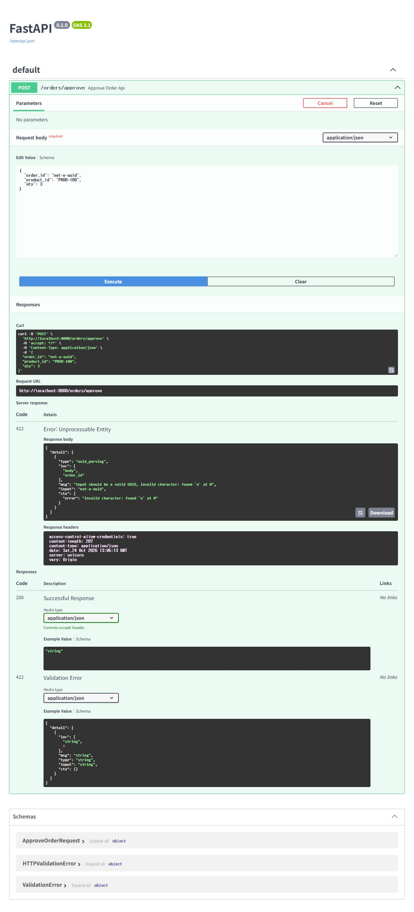

# Chapter 11 선택 복습

Core를 완료한 뒤 궁금한 질문 하나만 고릅니다. 여러 실험을 차례로 수행할 필요는 없습니다.
본문의 다섯 실습 기록은 그대로 두고, 실행한 심화 결과만 관찰 기록의 **추가로 확인한 것이 있다면**에 남깁니다.

| 궁금한 질문 | 사용할 자료 | 활동 하나 |
| :--- | :--- | :--- |
| 잘못된 요청은 어디서 거절될까? | [입력 검사](#ch11-input-validation) | 수량 0 또는 잘못된 UUID 하나 요청 |
| 응답을 받지 못하면 다시 눌러도 될까? | [통신 오류](#ch11-network-error) | API를 종료한 뒤 한 번 요청 |
| 양수 수량이면 항상 승인될까? | [주문 수량 불일치](#ch11-mismatch) | 저장 수량과 다른 값 한 번 요청 |
| 요청 중 버튼 잠금은 추가 요청을 막을까? | [추가 클릭](#ch11-click-lock) | 느린 요청 대기 중 추가 클릭 확인 |
| DB에서 본 중간 실패를 API와 화면으로 확인하면? | [중간 쓰기 실패](#ch11-mid-write) | 오류 응답·화면과 DB 취소 결과 연결 |
| 버튼 잠금이 서버 재승인도 막을까? | [잠금 범위 비교](#ch11-reapprove) | 화면과 SQL의 조건 비교 |
| 키보드와 좁은 화면에서도 사용할 수 있을까? | [조작·읽기 편의](#ch11-accessibility) | 두 항목 중 하나 확인 |
| 호출 방식·Vue 문법·구조 분리는 왜 다를까? | [호출 방식](#ch11-api-runtime)·[Vue 문법](#ch11-composition-preview)·[구조 확장](#ch11-expansion) | 주제 하나의 코드 비교 |

**심화 자료 사용 원칙**

AI는 해당 Chapter의 `AGENTS.md`, 허용된 실제 코드·SQL 실행본·관찰 기록을 먼저 읽습니다.
실제 `.env`·비밀값 읽기, DB 접속·SQL 실행·승인 요청은 AI에게 맡기지 않습니다. 실행은 독자가 직접 합니다.
아래 SQL·요청 예시·복원 명령을 고정 자료로 사용하며, 현재 구현과 전제가 다르면 실험 전에 차이만 보고하게 합니다.
새 실험 SQL·추가 개선 과제·전체 리팩터링은 만들지 않습니다. 참조 파일을 읽었다는 사실과 실제 DB 적용은 구분합니다.
서버가 필요하면 [실행·재개 안내](ch11_environment_setup.md#ch11-resume)로 꺼진 서버만 켭니다.
고정 주문을 승인하는 실험은 Chapter 11 전용 DB에서만 진행하며, 정리 확인 후 사용한 서버를 종료합니다.

<a id="ch11-check-input"></a>

## 입력 오류와 통신 오류

두 질문은 독립적입니다. 입력 검사 또는 통신 오류 중 필요한 항목 하나만 실행합니다.

<a id="ch11-input-validation"></a>

### 잘못된 요청은 어디서 거절될까?

**사용할 때:** API 입력 검사와 DB의 업무 조건 검사가 어떻게 다른지 궁금할 때 사용합니다.

> **[심화 학습 프롬프트: 입력 검사 한 사례]**
>
> ```text
> Chapter 11의 AGENTS.md와 실제 API 요청 모델, SQL 실행본, Core 관찰 기록을 읽으세요.
> 아래 고정 요청 중 내가 선택한 한 사례만 다룹니다. 선택이 없으면 수량 0을 사용합니다.
> 먼저 입력 검사와 DB 재고 검사의 차이를 세 문장 이내로 설명하세요.
> 독자가 아래 절차로 요청을 한 번 보내도록 안내하고, 422의 오류 필드와 DB 유지 결과를 대조하게 하세요.
> 현재 코드가 예상 결과와 다르면 차이를 먼저 보고하고 실험을 진행시키지 마세요.
> 종료 시 수량 3·고정 주문 ID로 요청 편집값만 복원하며, 정상 승인 요청은 보내지 않습니다.
> 파일·기록 수정, .env·비밀값 읽기, DB 접속·요청 실행, 새 SQL·추가 과제·전체 리팩터링은 하지 마세요.
> ```

**고정 절차:** [초기화 SQL](../11_chapter11.md#reset-sql)로 `CREATED·10·0`을 준비하고
Swagger의 `POST /orders/approve → Try it out`에서 아래 둘 중 **하나만** Execute합니다.

**수량 0**

```json
{
  "order_id": "00000000-0000-0000-0000-000000000001",
  "product_id": "PROD-100",
  "qty": 0
}
```

기대 결과는 `422`, `detail`의 `loc`는 `["body", "qty"]`입니다.

**잘못된 UUID**

```json
{
  "order_id": "not-a-uuid",
  "product_id": "PROD-100",
  "qty": 3
}
```

기대 결과는 `422`, `loc`는 `["body", "order_id"]`입니다.



**기록·종료:** 선택한 한 요청의 실제 Server response와 DB `CREATED·10·0` 유지를 기록합니다.
Responses의 명세 목록과 실제 응답을 구분하세요. 수량 3·고정 주문 ID로 편집값을 되돌리고 요청은 보내지 않습니다.
예상과 다르면 추가 요청 없이 실제 값과 코드를 확인합니다.

<a id="ch11-network-error"></a>

### 응답을 받지 못하면 다시 눌러도 될까?

**사용할 때:** 화면의 통신 오류 안내와 저장 결과 판단의 차이가 궁금할 때 사용합니다.

> **[심화 학습 프롬프트: 서버에 도달하지 않은 요청]**
>
> ```text
> Chapter 11의 AGENTS.md와 화면의 응답 없는 오류 처리, API 코드, Core 관찰 기록을 읽으세요.
> 먼저 응답 없음이 저장 취소를 뜻하지 않는 이유를 세 문장 이내로 설명하세요.
> 아래 고정 절차의 API 종료 후 요청 한 번만 안내하세요. 이 실험은 저장 후 응답 유실 실험이 아닙니다.
> 독자가 응답 없음·화면 메시지·DB 유지 결과를 기록하면 코드와 대조하고, 검증하지 않은 범위를 구분하세요.
> 기대 결과가 다르면 재요청시키지 말고 DB 결과와 마지막 응답을 확인하도록 안내하세요.
> 아래 명령으로 API를 복구한 뒤 승인 요청 없이 Swagger가 열리는지만 확인하게 하세요.
> 파일·기록 수정, .env·비밀값 읽기, DB 접속·요청 실행, 새 SQL·추가 과제·전체 리팩터링은 하지 마세요.
> ```

**고정 절차**

1. 두 서버를 켜고 초기화 SQL로 DB `CREATED·10·0`을 확인합니다.
2. 백엔드 터미널에서 `Ctrl+C`로 API를 종료합니다. 프론트엔드는 켜 둡니다.
3. Vue를 새로고침하고 Network 기록을 비운 뒤 승인 버튼을 한 번 누릅니다.
4. HTTP 응답 없음, DB 결과를 확인하라는 화면 메시지, 완료 표시 없이 로딩 종료, DB `CREATED·10·0` 유지를 확인합니다.

**복원:** 백엔드 폴더에서 다음 명령으로 API를 켜고 Swagger가 열리는지만 확인합니다. 승인 요청은 보내지 않습니다.

```powershell
Remove-Item Env:DATABASE_URL -ErrorAction SilentlyContinue
& .\venv\Scripts\python.exe -m uvicorn api.main:app --reload
```

**기록·종료:** 응답·화면·DB 값과 복구 여부를 별도 심화 기록에 남깁니다.
이번에는 API를 미리 껐으므로 요청이 서버에 도달하지 않았습니다. 저장 후 응답만 사라지는 경우는 확인하지 않았습니다.
실제 통신 장애에서는 응답 없음만으로 저장 실패를 단정하지 않고 DB 결과부터 확인합니다.

## 저장된 주문과 다른 수량

<a id="ch11-mismatch"></a>

**사용할 때:** 형식이 맞는 입력과 업무 조건을 만족하는 입력의 차이가 궁금할 때 사용합니다.

> **[심화 학습 프롬프트: 주문 수량 불일치]**
>
> ```text
> Chapter 11의 AGENTS.md, API 요청 모델, SQL 실행본과 **DB 정상 승인** 기록을 읽으세요.
> 양수 수량 검사와 저장 주문의 수량 일치 검사를 세 문장 이내로 비교하세요.
> 아래 고정 절차의 qty 4 요청 하나만 안내하고, 400의 사유와 DB 전후값이 같은지 독자 기록으로 확인하세요.
> 현재 코드에서 이 거절 조건을 찾지 못하면 그 차이만 보고하고 실행을 안내하지 마세요.
> 종료 시 Swagger의 qty만 3으로 되돌리며 정상 요청은 보내지 않습니다.
> 파일·기록 수정, .env·비밀값 읽기, DB 접속·요청 실행, 새 SQL·추가 과제·전체 리팩터링은 하지 마세요.
> ```

**고정 절차:** 초기화 SQL로 DB를 `CREATED·10·0`으로 복원합니다. 중간 쓰기 실패를 실행했다면 임시 제약도 제거했는지 확인합니다.
더 확인하고 싶다면 API를 켠 상태에서 Swagger의 고정 주문·상품은 그대로 두고 `qty`만 `4`로 요청해 보세요.
양수라서 입력 검사는 통과하지만, 저장된 주문 수량 `3`과 다르다는 사유로 DB 함수가 거절해 400이 와야 합니다.
요청 전후 DB는 `CREATED·10·0`으로 같습니다. 이 실험에서는 수량 3의 정상 요청을 보내지 않습니다.
**기록·종료:** 거절 사유·DB 전후값과 검사 위치를 남기고, Swagger의 `qty`를 3으로 되돌립니다. 추가 요청은 보내지 않습니다.

테스트 값을 고르는 기준도 비교해 보세요. `3`은 저장된 주문과 같은 정상값, `0`은 허용하는 최솟값 `1`의 바로 아래 값,
`4`는 입력 형식은 맞지만 업무 조건과 다른 값입니다. 다른 Day에서도 정상값·입력 경계·업무 불일치를 나누어 봅니다.

## 요청 중 추가 클릭 확인

<a id="ch11-click-lock"></a>

**사용할 때:** 요청 중 잠금이 같은 화면의 추가 요청을 막는지 확인하고 싶을 때 사용합니다.

> **[심화 학습 프롬프트: 요청 중 잠금]**
>
> ```text
> Chapter 11의 AGENTS.md, 실제 화면의 요청 함수·버튼 조건과 **화면 정상 승인** 기록을 읽으세요.
> 요청 중 잠금과 성공 후 잠금을 세 문장 이내로 비교하세요. 서버 재승인 방지와는 구분하세요.
> 아래 고정 절차의 대기 중 추가 클릭 실험 하나만 안내하세요.
> 독자의 POST 수·응답·DB 값과 코드 조건을 대조하고, 코드가 있다는 사실을 실행 통과로 판단하지 마세요.
> 결과와 관계없이 No throttling으로 복원하고 DB 초기화·화면 새로고침까지 정리하게 하세요.
> 기대와 다르면 새 요청을 반복시키지 말고 마지막 요청 결과부터 확인하게 하세요.
> 파일·기록 수정, .env·비밀값 읽기, DB 접속·요청 실행, 새 SQL·추가 과제·전체 리팩터링은 하지 마세요.
> ```

**고정 절차:** 결과는 별도 심화 기록에 남깁니다.
두 서버를 켜고 [초기화 SQL](../11_chapter11.md#reset-sql)로 DB `CREATED·10·0`을 만든 뒤 Vue를 새로고침합니다.

1. Network 기록을 비우고 네트워크 속도를 `Slow 3G`로 설정합니다.
2. 승인 버튼을 한 번 누른 뒤 대기 중 추가 클릭을 시도합니다. '처리 중...' 표시와 버튼 잠금을 확인합니다.
3. 승인 POST가 한 건인지 확인합니다. `OPTIONS`는 세지 않습니다. 응답 `200`·`status=success`, 완료 표시와 DB `PAID·7·1`을 대조합니다.
4. 결과와 관계없이 네트워크 속도를 `No throttling`으로 되돌립니다. 초기화 SQL로 DB `CREATED·10·0`을 복원하고 Vue를 새로고침합니다.

**질문 하나:** 요청 중 잠금과 성공 후 잠금은 어떻게 구분하나요?
**검색 단서:** 화면에서 `disabled`, `finally`, `success`를 검색해 버튼 조건·로딩 해제·성공 응답 검사를 찾습니다.
실제 화면 코드를 열고 요청을 시작하는 곳, 성공 응답을 확인하는 곳, 버튼 조건을 찾습니다.
참조 화면에서는 다음 조건을 사용합니다.

```html
:disabled="isLoading || isPaid"
```

요청 중에는 `isLoading`이, HTTP 200과 `status=success`를 확인한 뒤에는 `isPaid`가 잠금을 유지합니다.
`finally`에서 로딩을 해제해도 완료 상태는 남으므로 성공 뒤 버튼은 다시 활성화되지 않습니다.
생성물의 변수명이 다르면 같은 역할을 하는 상태를 찾으면 됩니다.
심화 기록에 화면 코드 위치와 이유를 한 문장으로 적습니다.

## 중간 쓰기 실패와 취소

<a id="ch11-mid-write"></a>

**사용할 때:** [본문의 DB 중간 실패 실험](../11_chapter11.md#ch11-db-atomicity)을 API와 화면까지 이어서 확인하고 싶을 때 사용합니다.
본문에서는 SQL Editor에서 취소를 확인했습니다. 여기서는 같은 실패가 API 응답과 화면 오류로 전달되는 모습을 봅니다.

> **[심화 학습 프롬프트: 중간 저장 실패 한 사례]**
>
> ```text
> Chapter 11의 AGENTS.md, 번호순 SQL 실행본·적용 기록, API 코드와 **DB 정상 승인** 기록을 읽으세요.
> 먼저 현재 SQL이 재고 UPDATE → 원장 INSERT → 주문 UPDATE 순서이며 예외를 삼키지 않는지 확인하세요.
> SQL 적용이 불확실하거나 순서·예외 처리가 다르면 차이를 보고하고 실험을 안내하지 마세요.
> 첫 쓰기 전 거절과 중간 실패의 변경 취소를 세 문장 이내로 비교하세요.
> 아래 고정 SQL·기대 결과·제거 SQL을 그대로 사용하는 실험 하나만 안내하세요. 새 SQL은 만들지 마세요.
> 독자가 기록한 제약 위반 사유·DB 전후값·제약 제거 결과를 코드와 대조하세요.
> PostgreSQL의 앞선 변경 취소와 API rollback의 트랜잭션 정리를 구분하고,
> 관찰된 DB 유지 결과만으로 rollback 호출 자체의 효과나 커밋 중 연결 장애까지 입증하지 마세요.
> 실패했거나 중단해도 제약 제거와 DB·화면 복원을 먼저 안내하세요.
> 파일·기록 수정, .env·비밀값 읽기, DB 접속·요청 실행, 추가 과제·전체 리팩터링은 하지 마세요.
> ```
[서버 실행·재개 안내](ch11_environment_setup.md#ch11-resume)를 따라 두 서버를 준비합니다.
중단했던 실험이라면 아래 제약 제거 SQL부터 실행한 뒤 시작값을 준비합니다. 결과는 별도 심화 기록에 남깁니다.

**이번에 확인할 것:** 재고를 차감한 뒤 원장 기록을 실패시켜, 앞선 재고 변경도 남지 않는지 봅니다.
실제 SQL 실행본에서 `재고 UPDATE → 원장 INSERT → 주문 UPDATE` 순서와 예외를 삼키지 않는 처리를 확인합니다.
적용한 정의가 불확실하면 먼저 실행본과 적용 기록을 확인하고, 요청을 보내지 않습니다.

**(1) 시작값과 화면 준비**

두 서버를 켠 상태에서 초기화 탭의 SQL을 실행합니다. 상태 조회에서 `CREATED·10·0`을 확인한 뒤 Vue 페이지를 새로고침합니다.

**(2) 원장 기록을 막는 임시 제약 추가**

Chapter 11 SQL Editor의 새 쿼리 탭에서 실행합니다. 초기화로 기존 원장 기록을 비운 뒤 실행해야 합니다.

```sql
ALTER TABLE stock_ledger
  ADD CONSTRAINT tmp_block_ledger CHECK (qty_change <> -3);
```

오류 없이 완료되면 다음으로 진행합니다. 제약 추가에 실패했다면 승인 요청을 보내지 말고 원인을 확인합니다.

**(3) 승인 요청과 취소 결과 확인**

**실행 전 예측:** 원장 기록이 실패하면 앞서 실행한 재고 차감도 남지 않아야 할까요?
Vue에서 승인 버튼을 한 번 누르고 다음 결과를 확인합니다.

- Network: `400` 응답에 `tmp_block_ledger` 위반 사유가 있습니다.
- Vue: 오류가 표시되고 완료 표시 없이 로딩이 끝납니다.
- 상태 조회 탭: 조회를 실행하면 `CREATED·10·0` 그대로입니다.

**(4) 임시 제약 제거와 실험 정리**

결과가 예상과 달라도 아래 SQL로 임시 제약을 제거합니다.

```sql
ALTER TABLE stock_ledger DROP CONSTRAINT IF EXISTS tmp_block_ledger;
```

오류 없이 제거됐다면 초기화 탭의 SQL을 실행하고, 상태 조회에서 `CREATED·10·0`을 확인한 뒤 Vue를 새로고침합니다.
**추가로 확인한 것이 있다면**에 API 응답·화면 오류와 DB 전후값, 제약 제거 결과를 기록합니다.

**(5) 정리를 마친 뒤 코드로 설명하기**

재고 부족은 첫 쓰기 전에 거절됐지만 이번에는 재고 변경 뒤 원장 기록에서 실패했습니다.
PostgreSQL이 실패한 함수 호출 안의 앞선 변경을 취소했고, 그 뒤의 주문 상태 변경은 실행되지 않았습니다.
**API는 실패한 트랜잭션을 정리하기 위해 `rollback()`을 호출합니다.**
취소된 재고 값과 SQL의 쓰기 순서를 연결해 설명해 봅니다.

**이번에 확인한 것:** 함께 취소 — 원장 기록에서 실패하자 앞선 재고 변경도 남지 않았습니다.

**심화 실험 종료:** 임시 제약이 없고 DB는 `CREATED·10·0`입니다. 실험을 마쳤다면 두 서버를 종료합니다.

**기록 확인:** 같은 대화에서 실제 제약 위반 사유·DB 전후값·제약 제거 성공 여부를 대조합니다.
예상값으로 빈 기록을 채우지 않습니다. 이 실험은 중간 쓰기 실패 사례이며 커밋 중 연결 장애는 다루지 않습니다.

**코드에는 있지만 Core에서 실행하지 않는 범위**

아래는 필수 실험에 포함하지 않은 사례입니다. 필요할 때만 살펴봅니다.

| 확인할 것 | 코드에서 찾을 근거 | 실행 검증의 한계 |
| :--- | :--- | :--- |
| API의 음수 수량 거절 | 요청 모델의 수량 제한 | `0`의 직접 실행은 선택이며 음수는 미실행 |
| DB 함수의 수량 검사 | NULL·0 이하 수량 거절 | 직접 함수 호출로는 미실행. API의 422가 이 검사의 검증은 아님 |
| 주문 존재·상품·수량 일치 | 주문 조회·불일치 거절 | 수량 불일치만 선택 실험. 주문 없음·상품 불일치는 미실행 |
| API의 명시적 `rollback()`만의 효과 | 실패한 트랜잭션을 정리하는 코드 | 위 심화 프롬프트에서 DB의 변경 취소와 구분 |
| 커밋 실패·세션 정리 | API 예외 처리·세션을 닫는 `finally` | 해당 실패·정리 동작 자체는 실행 검증하지 않음 |
| 주문·재고 행 잠금 | SQL의 두 `FOR UPDATE` | 동시 요청의 대기·처리 결과는 미실행 |
| DB 제약조건 | 재고·주문 수량·상태 CHECK | 이 업무 제약을 위반하는 직접 저장은 미실행 |


## 키보드와 좁은 화면

<a id="ch11-accessibility"></a>

키보드 조작 또는 좁은 화면의 읽기 편의 중 필요한 항목 하나만 확인합니다. 새 요청을 계획했다면
[초기화 SQL](../11_chapter11.md#reset-sql)로 DB `CREATED·10·0`을 맞추고 Vue를 새로고침한 뒤, 승인 버튼을
`Tab`으로 찾아 `Enter` 또는 `Space`로 실행합니다. 키보드 확인만을 위해 결과를 모르는 요청을 추가로 보내지는 않습니다.
오류 화면의 읽기 편의는 개발자 도구에서 너비를 `375px`로 바꿔 확인하며, 이 확인에는 새 요청이 필요 없습니다.
확인한 항목만 별도 심화 기록에 적습니다. 요청을 실행했다면 결과를 기록한 뒤 DB를 초기화하고 Vue를 새로고침합니다.
읽기 편의만 확인했다면 너비를 원래대로 돌립니다. 사용한 서버를 종료하고 마칩니다.

## 화면 잠금과 서버 재승인

<a id="ch11-reapprove"></a>

**사용할 때:** 버튼 잠금만으로 같은 주문의 재승인까지 막는지 궁금할 때 사용합니다.

> **[심화 학습 프롬프트: 두 잠금의 범위 비교]**
>
> ```text
> Chapter 11의 AGENTS.md, 실제 화면의 버튼 조건·요청 함수, SQL 실행본과 **화면 정상 승인** 기록을 읽으세요.
> 먼저 현재 화면의 잠금과 서버의 주문 상태 검사는 다른 조건이라는 점을 세 문장 이내로 설명하세요.
> 새 요청 없이, 버튼의 잠금 조건과 SQL의 현재 주문 상태 검사 유무를 한 번 비교하세요.
> 행 잠금이 있다는 사실을 PAID 주문 거절 조건으로 해석하지 마세요.
> 실제 생성물에 상태 검사가 있다면 그 근거로 판단하고, 참조 코드의 한계를 무조건 적용하지 마세요.
> 독자가 한 코드 위치와 이유 한 문장을 적게 하세요. 실행 검증은 하지 않았다고 구분하세요.
> 파일·기록 수정, .env·비밀값 읽기, DB 접속·요청 실행, 추가 과제·전체 리팩터링은 하지 마세요.
> ```

**기대 결과·종료:** 참조 SQL은 현재 주문의 `status`를 거절 조건으로 검사하지 않습니다.
독자의 SQL에서는 실제 조건을 확인해 판단합니다. 요청·DB 변경 없이 끝내므로 복원할 상태는 없습니다.

## 구현된 방어 장치와 한계

<a id="ch11-defense"></a>

> **[선택 읽기]** 실습에서 구현한 장치와 아직 보호하지 못하는 범위를 구분합니다.
> AI 생성물은 실제 코드·SQL을 확인한 뒤 아래 참조 구현의 요약과 비교하세요.

| 방어 장치 | 참조 구현 | 보호하는 것 | 보호하지 못하는 것 |
| :--- | :--- | :--- | :--- |
| 화면 버튼 잠금 | 적용 | 요청 중·승인 완료 후 현재 화면의 추가 클릭 | 새로고침·다른 브라우저·API 직접 요청 |
| API 입력 검사 | 적용 | 잘못된 UUID와 양수가 아닌 수량을 DB 호출 전 거절 | 호출자의 신원·업무 권한 |
| 주문·재고 행 잠금 | 적용 | 검사한 행을 트랜잭션 종료까지 잠가 다른 요청의 변경을 기다리게 함 | 동일 주문의 재승인 |
| DB 함수와 API의 commit/rollback | 적용 | 주문·재고·원장을 같은 트랜잭션으로 확정·취소 | 중복 요청이 같은 업무인지 판단 |
| 수량·상태값 CHECK | 적용 | 음수 재고·0 이하 주문 수량·허용하지 않은 상태값 저장을 차단 | 상태가 바뀌는 순서 검사 |
| 서버 중복 승인 방지·상태 전이 검사 | 미적용 | — | 재고가 충분하면 `PAID` 주문도 다시 차감될 수 있음 |
| 인증·회사 격리 | 미적용 | — | 로그인 여부·회사 소유권·업무 권한 검사 |

**화면·API·DB는 서로 다른 조건을 보호합니다.** 버튼을 잠가도 API 직접 요청은 들어올 수
있고, 주문 행을 잠가도 처리가 끝난 뒤 같은 주문을 다시 승인할 수 있습니다. 같은 요청을
반복해도 업무 결과가 중복되지 않게 하는 성질을 **멱등성**이라고 합니다.

`CHECK (status IN ('CREATED', 'PAID'))`는 허용된 값만 검사합니다. `PAID → PAID` 재승인이나
`PAID → CREATED` 역전이를 막으려면 변경 경로에서 현재 상태와 허용된 다음 상태를 검사해야
합니다. Day 프로젝트에서는 각 업무의 상태·재요청 규칙을 확인합니다.
[상태 전이와 트랜잭션](../11_appendix.md#a-1-시니어-심화-amazon-엔지니어가-시스템을-보는-방식-상태-전이와-트랜잭션)은 부록에서 복습할 수 있습니다.

**오류 응답도 학습용으로 단순화했습니다.** API는 DB 예외 문자열을 `detail`에 담고,
연결 실패 같은 서버 오류도 `400`으로 반환합니다. `hide_parameters=True`는 SQLAlchemy의
매개변수 표시를 숨기지만, DB 예외 본문에 포함된 값이나 SQL·함수 이름까지 제거하지 않습니다.
실제 서비스에서는 사용자용 메시지와 서버 로그를 분리하고 업무 오류와 서버 오류를 구분합니다.

DB 함수를 사용했다는 사실만으로 모든 방어가 완성되지는 않습니다. 이 장에서는 함수의 쓰기를
API가 같은 트랜잭션으로 확정·취소하며, Python에서 직접 처리하더라도 같은 DB 트랜잭션과
필요한 잠금을 사용하면 원자적으로 저장할 수 있습니다. 호출·커밋·롤백과 매개변수 바인딩은
[11.6의 핵심 코드 대조](../11_chapter11.md#ch11-code-review)에서 다시 확인하세요.

> **[검증 범위]** 위 표는 참조 구현의 요약입니다. 실제로 확인한 범위는 [본문 11.7](../11_chapter11.md#ch11-defense-scope)과 자신의 관찰 기록을 기준으로 구분합니다.

<a id="ch11-api-runtime"></a>

### 호출 방식과 브라우저 연결

질문 하나를 골라 현재 코드를 비교합니다. 두 항목 모두 추가 요청이나 DB 변경 없이 끝납니다.

**동기 DB 호출은 왜 일반 `def`일까?**

> **[심화 학습 프롬프트: 호출 방식 비교]**
>
> ```text
> Chapter 11의 AGENTS.md와 실제 API 경로 함수·DB 호출, **API 정상 승인** 기록을 읽으세요.
> 동기 SQLAlchemy·psycopg2 호출과 일반 def의 관계를 세 문장 이내로 설명하세요.
> 현재 경로 함수의 선언과 DB 호출 한 곳을 비교하고, async def로 이름만 바꿔도 비동기가 되는지 구분하세요.
> 독자가 찾은 위치와 이유 한 문장으로 끝내세요. 코드를 바꾸는 실험과 복원은 필요 없습니다.
> 파일·기록 수정, .env·비밀값 읽기, DB 접속·요청 실행, 추가 과제·전체 리팩터링은 하지 마세요.
> ```

**포트가 다른 화면의 응답 읽기는 어디서 허용할까?**

> **[심화 학습 프롬프트: CORS 설정 비교]**
>
> ```text
> Chapter 11의 AGENTS.md와 실제 화면 요청 주소·API CORS 설정, **화면 정상 승인** 기록을 읽으세요.
> 출처와 CORS의 역할을 세 문장 이내로 설명하세요.
> 현재 화면 주소와 API의 허용 출처 한 곳을 비교하고, Swagger 요청과 화면 요청의 조건 차이를 짚으세요.
> 독자가 찾은 설정과 이유 한 문장으로 끝내세요. 새 요청·설정 변경·복원은 필요 없습니다.
> 파일·기록 수정, .env·비밀값 읽기, DB 접속·요청 실행, 추가 과제·전체 리팩터링은 하지 마세요.
> ```

---

## 처음부터 다시 실습할 때만 초기화

<a id="ch11-reset-objects"></a>

재실습할 때만 사용합니다. 필요한 코드·SQL·관찰 기록을 보존하고,
PowerShell에서 `foundation-lab-kit` 루트로 이동해 초기화 대상을 미리 확인합니다.

```powershell
powershell -NoProfile -ExecutionPolicy Bypass -File .\tools\reset_practice_chapter.ps1 -Chapter ch11
```

미리 보기에는 백엔드의 `api/main.py`와 프론트엔드의 `ApproveOrder.vue`가 삭제 대상으로,
`src/App.vue`가 `_starter`의 시작 화면으로 복원될 대상으로 표시됩니다. 모든 경로가
`practice-workspace/ch11` 안에 있는지 확인한 뒤에만 적용합니다.

```powershell
powershell -NoProfile -ExecutionPolicy Bypass -File .\tools\reset_practice_chapter.ps1 -Chapter ch11 -Apply
```

이 도구는 `.env`·`venv`·`node_modules`를 삭제하지 않으므로 같은 PC에서는 재사용할 수 있습니다.
키트를 공유할 때는 비밀정보와 생성 부산물이 포함되지 않았는지 별도로 확인하세요.

DB 객체도 초기화하려면 현재 접속한 프로젝트가 Chapter 11 전용이고 보존할 데이터가 없는지
다시 확인합니다. 그다음 `workspace/sql/99_reset_lab.sql`의 삭제 대상을 읽고 Supabase SQL
Editor에서 직접 실행합니다. 이 SQL은 Chapter 11 표식이 없으면 중단되며, 이 장에서 만든
`approve_order` 함수와 세 테이블만 삭제합니다. 로컬 초기화 도구가 DB에 자동 접속하는 일은
없습니다.

초기화 후 로컬 시작 scaffold는 다음 명령으로 확인합니다.

```powershell
powershell -NoProfile -ExecutionPolicy Bypass -File .\tools\verify_practice_chapter.ps1 -Chapter ch11
```

### [선택 미리보기: APIRouter와 Composition API]

<a id="ch11-composition-preview"></a>

**사용할 때:** Day 코드의 라우터 등록이나 Vue 문법이 낯설 때 사용합니다. 아래 두 예시 중 하나만 읽습니다.

> **[심화 학습 프롬프트: 문법 예시 하나 읽기]**
>
> ```text
> 내가 고른 예시: [APIRouter 또는 Options API와 Composition API]
> 현재 열린 저장소의 AGENTS.md와 접근이 허용된 관련 코드, 이 절의 선택한 예시를 읽으세요.
> Chapter 11의 API 또는 화면 기록과 연결해 역할을 세 문장 이내로 설명하고 예시 한 곳만 비교하세요.
> Day 실제 소스가 없으면 아래 예시로만 설명하고 구현을 추측하지 마세요.
> 독자가 같은 역할의 위치와 이유 한 문장을 정리하면 끝냅니다. 문법 전환·실행·복원은 하지 않습니다.
> 파일·기록 수정, .env·비밀값 읽기, DB 접속·요청 실행, 추가 과제·전체 리팩터링은 하지 마세요.
> ```

#### 1. FastAPI APIRouter 구조 (백엔드 모듈화)

`backend/app/main.py`의 등록 부분입니다. 독립 실행용 코드가 아니며 URL은 각 라우터에서 확인합니다.

```python
from app.routers import purchase, inventory

app.include_router(inventory.router)
app.include_router(purchase.router)
```

#### 2. Vue 3 Composition API 구조 (프론트엔드 반응형 코드 격리)

이 장의 Options API는 `data()`와 `methods`로 상태·함수를 나눕니다. Day 화면은 주로
`<script setup>` 안에 상태와 함수를 선언합니다. 같은 로딩 상태를 다음처럼 표현합니다.

```javascript
// Options API의 메서드 안
this.isLoading = true

// Composition API의 스크립트 안: const isLoading = ref(false)로 선언한 경우
isLoading.value = true
```

문법이 달라도 요청 중 잠금과 성공·실패 후 화면 갱신을 확인하는 기준은 같습니다.

---


<a id="ch11-reference-section"></a>

## 코드 비교·복구와 심화 복습

> **[선택 참조]** Core를 완료했다면 읽지 않아도 됩니다. 막힌 단계의 코드를 비교·복구할 때 사용합니다.

전체 참조 코드는 기초 실습 키트의 `chapter-reference/ch11/` 폴더에 포함되어 있습니다.
이미 키트를 준비했다면 추가 ZIP을 받을 필요가 없습니다. 시작 scaffold와 구분해 비교·복구용으로 사용합니다.
`chapter-reference/ch11/README.md`를 읽고 필요한 파일만 비교하세요.

<a id="ch11-db-reference"></a>

**DB 테이블과 함수:** `chapter-reference/ch11/approve_order.sql`에서 주문·재고 검사, 행 잠금과 세 쓰기를 비교합니다.
이미 테이블이 있다면 전체 DDL을 다시 실행하지 말고 현재 객체와 필요한 변경부터 확인하세요.
고정 데이터 등록과 실험별 복원은 11.2와 [초기화 SQL](../11_chapter11.md#reset-sql)을 따릅니다.
참조 SQL을 사용했더라도 실제 성공한 내용은 [SQL 실행본 보존 절차](../11_chapter11.md#ch11-sql-record)에 따라 남깁니다.

<a id="ch11-api-reference"></a>

**API:** `chapter-reference/ch11/main.py`를 `workspace/erp-project/api/main.py`와 비교합니다.
요청 검사·매개변수 바인딩·커밋·롤백·세션 정리를 확인하며, 연결값은 기존 로컬 `.env`를 사용합니다.

<a id="ch11-ui-basic-reference"></a>
<a id="ch11-ui-state-reference"></a>

**화면과 앱 연결:** `chapter-reference/ch11/ApproveOrder.vue`와 `chapter-reference/ch11/App.vue`를
`workspace/frontend-project/src/`의 해당 파일과 비교합니다. 요청·로딩·성공·오류 처리와 카드 등록을 확인합니다.
통신만 되는 기본형으로 되돌리거나 정상 화면을 다시 작성할 필요는 없습니다.

전체 파일을 덮어쓰기 전에 차이와 수정 이유를 확인하세요. 복구에 사용한 파일·이유를 관찰 기록에 남기고,
변경한 코드로 관련 실험을 다시 수행합니다. 내려받은 참조 코드 자체를 실제 실행본이나 검증 완료의 근거로 삼지 않습니다.

**DB 함수와 API의 역할에서 한 질문만 고르기**

`BEGIN~END`와 커밋의 차이, 세션 정리와 롤백의 차이, SQL 매개변수 바인딩 중 궁금한 것 하나를 고릅니다.

> **[심화 학습 프롬프트: 역할 한 곳 비교]**
>
> ```text
> 내가 고른 질문: [위 질문 중 하나]
> Chapter 11의 AGENTS.md, 보존한 SQL 실행본·API 코드와 해당 Core 기록을 읽으세요.
> 선택한 질문의 개념만 세 문장 이내로 설명하고 실제 코드 한 곳을 근거로 비교하세요.
> 실행본이나 기록이 없으면 미확인으로 구분하세요. 다른 질문이나 실험을 추가하지 마세요.
> 독자가 코드 위치와 이유 한 문장으로 정리하면 끝냅니다. 상태를 바꾸지 않으므로 복원은 없습니다.
> 파일·기록 수정, .env·비밀값 읽기, DB 접속·요청 실행, 추가 과제·전체 리팩터링은 하지 마세요.
> ```

---

## 현재 구조가 깨지는 순간

<a id="ch11-expansion"></a>

**사용할 때:** 업무별 파일 분리·호출자 권한·화면 상태 중 한 문제가 궁금할 때 사용합니다.

> **[심화 학습 프롬프트: 구조의 한계 하나 읽기]**
>
> ```text
> 내가 고른 질문: [수정 위치 찾기, 호출자 권한, 화면 상태 중 하나]
> 현재 열린 저장소의 AGENTS.md와 허용된 관련 코드, 해당 Core 기록, 아래 시나리오 중 하나를 읽으세요.
> 선택한 문제가 생기는 이유를 세 문장 이내로 설명하고 실제 코드 한 곳 또는 문서 예시와 비교하세요.
> Day 소스가 없으면 예시의 개념까지만 설명하고 구현을 추측하지 마세요.
> 독자가 현재 구조의 한계 한 문장을 쓰면 끝냅니다. 구조 변경이나 추가 실험·복원은 필요 없습니다.
> 파일·기록 수정, .env·비밀값 읽기, DB 접속·요청 실행, 추가 과제·전체 리팩터링은 하지 마세요.
> ```

아래에서는 선택한 질문에 해당하는 시나리오만 읽습니다.

Day에서는 업무마다 다른 저장 조건을 다룹니다. 공급사 발주와 가맹점 발주는 별도 흐름이며,
승인 한 번으로 아래 업무가 모두 자동 실행되지는 않습니다.

| 업무 | 이어지는 실습 | 이 장에서 가져갈 질문 |
| :--- | :--- | :--- |
| 공급사 발주·수주 | Day 11~13 | 누가 어떤 상태에서 변경할 수 있는가? |
| 본사 입고 | Day 14 | 입고·재고·발주 상태가 함께 저장되는가? |
| 가맹점 발주·배송·입고 | Day 16~18 | 배송 시작과 입고 확정의 저장 시점은 어떻게 다른가? |
| POS 판매 | Day 20 | 판매와 재고 차감을 함께 처리하는가? |
| 마감·정산 | Day 22·24 | 마감된 거래의 변경을 어떻게 제한하는가? |

공급사 전송·바코드 검수·실시간 배송 추적까지 모두 구현한다는 뜻은 아닙니다. 실제 범위는
[Day별 목차](../days/_toc.md)를 기준으로 확인합니다.

### 시나리오 1. main.py 파일 하나가 3,000줄이 되는 날

`api/main.py`에 모든 업무를 덧붙이면 수정 위치를 찾기 어렵고 협업 중 변경 충돌도 늘어납니다.
모놀리스 안에서도 파일을 업무별로 나누고 공통 설정과 입력 규격을 분리할 수 있습니다.

> [!TIP]
> **[Day 프로젝트의 해결책: APIRouter 기반 도메인 분리]**
> `backend/app/routers/`의 `purchase.py`·`inventory.py`·`company.py`가 발주·재고·회사 업무를
> 나누어 담당하고, `backend/app/main.py`가 라우터와 공통 설정을 등록합니다.

### 시나리오 2. 누구나 curl 한 줄로 주문을 승인할 수 있다

11장의 `POST /orders/approve`에는 호출자의 신원·권한 검사가 없습니다. 외부에 공개하면
로그인하지 않은 사람도 요청할 수 있습니다. 아래 주소는 설명용이며 실행하지 않습니다.

```bash
# 로그인하지 않은 외부 공격자가 주문 승인을 직접 호출하는 경우
curl -X POST "https://api.my-monolith-erp.com/orders/approve" \
     -H "Content-Type: application/json" \
     -d '{"order_id": "00000000-0000-0000-0000-000000000001", "product_id": "PROD-100", "qty": 3}'
```

화면 잠금을 거치지 않는 이 요청도 주문·상품·수량이 일치하고 재고가 충분하면 처리됩니다.
서버는 **인증(Authentication: 누구인지 확인)**과 **인가(Authorization: 해당 업무의 권한 확인)**를
각각 수행해야 합니다.

> [!TIP]
> **[Day 프로젝트의 해결책: JWT 인증과 역할 검증]**
> Day 2부터 로그인 성공 시 사용자 식별 정보와 권한을 담은 **JWT(JSON Web Token)**를 발급하고,
> 이후 API에서 토큰과 역할을 검증합니다. 화면 버튼을 숨기는 것만으로 권한을 보호하지 않습니다.

### 시나리오 3. 새로고침 한 번에 증발하는 상태와 화면 간 데이터 불일치

`ApproveOrder.vue`의 `isPaid`·`errorMessage`는 새로고침하면 초기화되지만 DB 상태는 남습니다.
이 장은 주문을 재조회하지 않으므로 초기 화면만 보고 승인 여부를 판단하면 안 됩니다.
주문 목록·상단 건수·대시보드가 같은 변경을 반영하려면 API 재조회·컴포넌트 간 알림·공유 상태 중
업무에 맞는 방법을 정해야 합니다.

> [!TIP]
> **[Day 프로젝트의 해결책: 서버 데이터를 기준으로 화면 상태 갱신]**
> Day 프로젝트에서는 API 응답과 재조회를 기준으로 각 화면의 상태를 갱신합니다. 여러 화면이
> 같은 클라이언트 상태를 공유해야 할 때 전역 Store를 도입할 수 있지만, Pinia 설치 자체를
> Core 완료 조건으로 삼지는 않습니다.

### 현재 단일 흐름의 한계와 Day 프로젝트의 해결책 요약

Day에서도 세 가지를 확인하세요. **수정할 업무를 찾기 쉬운가, 서버가 호출자의 권한을 검사하는가,
화면이 서버의 최신 상태를 반영하는가.** 구체적인 구조는 다음 절에서 선택 복습할 수 있습니다.

---

## Day 프로젝트와 2권 연결 고리

> **[선택 읽기]** 실습이 없는 복습 단원입니다. Core를 마쳤다면 바로
> [Day 00](../days/day_00_starter_kit.md)으로 이동해도 됩니다.

<a id="ch11-day-transition"></a>

### [선택 복습] Day 프로젝트에서 달라지는 점

| 항목 | Chapter 11 | Day 프로젝트 |
| :--- | :--- | :--- |
| 작업 폴더 | `ch11/workspace/erp-project/`·`frontend-project/` | Day 00에서 별도로 준비하는 `franchise-erp/backend/`·`frontend/` |
| 실행 방식 | 백엔드·프론트엔드 개발 서버를 개별 실행 | Day 1부터 저장소 루트의 Docker Compose로 실행 |
| DB 접근 | SQLAlchemy 세션으로 PostgreSQL에 직접 연결하고 API에서 commit/rollback | 주요 업무는 Supabase Data API·RPC 사용. 여러 쓰기의 저장 조건은 해당 DB 함수에서 확인 |
| Vue 작성 방식 | Options API의 `data()`·`methods` | 주로 Composition API의 `<script setup>` 사용 |
| 인증·권한 | 구현하지 않음 | Day 2부터 로그인·JWT와 업무별 권한 검사 도입 |

RPC는 DB 함수를 원격 호출하는 방식입니다. 도구가 달라져도
**요청 → 서버 검사 → 저장 결과 → 화면 반영**을 대조하는 원칙은 같습니다.

**같은 질문으로 두 구조 읽기**

Core 완료 뒤 더 살펴보고 싶다면 API·SQL 실행본·화면에서 아래 역할을 찾아보세요. 새 요청이나 추가 기록은 필요 없습니다.
생성물의 이름이 달라도 같은 역할을 찾으면 됩니다. 막히면 [단계별 코드 확인](../11_chapter11.md#ch11-code-review)으로 돌아갑니다.

| 질문 | 11장 코드에서 찾을 곳 | Day에서 이어서 확인할 것 |
| :--- | :--- | :--- |
| 잘못된 요청은 어디서 거절하나요? | API 요청 모델의 UUID·수량 검사, DB 함수의 주문 일치·재고 검사 | 입력 검사에 로그인·권한·업무 상태 검사가 어떻게 더해지는가 |
| 함께 저장하는 범위와 확정 시점은 어디인가요? | SQL 실행본의 세 쓰기와 API의 `commit()` 뒤 성공 반환 | RPC의 DB 함수에서 여러 쓰기의 검사·저장이 한 트랜잭션으로 처리되는가 |
| 성공 뒤 화면은 무엇을 기준으로 바뀌나요? | 화면의 성공 응답 확인·완료 상태 변경·버튼 잠금 | 해당 업무에서 성공 후 어떤 데이터를 다시 조회하는가 |

예를 들어 본사 입고에서는 API의 `ConfirmInboundRequest`, `fn_confirm_hq_inbound` 호출과 해당 DB 함수,
입고 화면의 성공 후 조회를 같은 질문으로 읽게 됩니다. 실제 위치는 [아래 소스 지도](#ch11-day-source-map)에서 선택 복습할 수 있습니다.
지금 Day 소스를 준비하거나 구현할 필요는 없습니다. 새로고침은 화면 상태만 초기화하며, 11장의 승인 시 재고 차감을 입고에 그대로 적용하지 않습니다.

### A. [선택 복습] Day 프로젝트 구조 미리보기

<a id="ch11-day-source-map"></a>

11장은 SQLAlchemy로 PostgreSQL에 직접 접속하고 API에서 commit/rollback합니다.
Day 프로젝트의 주요 업무 API는 Supabase의 Data API와 **RPC(DB 함수 원격 호출)**를 사용하므로,
여러 쓰기를 함께 확정하는 조건은 해당 DB 함수에서 확인합니다.

본사 입고의 실제 소스에서 다음 역할을 찾아볼 수 있습니다. 이 표는 지금 파일을 만들거나
옮기라는 지시가 아니라, 해당 Day에서 AI의 조사 결과를 확인할 지도입니다.

| 책임 | 현재 Day 소스에서 확인할 위치 | 확인할 것 |
| :--- | :--- | :--- |
| DB 접근 준비 | `backend/app/core/database.py` | `get_tenant_db`가 사용자 토큰을 전달할 Supabase 클라이언트를 준비함 |
| 입력 검사 | `backend/app/models/inventory.py` | 요청의 필드·타입을 검사하는 Pydantic 모델 |
| HTTP·권한·DB 연결 | `backend/app/routers/inventory.py` | 입고 요청·권한 검사·업무 판단·RPC 호출·응답 변환 |
| 업무 판단 | `backend/app/services/hq_inbound.py` | 조회한 값으로 입고 가능 여부와 저장할 값을 판단 |
| 저장 시점 검사·원자 저장 | [본사 입고 DB 함수](../../database/create_hq_inbound_rpc.sql) | 저장 시점에 조건을 다시 검사하고 관련 데이터를 함께 저장 |
| 성공 후 화면 갱신 | `frontend/src/views/admin/StockInboundRegisterView.vue` | 입고 확정 응답의 번호로 상세 화면에 이동하고 입고 정보를 다시 조회 |

### A-2. [선택 복습] Day 종합 실전을 위한 3대 데이터 흐름 뼈대

**요청이 저장과 화면 반영까지 이어지는지**를 다음 순서로 비교하세요.

| 확인 순서 | 11장 | Day의 본사 입고 예 |
| :--- | :--- | :--- |
| 화면 요청 | Axios → `/orders/approve` | 입고 화면 → `/api/v1/stock_inouts/confirm` |
| 서버 검사 | Pydantic 입력 검사 | 입력·로그인·업무 권한·마감·입고 조건 검사 |
| DB 호출 | SQLAlchemy로 `approve_order` 호출 | Supabase 클라이언트로 `fn_confirm_hq_inbound` RPC 호출 |
| 저장 결과 | 주문·재고·원장 | 입고·재고·발주 상태·이벤트 등 해당 업무의 저장 결과 |
| 화면 반영 | 성공·오류 표시 | HTTP 응답 확인, 완료 표시·필요 데이터 재조회 |

이 흐름에서 세 가지를 구분하면 됩니다.

- **API 연결:** URL·본문·응답·DB 변화가 이어지는지 봅니다. 모든 Day가 위 본사 입고와
  같은 처리 순서를 따르거나 Axios를 쓰는 것은 아니므로 해당 소스에서 확인합니다.
- **요청·응답의 필드:** 11장의 `order_id`, `product_id`, `qty`처럼 API가 정한 이름을
  사용합니다. Axios는 `response.data`, fetch는 `response.ok`와 `response.json()`을 확인합니다.
- **화면 상태:** 11장의 고정 주문 화면에는 초기 조회·입력 폼이 없습니다. Day에서는 조회·입력이
  추가되며, 저장 중 잠금·성공 후 재조회·실패 후 입력 보존을 업무별로 검증합니다.

11장의 `PAID`나 승인 시 재고 차감을 모든 업무에 적용하지 않습니다. 발주·배송·입고·판매는
각각 상태와 재고가 바뀌는 시점이 다릅니다. 폴더·실행 방식·Vue 문법·인증의 차이는
[위 비교표](#ch11-day-transition)를, 구조 확장의 이유는 [현재 구조가 깨지는 순간](#ch11-expansion)을 참고하세요.

### B. [2권 예고 — Day 30 이후 MSA 분산 아키텍처 리빌딩 개념]

**`corp_id`는 회사 소속을 기록할 뿐, 접근 권한을 검사하지 않습니다.** 이 장에서는 기본값을
`'HQ'`로 두었으며 인증·회사 격리를 구현하지 않았습니다. 여러 회사가 같은 시스템을 사용하는
멀티테넌시에서는 로그인한 사용자가 자기 회사의 허용된 데이터만 다루도록 보호해야 합니다.

PostgreSQL의 **행 단위 보안(RLS)**은 정책으로 행 접근을 제한하는 장치입니다. 다만 정책을
우회할 수 있는 연결 역할도 있으므로, 컬럼이나 정책 하나만으로 회사 격리가 완성되지는 않습니다.
구체적인 설정은 아래 연결된 부록에서 읽고, 지금 Chapter 11 DB에 추가하지 않습니다.

2권에서는 Day 30까지 완성한 모놀리스를 더 안전하고 확장 가능한 구조로 재설계합니다.
분산 환경의 설계는 그때 학습하며, 지금은 다음 자료를 모두 읽을 필요가 없습니다.

| 더 확인할 주제 | 읽을 자료 |
| :--- | :--- |
| 상태 전이와 트랜잭션 | [부록 A-1](../11_appendix.md#a-1-시니어-심화-amazon-엔지니어가-시스템을-보는-방식-상태-전이와-트랜잭션) |
| 동시성 결함과 업무 영향 | [부록 C-1](../11_appendix.md#c-1-시니어-심화-동시성-결함이-실제로-어떤-재앙을-부르는가) |
| 2권 아키텍처 학습 순서와 흐름도 | [부록 D-1](../11_appendix.md#d-1-2권에서-다룰-핵심-아키텍처-패턴-로드맵) |
| 회사 격리와 모놀리스·MSA의 차이 | [부록 E](../11_appendix.md#appendix-e-2권-진입-전-모놀리스-vs-msa-아키텍처-전환-대비) |

> **[심화 학습 프롬프트: 업무 흐름 비교]**
>
> ```text
> 11장의 주문 승인과 Day 프로젝트의 발주·입고·판매가 어떻게 다른지 복습하고 싶어.
> Day 저장소가 열려 있다면 AGENTS.md와 목차, 실제 소스를 읽고 설명해줘.
> 아직 저장소가 없으면 일반적인 개념만 설명하고 실제 구현을 추측하지 마.
> 발주·배송·입고·판매 중 내가 고른 업무 하나만 주문 승인과 비교해줘.
> 먼저 그 업무의 상태·재고 변화 시점을 세 문장 이내로 설명하고, 실제 코드 한 곳 또는 예시 하나를 근거로 비교해줘.
> 다른 업무로 넓히지 말고 차이 한 문장을 남기면 끝내줘. 실행·복원은 필요 없어.
> 파일·기록 수정·명령 실행·DB 접속은 하지 말고 .env나 비밀값을 읽지 마. 추가 과제나 전체 리팩터링도 제안하지 마.
> 확인하지 못한 부분은 미확인으로 표시해줘.
> ```

[본문의 완료 체크로 돌아가기](../11_chapter11.md#ch11-completion)
