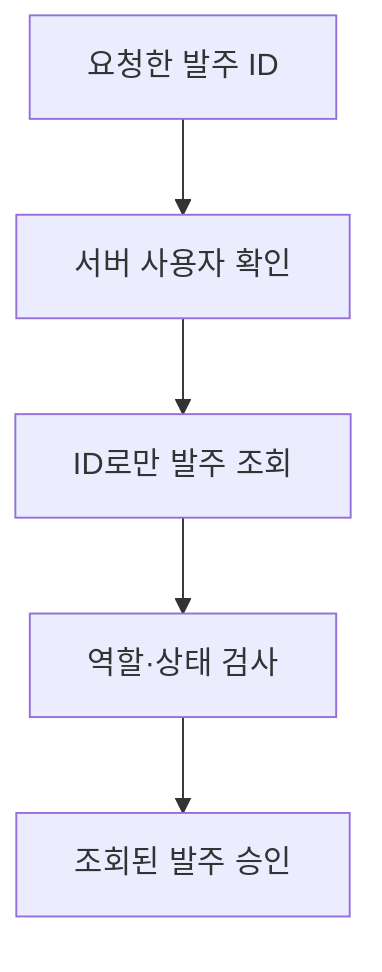

# 실습 4 — 회사 경계·디버깅: 다른 회사 발주가 승인되는 곳을 찾습니다

## 이번에 알아낼 것

관리자 권한과 발주 상태에 이어, 어느 회사의 발주를 처리할 수 있는지 확인합니다.

이번 절은 세 단계로 진행합니다.

1. 다른 회사 발주가 승인되는 문제를 확인합니다.
2. 원인을 따라가 회사 조회 조건 한 곳을 수정합니다.
3. 타회사 요청은 거부되고, 자기 회사 승인과 기존 역할·상태 검사는 유지되는지 확인합니다.

> **개발자:** A회사 관리자가 B회사 발주 번호를 알고 있다면 승인할 수 있나요?
>
> **업무 담당자:** 아니요. 관리자는 자기 회사의 승인 대기 발주만 승인할 수 있습니다.
>
> **설계 담당자:** 목록 조회뿐 아니라 승인 대상 조회에도 사용자 회사 범위를 적용하겠습니다. 거부한 요청은 발주 데이터를 바꾸면 안 됩니다.

**확정된 업무 기준:** 관리자 권한이 있어도 다른 회사 발주는 승인할 수 없습니다.

**구현 방침:** 서버가 확인한 사용자 회사와 발주 ID를 함께 사용해 승인 대상을 찾습니다.

회사별 데이터를 나누는 구조를 멀티테넌트라고 합니다. Chapter 3에서 확인한 조회의 회사 경계를
이번에는 데이터를 바꾸는 승인 처리에서도 확인합니다.

## 두 실습 화면을 구분합니다

제공된 화면 위의 **본 실습**과 **회사 경계 결함 실습** 버튼으로 두 실습을 오갑니다.
이제 **회사 경계 결함 실습**으로 이동합니다. 여기에는 회사 범위 조회가 빠진
코드가 준비되어 있습니다. 이번에는 정해진 기준을 위반하는 원인을 찾아 고칩니다.

| 이동 전에 알아둘 것 | 이번 실습의 범위 |
|---|---|
| 왜 이동하나요? | 본 실습에는 회사 차단이 제공됩니다. 회사 경계 결함 실습에는 조사할 결함이 준비되어 있습니다. |
| 무엇이 준비되어 있나요? | 결함 실습용 역할·상태 검사와 DB가 제공됩니다. 제공된 화면으로 요청합니다. |
| 무엇을 수정하나요? | 승인 대상을 찾는 조회의 회사 조건만 고칩니다. |

**본 실습**과 **회사 경계 결함 실습**은 같은 서버에서 실행되지만, 각각 별도의 승인 처리 코드와
DB·접속 정보를 사용합니다.
화면을 전환하면 이전 응답과 선택한 발주 표시가 비워집니다.
아래 순서대로 **회사 경계 결함 실습**을 선택하고, 데이터를 초기화한 뒤 사용자로 접속합니다.

## 결함을 직접 관찰합니다

A회사 관리자가 B회사 발주를 지정해도 승인되지 않아야 합니다. 준비된 구현이 이 기준을 지키는지 확인합니다.

1. **회사 경계 결함 실습**을 선택하고 초기화합니다.
2. **A회사 관리자로 접속**하고 **발주 메뉴 열기**를 누릅니다.
3. A회사 목록에 B회사 2001번이 표시되지 않는지 확인합니다.
4. **회사 경계 확인**의 **B회사 발주 승인 요청 보내기**를 누릅니다. 실제 응답 `200`을 확인합니다.
5. **B회사 관리자로 접속**하고 **발주 메뉴 열기**와 **2001 상세 조회**를 차례로 누릅니다.
6. 승인 완료, 처리 횟수 `1`로 바뀌었는지 확인합니다.


목록에 없던 발주도 ID를 지정해 요청할 수 있습니다. A회사 목록에서 B회사 발주를 숨긴 것만으로는
서버의 승인 처리를 막지 못했습니다. 회의에서 금지한 타회사 승인이 실제 데이터에 반영됐으므로 결함입니다.

## 수정부터 하지 말고 흐름을 찾습니다

```text
AGENTS.md와 README.md를 읽고 회사 경계 결함 실습의 원인을 조사하세요.
요청 전송 → 사용자 확인 → 발주 조회 → 역할·상태 검사 → 저장 순서로 정리하세요.
서버가 확인한 사용자 회사가 발주 조회 조건에 쓰이는지 확인하세요.
각 단계에서 회사 값이 어디에서 오는지도 함께 표시하세요.
각 단계의 파일·함수·검색어를 한 줄로 적고, 누락된 조건과 최소 수정 위치를 알려 주세요.
관찰 결과와 코드 근거를 구분하고, 찾지 못한 곳은 미확인으로 표시하세요.
코드 조사만 하고 파일 수정이나 명령 실행은 하지 마세요.
```

| 역할 | AI가 찾았어야 할 위치 | 직접 확인할 질문 |
|---|---|---|
| 제공된 화면과 응답 전달 | `frontend/app.js`, `frontend/transport.js` | 어떤 발주 ID로 승인 요청을 보내는가? |
| 서버 사용자 확인 | `backend/lab_auth.py`의 `current_user` | 사용자 회사는 어디에서 오는가? |
| 요청 연결 | `backend/app.py`의 `approve` | 회사 경계 결함 실습의 사용자·저장소를 어디에 전달하는가? |
| 승인 대상 조회 | `backend/defect_scope.py`의 `find_order` | ID 외에 사용자 회사도 조건에 쓰는가? |
| 역할·상태 판단 | `backend/defect_rules.py`의 `check_permission` | 두 검사만으로 회사 범위를 제한할 수 있는가? |
| 저장 | `backend/defect_approval.py`의 `approve_order` | 어떤 행의 회사로 갱신하는가? |

AI가 찾은 위치를 위 표와 비교하고 실제 조회 코드를 엽니다. 핵심은 **사용자 회사가 있는데도 조회에 사용하지 않는 위치**입니다.
다음은 회사 조건이 빠진 조회 부분입니다.

```python
def find_order(db, order_id, user):
    return db.execute(
        "SELECT * FROM orders WHERE id = ?", (order_id,)
    ).fetchone()
```

발주 ID만으로 찾으면 다른 회사 발주도 나옵니다. 뒤의 UPDATE에는 회사 조건이 있지만,
그 값은 **조회된 발주의 회사**입니다. 사용자가 그 회사에 접근해도 되는지 확인한 값이 아닙니다.
조건이 있다는 사실과 조건에 들어가는 값의 출처를 함께 봐야 합니다.




수정 전 결과는 그림 4-2·4-3의 예시와 비교합니다. 자신의 화면을 남기고 싶다면 캡처해도 좋습니다.
이후 시연에서는 이 예시 또는 실제 캡처와 수정 후 실행을 구분해 보여 줍니다.
HTTP `200`과 데이터 변경을 업무 기준에 비추어 보고, 요청부터 저장까지 따라가며 원인을 좁힙니다.
승인 대상은 **서버가 확인한 사용자 회사**로 제한해야 합니다.
AI가 안내한 조회 코드에서 그 회사 값이 조회 조건으로 전달되는지 확인하세요.

## AI에게 최소 수정을 요청합니다

확인한 원인을 바탕으로 AI에게 회사 조건만 보완하도록 요청합니다.

```text
AGENTS.md와 README.md를 읽고 다른 회사 발주가 승인되는 원인을 조사하세요.
변경할 파일과 이유를 짧게 알린 뒤 다음 기준에 맞게 수정하세요.

- 서버 세션에서 확인한 사용자 회사와 발주 ID로 승인 대상을 찾으세요.
- 다른 회사와 없는 발주는 모두 404와 '발주를 찾을 수 없습니다.'로 응답하세요.
- 거부 응답에는 발주 내용을 넣지 않고, 대상 상태·처리 횟수를 유지하세요.
- 자기 회사 정상 승인과 기존 역할·상태 검사를 유지하세요.

이번에는 승인 대상을 찾는 회사 조건만 수정하세요.
```

예상 변경은 `backend/defect_scope.py` 한 곳입니다.
서버가 확인한 사용자 회사와 발주 ID를 함께 쓰는지 변경 내용을 확인합니다.
타회사 발주와 없는 발주에 같은 `404`를 보내면, 오류 응답만으로 타회사 발주의 존재를 구별하기 어렵습니다.

## 초기화하고 같은 요청을 다시 보냅니다

수정 전 요청으로 B회사 발주가 이미 승인됐습니다. 상태 거부와 회사 거부를 혼동하지 않도록
**회사 경계 결함 실습**에서 **실습 데이터 초기화**를 누릅니다. 수정한 코드는 유지됩니다.

1. **A회사 관리자로 접속**하고 **발주 메뉴 열기**를 누른 뒤 **B회사 발주 승인 요청 보내기**를 누릅니다.
2. `404`와 `발주를 찾을 수 없습니다.`를 확인합니다. 대상 발주 내용이 없어야 합니다.
3. **B회사 관리자로 접속**하고 **발주 메뉴 열기**와 **2001 상세 조회**를 차례로 누릅니다.
4. 승인 대기, 처리 횟수 `0`인지 확인합니다. 거부 응답과 실제 데이터 유지를 함께 확인한 것입니다.


이어서 같은 회사 경계 결함 실습에서 자기 회사 승인과 기존 역할·상태 검사가 유지되는지 확인합니다.

1. **A회사 관리자로 접속**하고 메뉴·1001번 상세를 엽니다. **승인 요청 직접 보내기**를 눌러 `200`, 승인 완료, 횟수 `1`을 확인합니다.
2. 다시 직접 요청을 보냅니다. `409`와 승인 완료·횟수 `1` 유지를 확인합니다.
3. **A회사 조회 담당자로 접속**하고 메뉴·1001번 상세를 엽니다. 조회가 가능하고, 직접 요청은 `403`으로 거부되며 승인 완료·횟수 `1`이 유지되는지 확인합니다.

## AI 검증과 완료

앞에서 화면으로 확인한 동작을 AI가 요청과 코드로 다시 확인하게 합니다.
회사 경계 결함 실습을 먼저 확인한 뒤, 본 실습에서도 다른 회사 발주를 계속 막는지 확인합니다.

### 회사 경계 결함 실습의 수정 결과를 검증합니다

수정 후 A회사 관리자의 B회사 발주 승인 요청은 `404`로 거부되어야 합니다.
B회사 관리자로 다시 조회한 2001번은 승인 대기·처리 횟수 `0`이어야 합니다.
거부 응답과 대상 데이터 유지를 함께 확인한 뒤 아래 프롬프트를 그대로 실행합니다.

```text
AGENTS.md를 읽고, 수정을 마친 회사 경계 결함 실습에서
다음 동작이 지켜지는지 직접 확인해 주세요. 이번에는 회사 경계 결함 실습만 확인합니다.

1. A회사 관리자가 B회사 발주를 승인하려 하면 거부되고,
   B회사 발주의 상태와 승인 처리 횟수는 바뀌지 않아야 합니다.
2. A회사 관리자는 자기 회사 발주를 승인할 수 있어야 합니다.
3. 이미 승인한 발주를 다시 승인하면 거부되어야 합니다.
4. 조회 담당자는 발주를 볼 수 있지만 승인할 수 없어야 합니다.

코드는 수정하지 마세요.
확인한 결과와 확인하지 못한 항목을 짧게 알려 주세요.
다른 회사의 발주를 막는 코드 한 곳도 짚어 주세요.
```

AI 피드백에서 **회사 조건만 수정했는지, 거부 뒤 데이터가 유지됐는지, 정상 승인은 가능한지**를
확인합니다. 실행하지 않은 사례는 `Not Run`으로 남깁니다.

### 본 실습의 회사 차단이 유지되는지 확인합니다

이번 수정 결과는 회사 경계 결함 실습에서 확인했습니다. **본 실습**의 회사 차단이 유지되는지도
별도로 확인합니다. 앞에서 되던 동작을 다시 확인하는 것을 회귀 검증이라고 합니다.
본 실습에는 B회사 대상 요청 버튼이 없으므로 아래 요청으로 AI에게 로컬 API 실행을 맡깁니다.

```text
AGENTS.md를 읽고, 이번에는 본 실습에서 다음 순서로 직접 확인해 주세요.

1. B회사 관리자로 2001번 발주의 상태와 승인 처리 횟수를 조회합니다.
2. A회사 관리자로 바꾸어 같은 발주에 승인 요청을 보냅니다.
   발주를 찾을 수 없다는 응답으로 거부되고, 발주 내용은 보이지 않아야 합니다.
3. B회사 관리자로 다시 조회했을 때 상태와 처리 횟수가 처음과 같아야 합니다.

코드는 수정하지 마세요.
확인한 결과와 확인하지 못한 항목을 짧게 알려 주세요.
```

보고에서 **본 실습·A회사 관리자·2001번 요청·404 응답**이 맞는지 확인합니다.
B회사 관리자의 요청 전후 재조회 값도 같아야 합니다. 코드 조사만 했다면 실행 결과로 인정하지 않습니다.

### 코드 근거를 확인하고 마칩니다

AI가 안내한 회사 경계 결함 실습의 `find_order`를 엽니다. 조회 조건에 발주 번호와
서버 사용자 회사가 함께 쓰이는지 확인한 뒤 마칩니다.

- [ ] 회사 조건 누락을 찾아 수정한 뒤, 타회사 요청 404와 대상 상태·횟수 유지를 확인했습니다.
- [ ] 자기 회사 정상 승인, 역할·상태 거부와 본 실습의 회사 차단도 확인했습니다.

**이번에 배운 것:** 역할 검사와 회사 범위 검사는 서로 다릅니다. 조회에 쓴 회사 값이 요청에 적힌 값인지, 서버가 확인한 사용자 회사인지 확인해야 합니다.


## 완료한 규칙을 조합해 확인합니다

다음 표는 **4.4까지 완료한 본 실습과 회사 조건을 수정한 회사 경계 결함 실습**의 승인 API 기대 결과입니다.
기대값은 실행 기록이 아닙니다. 추가로 확인할 때는 실습 화면 하나를 정하고, 각 행을 초기 데이터에서
따로 시작합니다. 초기화 후에는 선택한 실습에서 사용자를 다시 선택합니다.

| 접속 사용자 | 대상 발주·회사·시작 상태 | 기대 응답 | 처리 후 확인 |
|---|---|---:|---|
| 미접속 | 1001·A·승인 대기 | `401` | 상태·횟수 유지 |
| A회사 관리자 | 1001·A·승인 대기 | `200` | 승인 완료·횟수 1 |
| A회사 관리자 | 1002·A·승인 완료 | `409` | 승인 완료·횟수 1 유지 |
| A회사 조회 담당자 | 1001·A·승인 대기 | `403` | 승인 대기·횟수 0 유지 |
| A회사 조회 담당자 | 1002·A·승인 완료 | `403` | 승인 완료·횟수 1 유지 |
| A회사 관리자 | 2001·B·승인 대기 | `404` | 대상 내용 비노출·상태와 횟수 유지 |
| A회사 조회 담당자 | 2001·B·승인 대기 | `404` | 대상 내용 비노출·상태와 횟수 유지 |
| A회사 관리자 | 9999·없는 발주 | `404` | '발주를 찾을 수 없습니다.'·데이터 변화 없음 |
| A회사 조회 담당자 | 9999·없는 발주 | `404` | '발주를 찾을 수 없습니다.'·데이터 변화 없음 |
| B회사 관리자 | 2001·B·승인 대기 | `200` | 승인 완료·횟수 1 |

이 장의 흐름은 **접속 확인 → 자기 회사 발주 조회 → 역할 검사 → 상태 검사 → 저장**입니다.
따라서 조회 담당자가 자기 회사의 승인 완료 발주에 요청해도 상태 검사 전에 `403`으로 멈춥니다.
타회사·없는 발주는 역할 검사 전에 같은 `404`와 '발주를 찾을 수 없습니다.'로 응답합니다.
검사 순서는 이 키트의 기준이며, 모든 시스템에서 같은 응답을 우선한다는 뜻은 아닙니다.

화면에서 가능한 사례는 **승인 요청 직접 보내기**로 확인합니다. 미접속·없는 ID·본 실습의
타회사 요청은 AI에게 선택한 실습의 로컬 API 실행을 맡깁니다. 미접속은 세션 없이, 나머지는
표의 사용자 세션으로 요청하고, 대상 데이터는 소유 회사 사용자로 재조회합니다.
AI에게 실습 이름·사용자·대상 ID·실제 응답·재조회 값을 표와 대조하게 하세요. 미실행은 `Not Run`으로,
기대와 다른 결과는 차이와 코드 근거로 보고받습니다. 수정이 필요하면 위치와 이유부터 확인합니다.

### 선택 실행: 승인 API를 한 번에 검증합니다

4.4까지 구현한 뒤에는 다음 명령으로 위 표의 10개 사례를 두 실습에서 각각 확인할 수 있습니다.
각 실습에서 쿼리와 요청 본문의 `corp_id`를 B회사로 보내도 타회사 접근이 차단되는지 2개씩
추가해, 모두 24개 사례를 실행합니다. 회사·역할은 계속 서버 세션을 기준으로 판단해야 합니다.

```powershell
.\.venv\Scripts\python.exe .\verify_business_rules.py
```

이 도구는 현재 코드를 임시 폴더로 복사해 별도 서버·DB·세션을 사용합니다. 각 사례는
초기 데이터에서 시작하며, 현재 실습 데이터와 실행 중인 서버는 유지합니다. 실행 후에는
이번 검증이 만든 임시 서버와 파일을 정리합니다. 시작본·중간 단계에 완성 기준 통과를 요구하지 않습니다.

`RESULT`에서 `Pass=24 Fail=0 Not Run=0`과 종료 코드 `0`을 확인하면 전체 통과입니다.
`FAIL`이면 첫 실패 행의 실습 이름·사용자·발주·기대값·실제값을 비교하세요. 잘못된 응답 형식도 실패로 표시합니다.
`NOT RUN`이면 표시된 환경·DB 조회·서버 오류부터 확인합니다. 가상환경의 Python으로 실행했는지도 확인하세요.
종료 코드는 통과 `0`, 기준 실패 `1`, 환경·미실행 문제 `2`입니다. 서버 준비·정리 오류가 있으면 통과로 보지 않습니다.
문제를 고친 뒤 같은 명령을 다시 실행합니다. 검사 기준은 유지하고, 화면 버튼 제한은 직접 확인합니다.
동시 요청과 저장 실패 시험은 이번 자동 검증 범위에 포함되지 않습니다.

확인할 대상에 따라 다음 방법을 사용합니다.

| 확인할 대상 | 확인 방법 |
|---|---|
| 일반 승인 버튼 제한·안내 문구 | 앞에서 직접 확인한 화면 결과 |
| 요청의 응답과 저장된 상태·횟수 | 실제 API 요청과 DB 재조회 |
| 제공 파일의 변경 여부 | `verify_observation.py` |
| 완성한 업무 규칙 24개 사례 | `verify_business_rules.py` |

> **[심화 학습 프롬프트]**
>
> ```text
> AGENTS.md와 현재 ch04 코드를 읽고, 관리자·자기 회사·승인 대기 정상 승인과
> 조회 담당자·자기 회사·승인 완료 거부를 pytest 테스트로 옮기면 어떤 모습인지 설명해 주세요.
> 각 사례에 준비할 사용자·발주, 승인 요청, 응답과 DB 재조회에 대한 단언문을 예시로 보여 주세요.
> 실제 앱의 연결 방식과 API를 조사하고, 임시 SQLite DB로 실습 DB와 분리하는 방법도 설명하세요.
> 이어서 위 조합 표를 매개변수화해 같은 테스트를 여러 입력으로 실행하는 방법을 알려 주세요.
> 파일과 실습 데이터를 변경하거나 테스트를 실행하지 마세요. 예시는 실행 검증 결과와 구분하세요.
> ```
