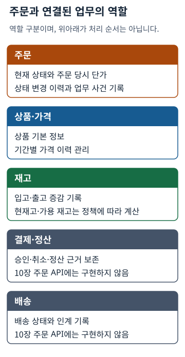
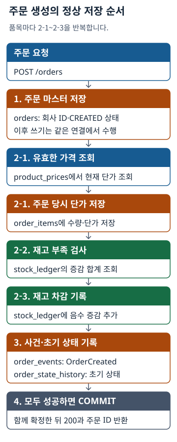
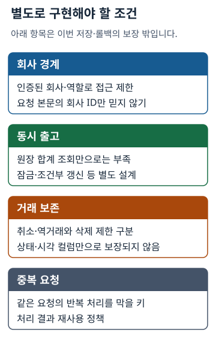
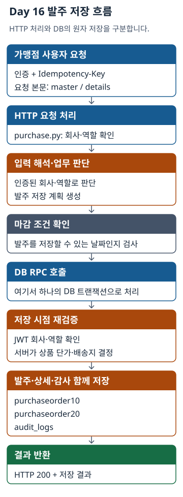

# Chapter 10 설계·심화 참고

[10장 Core로 돌아가기](../README.md#return-to-book)

Core 완료 후 설계 비교와 아키텍처를 더 살펴볼 때 사용합니다. 읽기용 DDL을 Core DB에 실행하지 않습니다.

**선택 설계 예시: 10.4.1 원칙의 적용 전후**

아래 DDL은 읽기용 비교 예시입니다. Core DB에 실행하지 않습니다.

```sql
-- AI가 생성한 전형적인 멀티테넌트 고려 없는 테이블 DDL
CREATE TABLE orders (
    order_id UUID PRIMARY KEY,
    order_status TEXT NOT NULL
);
```

```sql
CREATE TABLE orders (
    order_id UUID PRIMARY KEY,
    corp_id UUID NOT NULL, -- 주문의 소속 회사 식별자를 필수로 저장
    order_status TEXT NOT NULL
);

-- 회사별 주문 조회를 돕는 인덱스. 접근 권한을 검사하지는 않음
CREATE INDEX idx_orders_corp_order ON orders (corp_id, order_id);
```

---

**선택 심화: 10.4.1 원칙의 확장**

> [!NOTE]
> **[2권 예고]**
>
> **행 단위 보안(Row-Level Security, RLS)**은 정책에 따라 읽거나 변경할 수 있는 행을 제한합니다.
> 정책뿐 아니라 활성화 여부와 인증 정보 전달 방식도 확인합니다. 테이블 소유자나 우회 권한이 있는
> 역할에는 일반적인 제한이 적용되지 않을 수 있으므로, 실제 DB 실행 역할도 확인해야 합니다.
>
> **[심화 학습 프롬프트]**
> ```text
> PostgreSQL의 Row-Level Security(RLS)가 무엇이고,
> 멀티테넌트 SaaS 환경에서 애플리케이션의 WHERE 조건문
> 필터링 방식과 비교했을 때 어떤 아키텍처적 장단점을
> 가지는지 설명해줘. (개발 환경: Python + FastAPI + Supabase)
> ```

---

**선택 설계 예시: 10.4.2 원칙의 적용 전후**

아래 DDL은 읽기용 비교 예시입니다. Core DB에 실행하지 않습니다.

```sql
-- AI가 생성한 전형적인 스냅샷이 누락된 주문 상세 테이블 DDL
CREATE TABLE order_items (
    order_item_id UUID PRIMARY KEY,
    order_id UUID NOT NULL,
    product_id UUID NOT NULL,
    quantity INT NOT NULL
);
```

```sql
-- 1단계: 상품 단가 변동을 추적하는 product_prices 테이블 분리
CREATE TABLE product_prices (
    product_price_id UUID PRIMARY KEY,
    product_id UUID NOT NULL,
    price NUMERIC NOT NULL,
    valid_from TIMESTAMP NOT NULL,
    valid_to TIMESTAMP
);

-- 2단계: 주문 당시 단가를 저장하는 price_snapshot 추가
CREATE TABLE order_items (
    order_item_id UUID PRIMARY KEY,
    order_id UUID NOT NULL,
    product_id UUID NOT NULL,
    quantity INT NOT NULL,
    price_snapshot NUMERIC NOT NULL -- 주문 발생 당시의 단가를 1회성으로 기록
);
```

---

**선택 심화: 10.4.2 원칙의 확장**

> [!NOTE]
> **[2권 예고]**
>
> 주문과 정산을 별도 서비스로 나눌 때도 각 거래의 단가를 보존해야 합니다. 다른 서비스의 현재 상품 가격을 다시 조회하지 않고 과거 금액을 확인하는 근거가 됩니다.
>
> **[심화 학습 프롬프트]**
> ```text
> 이 장의 스냅샷은 주문 당시 단가를 상세에 복사해 보존하는 뜻입니다.
> 주문과 정산을 별도 서비스로 나눴을 때, 현재 상품 가격 대신
> 저장된 주문 단가를 사용해야 하는 이유를 예로 설명해줘.
> 가격 이력과 주문 단가 보존의 역할도 구분해줘.
> (개발 환경: Python + FastAPI + Supabase)
> ```

---

**선택 설계 예시: 10.4.3 원칙의 적용 전후**

아래 DDL은 읽기용 비교 예시입니다. Core DB에 실행하지 않습니다.

```sql
-- AI가 생성한 전형적인 UPDATE 기반의 재고 관리 테이블
CREATE TABLE products (
    product_id UUID PRIMARY KEY,
    stock_quantity INT NOT NULL
);
```

```sql
-- 주문 발생 시점의 재고 차감 로직
UPDATE products 
SET stock_quantity = stock_quantity - 2 
WHERE product_id = 'aaaaaaaa-aaaa-aaaa-aaaa-aaaaaaaaaaaa';
```

```sql
-- 변경 이력만 계속 쌓아나가는 Append-Only 수불부 원장(Ledger) 테이블 설계
CREATE TABLE stock_ledger (
    ledger_id UUID PRIMARY KEY,
    product_id UUID NOT NULL,
    quantity_change INT NOT NULL, -- 입고는 양수(+), 출고/주문은 음수(-)
    created_at TIMESTAMP DEFAULT CURRENT_TIMESTAMP
);

-- 현재 재고 파악은 원장의 모든 증감 이력을 합산
SELECT product_id, SUM(quantity_change) AS current_stock
FROM stock_ledger
WHERE product_id = 'aaaaaaaa-aaaa-aaaa-aaaa-aaaaaaaaaaaa'
GROUP BY product_id;
```

---

**선택 심화: 10.4.3 원칙의 확장**

> [!NOTE]
> **[2권 예고]**
>
> **CQRS(명령-조회 책임 분리)**는 변경 처리와 조회의 모델을 나누는 설계입니다.
> 조회에 맞는 요약 데이터를 둘 수 있지만, 합계 뷰만으로 CQRS 전체가 구현되지는 않습니다.
> 캐시와 분산 락도 갱신·장애·재시도 정책이 있어야 하며, 동시성 안전성이나 처리량을 자동으로 보장하지 않습니다.
>
> ```sql
> -- Read Model 예시: 재고 현황을 빠르게 조회하기 위한 Materialized View
> CREATE MATERIALIZED VIEW mv_stock_summary AS
>     SELECT product_id, SUM(quantity_change) AS current_stock
>     FROM stock_ledger GROUP BY product_id;
> -- Materialized View는 자동 갱신되지 않으므로 갱신 주기와 지연 허용 범위를 정해야 합니다.
> ```
>
> **[심화 학습 프롬프트]**
> ```text
> 데이터베이스의 쓰기 모델(Write Model)과 읽기
> 모델(Read Model)을 분리하는 CQRS 패턴이 대규모
> 동시성 재고 시스템에서 어떤 조회 이점을 주는지 설명해줘.
> 캐시의 갱신 지연과 분산 락의 실패·만료 조건까지 고려해,
> 재고 무결성을 별도로 지켜야 하는 이유도 설명해줘.
> (개발 환경: Python + FastAPI + Supabase)
>
> ```

---

**선택 심화: 동시 출고 제어 비교**

> **[심화 학습 프롬프트]**
> ```text
> 재고 10개에 8개 주문 두 건이 동시에 들어올 때,
> SELECT ... FOR UPDATE 잠금과 조건부 UPDATE가 각각
> 어떻게 초과 출고를 막는지 비교해줘.
> PostgreSQL의 격리 수준(Read Committed, Serializable)에서
> 이 문제가 어떻게 달라지는지, 충돌로 실패한 요청을
> 재시도해야 하는 경우는 언제인지도 설명해줘.
> (개발 환경: Python + FastAPI + Supabase)
> ```

---

**선택 설계 예시: 10.4.4 원칙의 적용 전후**

아래 DDL은 읽기용 비교 예시입니다. Core DB에 실행하지 않습니다.

```sql
-- 주문 데이터 삭제 API에 대응하는 AI의 DELETE SQL
DELETE FROM orders 
WHERE order_id = '22222222-2222-2222-2222-222222222222';
```

```sql
-- 1단계: 주문 상태와 논리 삭제 시각을 저장할 컬럼 정의
CREATE TABLE orders (
    order_id UUID PRIMARY KEY,
    corp_id UUID NOT NULL,
    order_status TEXT NOT NULL CHECK (order_status IN ('CREATED', 'PAID', 'CANCELLED', 'SHIPPED')),
    created_at TIMESTAMP DEFAULT CURRENT_TIMESTAMP,
    deleted_at TIMESTAMP -- Soft Delete용 논리 삭제 시각 기록 컬럼
);

-- 2단계: 행을 지우지 않고 주문의 취소 상태 기록
UPDATE orders 
SET order_status = 'CANCELLED'
WHERE order_id = '22222222-2222-2222-2222-222222222222';
```

---

**선택 심화: 10.4.4 원칙의 확장**

> [!NOTE]
> **[2권 예고]**
>
> 이벤트 기록은 감사와 후속 처리의 근거입니다. **이벤트 소싱**은 이벤트를 기준 기록으로 삼아
> 상태를 재구성하는 설계입니다. **Saga**는 여러 서비스의 업무 단계를 조정하고 실패 시 보상 동작을
> 실행하는 방식입니다. 로그 테이블을 추가하는 것만으로 이 두 설계가 구현되지는 않습니다.
>
> **[심화 학습 프롬프트]**
> ```text
> 보존 대상 거래의 삭제 제한, Transactional Outbox,
> 이벤트 소싱(Event Sourcing), Saga가 각각 해결하는 문제를 설명해줘.
> 취소 기록만 저장한 경우와 재고·금액을 보상한 경우의 차이를 예로 들고,
> 각 설계에 추가로 필요한 권한 통제·재시도·중복 처리를 구분해줘.
> (개발 환경: Python + FastAPI + Supabase)
> ```

---

<a id="ch10-principle-prompts"></a>

**원칙별 추가 질문 (선택)**

필수 검토를 마친 뒤 더 확인하고 싶은 원칙만 고릅니다. 같은 AI 대화에서 해당 질문을 보내고,
10.4.1~10.4.4의 핵심 구분과 실제 관찰값을 대조합니다. 새 대화라면 Step 9의 검증 프롬프트와 관찰값부터 전달하세요.

> **참고: AI 프롬프트 - Multi-Tenant 검증**
>
> ```text
> 주문의 회사 소속이 어떻게 구분되는지 조사하세요.
> NOT NULL·외래 키·인덱스의 역할과 접근 통제를 구분하고, 요청 본문의 회사 ID를
> 인증된 회사로 제한하는 코드와 RLS 정책이 있는지 확인하세요.
> 없는 기능을 있다고 가정하지 마세요. 존재하지 않는 회사 ID의 FK 오류는 접근 차단의 증거가 아닙니다.
> ```

> **참고: AI 프롬프트 - Price Snapshot 검증**
>
> ```text
> 주문 단가가 DB의 유효한 가격으로 정해져 상세에 복사되는지, 과거 주문 금액 계산에
> 그 값을 쓰는지 조사하세요. 조회·정산 기능이 없으면 미구현이라고 보고하세요.
> 가격 이력 보존, 스냅샷 보존, 스냅샷 변경 제한을 구분하세요.
> Step 7의 가격 변경 관찰 결과가 있으면 코드 근거와 대조하고, 없으면 Not Run으로 쓰세요.
> ```

> **참고: AI 프롬프트 - Stock Ledger 검증**
>
> ```text
> 원장의 증감 기록, 과거 이력의 수정·삭제 제한, 초과 출고 제어를 구분하세요.
> 현재고 UPDATE를 쓴다는 이유만으로 결함으로 판정하지 마세요.
> 재고 10개에 8개 주문 두 건이 동시에 들어오는 실행 순서를 분석하되,
> 코드 분석은 동시성 테스트가 아닙니다. 단일 요청의 성공·롤백과 동시 출고 안전성을 따로 판정하세요.
> ```

> **참고: AI 프롬프트 - No-Delete 검증**
>
> ```text
> 주문 취소 상태, 논리 삭제 표시, 확정 효과를 되돌리는 역거래를 구분하세요.
> 취소 API와 DELETE·UPDATE 차단이 실제 구현되어 있는지, RESTRICT·CASCADE가 어떤 행에
> 영향을 주는지 조사하세요. 상태 컬럼만으로 삭제 차단을 구현했다고 판정하지 말고,
> 미구현 기능을 새로 만들지는 마세요.
> ```

---

**선택: 이벤트 저장과 외부 전달**

> [!NOTE]
> **[2권 예고]**
>
> 주문 변경과 전송할 이벤트를 같은 DB 트랜잭션에 기록하고, 별도 전달기가 외부로 보내는 설계를 **Transactional Outbox(트랜잭셔널 아웃박스)**라고 합니다. 이 예제는 이벤트를 함께 저장하는 부분만 보여주며 전달기는 구현하지 않습니다.
> DB 저장 성공이 외부 전송 성공을 뜻하지는 않습니다. 실제 전달에는 재시도, 중복 전달에 대한 소비자의 멱등 처리와 전송 상태 관리가 필요합니다. 이벤트 행을 INSERT하는 것만으로 전송 신뢰성까지 보장됐다고 판단해서는 안 됩니다.
>
> **[심화 학습 프롬프트]**
> ```text
> Transactional Outbox에서 DB 변경과 이벤트 기록을 원자적으로
> 저장하는 범위와, 외부 전달 시 재시도·중복 처리가 필요한 이유를
> 구분해줘. Message Relay의 Polling Publisher와 Transaction Log
> Tailer 방식도 비교해줘.
>
> ```

---

**선택: 서비스별 DB와 보상 처리**

> [!NOTE]
> **[2권 예고]**
>
> 이번에 확인한 **원자성**은 트랜잭션의 네 가지 성질인 ACID 중 하나입니다. 여러 쓰기를 함께 확정하거나, 실패하면 함께 취소하는 성질입니다.
> 
> 서비스별로 DB를 나누면 하나의 커밋으로 전체 업무를 확정할 수 없습니다. 주문은 저장됐는데 재고 처리가 실패했을 때 어떤 보상 동작을 할지 별도로 설계해야 합니다.
>
> **[심화 학습 프롬프트]**
> ```text
> 서비스별 DB가 분리된 마이크로서비스(MSA) 환경에서
> 한 DB의 ACID 트랜잭션으로 여러 DB의 변경을 함께 확정할 수 없는 이유를 설명해줘.
> Saga의 Choreography와 Orchestration 방식이 업무 단계를 조정하고,
> 실패 시 보상 동작을 실행하는 흐름을 비교해줘.
> 보상 실패·재시도와 중복 처리도 고려해 최종 일관성을 유지하려면
> 어떤 조건이 필요한지 설명해줘.
> ```

---

### 업무별 데이터 모델 로드맵

다음 표는 주문 외의 업무로 확장할 때 보존할 기록과 학습 위치를 정리한 것입니다. 예시 테이블명은 실제 Day 스키마와 구분해 읽습니다.

| 분류 | 보존할 데이터 | 목적 | 진행 단계 |
| :--- | :--- | :--- | :--- |
| **핵심** | `orders`, `order_items` | 원본 주문과 주문 당시 단가 보존 | **[본 장] Ch.10 완료** |
| **정산** | `payments`, `settlements` 같은 개념 모델 | 승인·취소·수수료·정산 | 1권 Day 15·22·24에서 실제 정산 테이블과 업무를 학습, 2권에서 재설계 |
| **물류** | `shipments`, `deliveries` 같은 개념 모델 | 배송 상태와 입고 인계 | 1권 Day 13·14·17·18에서 학습, 2권에서 재설계 |
| **사고** | `refunds`, `returns` 같은 개념 모델 | 반품·취소 등 역흐름 | 1권 Day 19에서 반품 요청·승인 학습, 2권에서 재설계 |
| **감사** | `order_events`, `audit_logs` | 업무 변화 추적 | 10장 이벤트·초기 이력 체험, Day 16·17에서 실제 감사 기록 확인 |

업무가 달라져도 현재 상태, 변경 근거와 실패 처리 범위를 구분해 읽습니다.

---

### [아키텍트 심화] AI 공격 및 교정 훈련 (AI를 리드하는 법)

> **[선택 읽기]** 잘못된 요청에 AI가 어떤 결정을 하는지 검토하는 예시입니다.

원칙과 어긋나는 요청을 예로 들어 결과를 검토합니다. 실제 데이터의 변경·삭제를 실행하지 않고, 개선안과 검증 방법을 먼저 확인합니다.

#### 관찰 결과로 수정 요청하기: 원인 조사와 최소 수정

AI 결과가 예상과 다르면 역할을 강하게 반복하기보다 실패한 사실과 범위를 전달합니다.

1. **1단계 — 차이 설명**: “두 번째 품목 저장 실패 실험을 실행했는데 첫 번째 품목의 원장이 남았어.
   기대 결과는 관련 쓰기의 전체 롤백이야. 현재 파일에서 원인과 근거를 조사하고 아직 수정하지 마.”
2. **2단계 — 최소 수정 요청**: “조사한 원인과 변경 파일을 확인했어. 승인한 범위에서 수정하고,
   같은 요청의 실패 전후 조회로 재검증해줘. 미실행은 Not Run으로 남겨줘.”

첫 문장의 관찰 결과는 형식 예시입니다. 실제로 원장이 남지 않았다면 남았다고 전달하지 않습니다.
연결 문자열이나 오류 전문 전체를 복사하지 않고 재현 요청·응답 코드·필요한 조회값만 공유합니다.

#### 공격 1 (History 파괴 시도)

- **공격 (점주)**: “상품 가격이 4,000원으로 올랐어. UPDATE SQL 짜줘.”
- **교정 (아키텍트)**: “주문 금액은 저장된 스냅샷을 유지하고, 상품 가격 이력은 기존 유효기간을 마감한 뒤 새 행으로 추가해줘. 가격 이력 보존과 과거 주문 금액 보존을 구분하고, 변경 후 기존 주문 금액이 유지되는지 검증해줘.”

#### 공격 2 (No Delete 위반 시도)

- **공격 (점주)**: “123번 주문 테이블에서 완벽하게 지워줘. DELETE SQL 짜줘.”
- **교정 (아키텍트)**: “보존 대상 거래의 원본과 취소 근거가 남아야 해. 현재 취소·역거래 기능과 삭제 제한을 조사하고, 상태 변경만으로 충분한지 설명해줘. DB 변경이나 삭제는 실행하지 말고 먼저 최소 변경안을 제시해줘.”

> **[오류를 근거로 질문하기]**
>
> 오류 종류와 제약 이름을 실제 스키마에서 확인한 뒤, 필요한 부분만 AI에게 전달합니다.
>
> - **예시**: `violates check constraint`와 실제 응답에 표시된 제약 이름을 확인합니다.
> - **해석**: 상태값 CHECK 위반이라면 스키마의 허용 목록과 요청값을 비교합니다. 수량 CHECK와 혼동하지 않습니다.
> - **AI 피드백**: “실제 응답의 제약 이름과 요청값은 다음과 같아. 저장소의 제약 정의를 찾아 원인과 최소 수정 범위를 설명해줘. 아직 파일이나 DB는 바꾸지 마.”

---

### [아키텍트 심화] 데이터 모델 안티패턴(Anti-Pattern) 10대 자가 진단 프롬프트

완주 후 아래 10가지 항목을 더 검토하고 싶을 때 사용합니다. AI가 저장소에서 DDL·API·권한·테스트를
직접 조사하게 합니다. 구현 여부, 수동 실습 결과와 업무 자동 테스트 현황을 나눠 읽으세요.

```text
[역할]
너는 엔터프라이즈 커머스/ERP 시스템의 비즈니스
안정성을 검증하는 시니어 데이터베이스 감사관이다.

[미션]
AGENTS.md와 저장소에서 스키마·API·권한·관련 테스트를 직접 조사하여
아래 10가지 데이터 설계 항목을 진단하고,
발견된 문제점과 최소 개선안을 제시하라. 파일을 수정하거나 DB에 접속하지 말고,
.env·연결 문자열·비밀값은 읽거나 출력하지 말라.
구현 여부와 실행 결과를 구분하라. 수동 실습은 제공된 관찰값에 따라 Pass·Fail·Not Run으로 판정하라.
업무 자동 테스트는 없으면 테스트 없음, 있으면 제공된 실행 근거에 따라 Pass·Fail·Not Run으로 별도 보고하라.

[10대 안티패턴 진단 리스트]
1. 단가 마스터 이력 누락
   (가격 정책 변동 추적 곤란. 과거 주문 금액 보존은 스냅샷으로 별도 확인)
2. 주문 아이템 스냅샷 단가 누락
   (과거 주문을 현재 상품 단가로 계산하면 가격 변경 후 정산 결과가 달라질 위험)
3. 재고 부족 조건·동시성 제어 또는 증감 기록 누락
   (초과 출고와 추적 곤란을 구분. UPDATE 자체를 결함으로 판정하지 않음)
4. 보존 대상 거래의 물리 DELETE 허용
   (원본 거래와 취소 근거를 잃을 위험. 취소 상태 기록과 삭제 차단을 구분)
5. 허용 상태값 검사 누락
   (오타·대소문자 혼용 위험. TEXT 자체를 결함으로 판단하지 않고 전환 순서 검사는 별도 확인)
6. 주문의 회사 소속을 식별할 관계 또는 접근 검사 누락
   (직접 회사 ID나 부모 참조를 확인하고, 인증된 회사 범위로 제한하는지 별도 검사)
7. 외래 키(Foreign Key) 제약조건 생략
   (고아 데이터 발생으로 인한 데이터 참조 무결성 붕괴 위험)
8. 생성/수정 시간(Timestamps) 메타데이터 누락
   (발생·변경 시점을 확인하기 어려워 장애 조사에 필요한 근거가 부족할 위험)
9. 비즈니스 라이프사이클 이벤트 로그 누락
   (사건 추적과 후속 처리의 근거 부족. 외부 전달이 필요하면 전달 상태와 재시도도 별도 확인)
10. 민감 설정 변경에 대한 감사 로그(Audit Log) 부재
    (수행자·시각·변경 근거를 확인하기 어려워 문제 원인과 책임을 조사하기 힘들 위험)

[출력 포맷]
- 안티패턴 검출 요약표
  (안티패턴 번호 / 검출 여부 / 위험 수준)
- 항목별 파일·코드 근거, 최소 개선 범위, 독자가 확인할 한 곳
- 구현 상태와 수동 실습 결과(Pass / Fail / Not Run)를 별도 표기
- 업무 자동 테스트 현황은 별도 항목에 표기(테스트 없음 또는 Pass / Fail / Not Run과 실행 근거)
```

---

### [아키텍트 심화] 데이터 모델 AI 검증 프롬프트 (8가지 검토 기준)

완주 후 데이터 모델을 8가지 관점으로 검토하는 선택 질문입니다. 특정 기업의 공식 기준은 아닙니다.
AI가 완성한 작업 폴더의 DDL·코드·권한과 내 관찰값을 함께 조사하게 합니다.

```text
[역할]
너는 ERP 데이터 모델을 검토하는 시니어 개발자이다.

[미션]
AGENTS.md와 저장소에서 실제 스키마·API·권한·관련 테스트를 직접 조사하라.
파일을 수정하거나 DB에 접속하지 말고 .env·비밀값을 읽거나 출력하지 말라.
아래 8가지 기준별로 구현 상태, 수동 실습 결과와 확인된 범위를 구분하라.
업무 자동 테스트 현황은 별도로 보고하고, 자동 테스트 부재를 수동 실습 결과에 적용하지 말라.
원고의 예상 판정을 정답으로 가정하지 말고 실제 근거로 판단하라.

[8가지 검토 기준]
1. 멀티테넌트(Tenant) 격리:
   직접 식별자나 부모 참조로 회사 소속이 식별되고,
   인증된 회사 범위로 접근을 제한하는가?
   인덱스와 NOT NULL만으로 격리가 보장된다고 판단하지 말 것.
2. 데이터 불변성(Immutability):
   보존 대상 이력을 추가 기록하며,
   UPDATE·DELETE 제한이 실제로 구현되어 있는가?
   컬럼 존재와 권한 통제를 구분할 것.
3. 시계열 메타데이터:
   해당 업무에 필요한 생성·변경 시각이나 유효기간이 있는가?
   모든 테이블에 같은 메타데이터를 강제하지 말 것.
4. 가격 스냅샷(Snapshot):
   주문 상세 테이블에 마스터 단가 변경 시
   오염을 막기 위한 단가 복사 필드
   (price_snapshot)가 존재하는가?
5. 원장(Ledger) 모델:
   증감 근거를 기록하고, 현재고도 저장한다면 원장과
   같은 트랜잭션에 반영하는가? 동시 출고 제어도 별도로 확인할 것.
6. 상태 제어(State Machine):
   허용 상태값 검사, 전환 순서 검사, 저장 시점 재검증과
   변경 이력을 구분해 확인하는가? CHECK만으로 전환 순서가
   보장된다고 판단하지 말 것.
7. 참조 무결성:
   필요한 참조 관계에 외래 키(Foreign Key)가 있는가?
   필수 관계의 NULL 허용 여부와 부모 삭제 시 RESTRICT·CASCADE 정책을 확인하라.
   존재하는 참조를 보장하는 범위와 거래 이력을 보존하는 범위를 구분하라.
8. 감사(Audit):
   요금제나 권한 등 민감한
   관리자 설정 변경에 대한
   수행자·시각·변경 근거를 추적할 감사 기록이 있는가?
   deleted_at만으로 감사 이력이 충족된다고 판단하지 말 것.

[출력 포맷]
- 각 평가 기준별 진단 결과
  (구현됨·미구현 / 수동 실습 결과 Pass·Fail·Not Run / 확인된 범위)
- 업무 자동 테스트 현황: 없으면 테스트 없음, 있으면 제공된 실행 근거에 따라 Pass·Fail·Not Run과 근거
- 발견된 취약 코드 조각 및
  비즈니스에 미칠 영향
- 실제 파일·코드 근거, 최소 개선 범위와 독자가 직접 확인할 한 곳

[추가 관찰값]
직접 실행한 요청·응답 코드·조회 결과만 필요한 만큼 제공한다.
결과가 없으면 실행을 추정하지 말고 Not Run으로 표시한다.
```

<a id="ch10-role-diagram"></a>

## 역할별 개념도

아래 개념도는 주문·상품·재고와 후속 처리가 맡는 역할을 보여 줍니다.

> **[선택 읽기]** 특정 기업의 내부 구조나 이 장의 실행 스키마를 뜻하지 않습니다.
>
> 
>
> 주문은 현재 상태·당시 단가·변경 이력·업무 사건을, 상품은 기본 정보와 가격 이력을 관리합니다.
> 재고는 입출고 증감을 기록합니다. 현재고를 별도로 저장한다면 원장과 같은 트랜잭션에서 갱신하고,
> 예약 재고가 있는 업무에서는 이를 반영해 가용 재고를 계산합니다. 실행 테이블의 역할은 10.5에서 확인합니다.

<a id="ch10-transaction-detail"></a>

## 주문 트랜잭션 상세 흐름

> **[선택 읽기]** 여러 테이블의 쓰기를 하나의 트랜잭션으로 묶는 흐름입니다.

---

> #### [읽어만 보기 — API 내부 트랜잭션 흐름도]
>
> 
> *그림 10-2. 주문 생성 API 내부 트랜잭션 흐름도*

---

그림은 참고 구현의 정상 저장 순서입니다. 1단계에서는 회사 ID와 `CREATED` 상태를 저장합니다.
품목 처리를 모두 마친 뒤 `OrderCreated` 이벤트와 초기 상태 이력을 기록합니다.
오류가 난 경우는 다음처럼 구분합니다.

- 필수 필드·자료형·빈 품목·0 이하 수량 검사 실패는 주문 업무의 DB 처리 전 **422**로 거절합니다.
- 트랜잭션 안에서 가격 없음·재고 부족이 발생하면 **ROLLBACK 후 400**을 반환합니다.
- 실습 장치·회사 FK 등 DB 오류는 **ROLLBACK 후 500**을 반환합니다. 실패 전에 쓴 내용도 함께 취소합니다.

이 도식과 참고 구현 `chapter-reference/ch10/server.py`의 주석은 같은 단계 번호를 씁니다. 1단계는 주문 마스터 저장, 2단계는 품목마다 반복하는 처리(2-1 단가 조회와 상세 저장, 2-2 재고 확인, 2-3 원장 기록), 3단계는 이벤트와 초기 상태 이력 저장, 4단계는 COMMIT입니다. 본문 10.5의 그림도 이 순서를 요약합니다.

AI가 만든 코드가 재고를 먼저 확인하고 상세를 저장해도 가능합니다. 단가는 DB에서 읽은 값을 복사하고, 재고 부족 시 이번 주문을 거절하며, 모든 기록은 같은 트랜잭션에서 함께 확정하거나 취소해야 합니다. 그림과 세부 순서가 같은지만으로 통과를 판정하지 않습니다.

위 도식은 주문 저장이 일부만 반영되지 않도록 묶는 개념적 흐름입니다. 실제 코드와 검증할 범위는 10.3을 기준으로 확인합니다.

> **[2권 예고 — 트랜잭션 경계]**
>
> 한 DB 트랜잭션은 관련 변경을 함께 확정하거나 롤백할 수 있습니다. DB가 다른 서비스로
> 나뉘면 이미 확정한 변경을 다른 DB의 롤백으로 취소할 수 없습니다. 이때 필요한 보상 동작은
> 이 문서의 심화 질문에서 살펴봅니다.

---



<a id="ch10-day16-reference"></a>

## 12장 연결: 파일·API·저장 흐름

> **[12장 연결 포인트]**
> 10장은 하나의 `server.py`에서 HTTP 요청, 업무 검사와 SQL 실행을 읽습니다. 12장에서는
> 각 역할을 담당하는 Python 코드와 DB 함수를 찾아 읽습니다. 미니 프로젝트를 복사해
> 파일만 나누는 과정은 아니며, 아래 표는 Day 16 가맹점 발주를 기준으로 한 예상 위치입니다.
>
> | 역할 | 실제 파일과 확인할 함수 |
> | :--- | :--- |
> | 앱 실행·라우터 연결 | `backend/app/main.py`의 `app`과 `include_router` |
> | HTTP 요청·인증·저장 호출·응답 | `backend/app/routers/purchase.py`의 `save_purchase_order_full` |
> | 입력 해석·업무 판단 | `backend/app/services/purchase_order.py`의 `parse_branch_order_event`, `decide_branch_order_save` |
> | 인증 사용자 범위의 DB 호출 준비 | `backend/app/core/database.py`의 `get_tenant_db` |
> | 저장 시점 재검증·원자 저장 | `database/fn_save_branch_purchase_order.sql`의 `fn_save_branch_purchase_order` |
>
> **요청 흐름:** HTTP 요청 → 인증·입력 해석·업무 판단 → DB RPC 호출 → DB에서 재검증·저장 → 응답
>
> RPC는 DB에 정의된 함수를 호출하는 방식입니다. Day 16은 Supabase Client의
> `db.rpc("fn_save_branch_purchase_order", change.rpc_params()).execute()`로 저장을 요청합니다.
> 여러 테이블 변경을 하나로 묶는 경계는 이 DB 함수에 있습니다. Python에서 여러
> `.table(...).insert(...).execute()`를 차례로 호출하는 것만으로 같은 트랜잭션이 되지는 않습니다.
>
> 표의 파일들은 AI가 저장소에서 조사할 위치를 독자가 확인하는 기준입니다. 지금 수정하거나
> 내용을 프롬프트에 복사할 필요는 없습니다.


#### 12장 완성 프로젝트 핵심 API 명세

| Day와 업무 | 실제 Method·URL | 이 장에서 연결할 개념 |
| :--- | :--- | :--- |
| Day 16 가맹점 발주 생성 | `POST /api/v1/purchase_orders` | 마스터·상세·감사 원자 저장, 서버 단가·배송지 결정 |
| Day 16 발주 상세 조회 | `GET /api/v1/purchase_orders/{po_no}` | 사용자 역할과 발주 관계에 따른 조회 범위 |
| Day 17 본사 배송 시작 | `POST /api/v1/purchase_orders/branch-shipment` | 발주 행 잠금·최신 상태 재검사, 상태 `10→40`·배송정보·감사 원자 저장 |
| Day 23 현재고 조회 | `GET /api/v1/inventory/current` | 인증·허용 회사 범위의 `current_stock` 조회 |

가맹점 발주 생성 요청은 `master`와 `details` 구조이며, 인증과 `Idempotency-Key`가 필요합니다.
10장의 `{corp_id, items}` 요청을 그대로 보내지 않습니다. 발주번호도 UUID가 아닌 정수입니다.
공급사의 수주 승인·거절은 Day 13의 별도 업무이며, 같은 발주 흐름으로 혼동하지 않습니다.

#### 12장 주문 API 요청 제어 흐름도 (Swagger 테스트 동선)

다음은 Day 16에서 가맹점이 새 발주를 저장할 때의 핵심 흐름입니다. 상세 입력과 오류 응답은
Day 16 원고 (전자책 본문 참조)의 API 명세를 참고하세요.



요청 URL은 `POST /api/v1/purchase_orders`입니다. `verify_token`으로 회사·역할을 확인한 뒤,
`parse_branch_order_event`가 입력을 해석하고 `decide_branch_order_save`가 발주 저장 계획을
만듭니다. DB는 저장 결과의 `status`·`purchase_order_no`·`order_status` 등을 반환합니다.

이 흐름의 저장 함수는 `database/fn_save_branch_purchase_order.sql`입니다. 함수 안에서 실패하면
부분 저장되지 않도록 처리하며, Python에서 별도의 `conn.commit()`을 호출하지 않습니다.
재고 차감·주문 이벤트 기록을 묶는 10장 예제와 저장 대상이 다르다는 점을 확인하세요.

