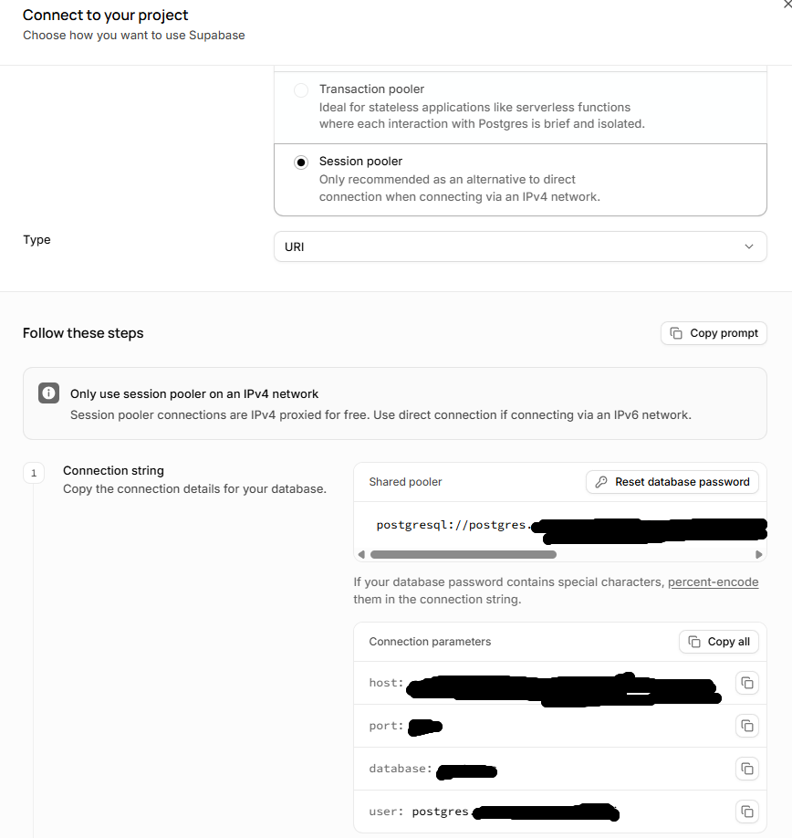

# 공통 부록. Supabase 전용 실습 프로젝트 준비

<a id="supabase-project-setup"></a>

처음 Supabase를 사용한다면 여기서 로그인부터 프로젝트 생성, SQL 실행, 연결 주소 확인까지 준비합니다.
Supabase 프로젝트에는 PostgreSQL 데이터베이스와 이를 관리하는 화면이 함께 제공됩니다.
별도의 `CREATE DATABASE` 명령은 실행하지 않습니다.

**공통 안내를 사용해도 실습 DB는 장마다 따로 만듭니다.** 같은 프로젝트에 10장과 11장의 테이블을 섞지 않습니다.
이미 해당 장의 전용 프로젝트를 만들었다면 다시 만들지 말고 프로젝트 이름부터 확인합니다.

**읽고 돌아오는 방법:** 1~4단계에서 프로젝트와 연결 주소를 준비합니다. 비밀번호 처리나 생성 한도에 막히면 5~6단계도 확인합니다.
SQL Editor에서 결과 `1`을 확인하고 Session pooler 주소를 찾았다면, 전자책 리더로 돌아가 아래 표에 적힌 위치에서 이어갑니다.
부록 마지막의 **[본문으로 돌아가기](#supabase-return)**에서도 같은 링크를 찾을 수 있습니다. 온라인 문서의 돌아가기 링크는 복귀할 위치를 안내하며, 전자책을 직접 열지는 않습니다.

| 읽고 있는 장 | 프로젝트 이름 예시 | 준비 후 돌아갈 곳 |
|---|---|---|
| Chapter 10 | `erp-chapter10-lab` | [10.2 전용 DB 준비로 돌아가기](../README.md#return-to-book) |
| Chapter 11 | `erp-chapter11-lab` | [11.0-ENV 4단계로 돌아가기](../README.md#return-to-book) |

## 1. Supabase에 로그인하고 조직 선택하기

1. [Supabase 대시보드](https://supabase.com/dashboard)를 엽니다.
2. 처음 사용하는 독자는 화면의 가입 안내에 따라 계정을 만듭니다. GitHub 로그인이나 이메일 등 화면에서 제공하는 방식을 사용하고, 인증을 완료합니다.
3. 로그인 후 프로젝트 목록으로 이동합니다. 조직 선택 또는 생성 화면이 먼저 나오면 사용할 개인 실습 조직을 선택합니다.
4. 조직이 없다면 **New organization**에서 실습용 조직을 만듭니다. 이름은 `erp-book-lab`처럼 용도를 알아볼 수 있게 정합니다.
   무료 실습을 진행한다면 조직 생성 화면에서 **Free** 플랜인지 확인합니다. 이미 개인 실습용 조직이 있다면 다시 만들지 않아도 됩니다.

조직(Organization)은 프로젝트를 묶어 관리하는 공간입니다. 아직 이 조직을 골랐다는 것만으로 DB가 만들어진 것은 아닙니다.
다음 단계에서 현재 장에 사용할 프로젝트를 만듭니다.

**이 단계 완료:** 사용할 조직을 선택했고, 그 조직의 프로젝트 목록을 열 수 있습니다.

## 2. 현재 장의 전용 프로젝트 만들기

프로젝트 목록에서 **New project**를 선택합니다. 생성 화면에서 다음 항목을 확인합니다.

| 화면의 항목 | 입력하거나 확인할 내용 |
|---|---|
| Organization | 앞에서 선택한 개인 실습용 조직 |
| Project name / Name | 10장은 `erp-chapter10-lab`, 11장은 `erp-chapter11-lab` |
| Database password | 이 프로젝트의 DB 접속에 사용할 길고 고유한 비밀번호 |
| Region | 현재 위치에서 가까운 지역. 선택 가능한 지역 중 하나를 고릅니다. |

DB 비밀번호는 Supabase 로그인 비밀번호와 별개입니다. 비밀번호를 자동 생성했다면 프로젝트를 만들기 전에 비밀번호 관리 도구에 보관합니다.
메모에는 장별 프로젝트 이름을 함께 적어 두세요. DB 비밀번호를 AI 대화나 실습 결과 파일에 넣지 않습니다.

선택한 조직·프로젝트 이름·지역을 다시 읽고 **Create new project**로 생성을 완료합니다.
생성 중에는 기다렸다가 해당 프로젝트의 관리 화면을 엽니다. 화면에서 준비 중이라고 표시되는 동안 SQL을 실행하지 않습니다.
버튼 위치나 문구가 달라도 ‘새 프로젝트 생성’, ‘DB 비밀번호’, ‘지역’에 해당하는 항목을 찾아 확인합니다.

**이 단계 완료:** 현재 장의 프로젝트 이름이 보이고, 그 프로젝트의 **SQL Editor**와 **Connect**를 열 수 있습니다.
다른 장이나 실제 업무용 프로젝트가 열려 있다면 다음 단계로 진행하지 않습니다.

프로젝트 생성 항목은 [Supabase의 프로젝트 생성 안내](https://supabase.com/blog/loading-data-supabase-python#loading-data-into-supabase-using-python)를 참고할 수 있습니다.

<a id="supabase-sql-editor"></a>

## 3. SQL Editor에서 간단한 조회 실행하기

1. 화면 상단의 프로젝트 이름이 현재 장의 이름인지 확인합니다.
2. **SQL Editor**를 열고 **New Query**로 새 쿼리를 만듭니다. SQL을 입력하는 편집 영역과 결과 영역을 구분하세요.
3. 아래 SQL을 편집 영역에 붙여 넣습니다. 코드 블록의 시작·끝에 있는 백틱은 복사하지 않습니다.

```sql
SELECT 1 AS connection_check;
```

4. **Run**을 누릅니다. 여러 SQL 중 일부를 선택한 상태라면 선택한 부분만 실행될 수 있으므로, 이번에는 위 한 문장만 둡니다.
5. 결과 표에서 다음과 같은 값을 확인합니다.

| connection_check |
|---:|
| 1 |

이 결과는 브라우저의 SQL Editor에서 DB 조회가 실행됐다는 뜻입니다. 아직 내 PC의 Python 연결을 확인한 것은 아닙니다.
테이블 생성이나 실습 데이터 입력도 하지 않았습니다. 해당 장의 SQL은 본문으로 돌아가 안내된 순서에 따라 실행합니다.

본문에서 SQL 파일 실행을 안내하면 VS Code에서 해당 `.sql` 파일을 열고 내용을 전체 복사합니다.
SQL Editor의 새 쿼리에 붙여 넣고 프로젝트 이름을 다시 확인한 뒤 **Run**을 누릅니다.
이전 쿼리에 이어 붙이지 말고 파일 하나씩 실행하세요. 삭제를 포함하는 SQL이면 본문의 삭제 대상 확인부터 마칩니다.
오류가 표시되면 다음 SQL로 넘어가지 않고 해당 장의 도움말을 확인합니다.

**이 단계 완료:** 오류 없이 결과 표의 `1`을 확인했습니다. SQL Editor의 사용 방법은 [공식 SQL 실행 안내](https://supabase.com/docs/guides/database/functions#getting-started)를 참고하세요.

<a id="supabase-connect"></a>

## 4. Python에서 사용할 연결 주소 확인하기

1. 같은 프로젝트 상단의 **Connect**를 엽니다.
2. 연결 방식에서 **Session pooler**를 선택합니다. 형식 선택 항목이 있다면 **URI**를 고릅니다.
3. **Connection string**의 PostgreSQL 연결 주소를 확인합니다. **Copy prompt**로 AI용 설명을 복사하는 것과 구분합니다.
4. 주소를 로컬 편집기의 해당 장 `.env` 파일에 옮깁니다. 아직 `.env`를 만들지 않았다면 주소를 채팅에 붙이지 말고, 본문의 파일 준비 안내로 돌아갑니다.



위 화면은 연결 방식과 항목을 찾기 위한 예시입니다. 사용자명·호스트는 각 프로젝트의 Connect 화면에서 복사한 값을 사용합니다.
이 장들의 PC 실습에서는 IPv4 환경에서 사용할 수 있는 Session pooler를 기준으로 진행합니다.
**Transaction pooler**는 선택하지 않습니다. 연결 방식의 차이는 [Supabase 연결 안내](https://supabase.com/docs/guides/database/connecting-to-postgres)를 참고하세요.

주소는 다음 구조이며, 아래 대괄호 표시는 설명을 위한 자리입니다. 그대로 복사해 접속하는 주소가 아닙니다.

```text
postgresql://[사용자명]:[DB 비밀번호]@[호스트]:[포트]/[데이터베이스명]
```

Connect에서 복사한 주소에 `[YOUR-PASSWORD]`가 남아 있다면 프로젝트 생성 때 보관한 DB 비밀번호로 바꿉니다.
비밀번호에 특수문자가 있으면 아래 URL 인코딩 설명을 먼저 읽습니다. 호스트나 사용자명은 지역 이름을 보고 직접 만들지 않습니다.

| 혼동하기 쉬운 값 | 이번 연결에서의 역할 |
|---|---|
| Supabase 로그인 비밀번호 | 대시보드 로그인용. DB 연결 주소에 넣지 않음 |
| Database password | 해당 프로젝트의 PostgreSQL 접속용 비밀번호 |
| `postgresql://`로 시작하는 URI | Python의 DB 연결 도구에 전달할 주소 |
| `https://`로 시작하는 프로젝트 URL과 API 키 | Data API 등에서 사용하는 값. 이번 장의 `DATABASE_URL`에 넣지 않음 |

**이 단계 완료:** 현재 장 프로젝트의 Session pooler URI를 찾았고, 해당 프로젝트의 DB 비밀번호를 사용할 수 있습니다.
주소의 시작 형식과 저장 위치는 다음 표처럼 각 장에서 마무리합니다.

| 항목 | Chapter 10 | Chapter 11 |
|---|---|---|
| 연결 도구 | pg8000 | SQLAlchemy·psycopg2 |
| `.env` 위치 | `ch10/erp-mini/.env` | `ch11/workspace/erp-project/.env` |
| 주소 시작 부분 | `postgresql://` 그대로 사용 | 본문 지시에 따라 `postgresql+psycopg2://`로 변경 |
| Python 연결 성공 표시 | `DB connection OK` | `1` |

두 장의 `.env`를 복사해서 공유하지 않습니다. 프로젝트별 URI를 각각 사용합니다.

<a id="supabase-password-encoding"></a>

## 5. 비밀번호의 특수문자 처리하기

URI에서 `@`, `:`, `/`, `#`, `%` 같은 문자는 주소를 나누는 데 쓰입니다.
비밀번호에 이런 문자가 있으면 주소의 구분자로 해석되지 않도록 `%40` 같은 표기로 바꿉니다. 이를 URL 인코딩이라고 합니다.

예를 들어 가짜 비밀번호 `lab@/#`는 `lab%40%2F%23`으로 적습니다.
변환한 값으로 **URI의 비밀번호 부분만** 바꿉니다. 주소 전체를 인코딩하거나 이미 인코딩된 비밀번호를 다시 변환하지 않습니다.
인코딩은 암호화가 아니므로 변환 결과도 비밀번호와 마찬가지로 보호합니다.

실제 비밀번호는 AI나 웹 변환 사이트에 보내지 말고 내 PC에서 처리합니다.
직접 실행할 Python 명령은 해당 장의 가상환경 경로를 사용해야 하므로 본문과 장별 도움말을 따릅니다.
별도 비밀번호 입력칸을 제공하는 DB 접속 도구에서는 URI용 변환값 대신 원래 비밀번호를 사용합니다.

<a id="supabase-project-limit"></a>

## 6. 프로젝트 생성 한도에 걸렸을 때

무료 플랜의 활성 프로젝트 한도를 사용 중이면 새 프로젝트 생성이 제한될 수 있습니다.
현재 [공식 요금 FAQ](https://supabase.com/docs/guides/platform/billing-faq#how-many-free-projects-can-i-have)에서는 활성 무료 프로젝트 2개와 일시 중지 프로젝트의 제외를 안내합니다.
조직의 Owner·Admin 구성원 사용량도 영향을 주므로, 화면의 제한 안내와 최신 FAQ를 함께 확인합니다.

먼저 이전 실습의 SQL·코드·확인 결과를 보관합니다. DB 데이터 자체를 계속 보관해야 한다면 [공식 백업 안내](https://supabase.com/docs/guides/platform/migrating-within-supabase/backup-restore)를 확인하세요.
현재 사용하지 않는 **자신의 무료 실습 프로젝트**라면 **Settings → General → Project availability → Pause Project**에서 일시 중지한 뒤 새 프로젝트 생성을 다시 시도할 수 있습니다.
프로젝트 이름을 다시 확인하고, 다른 사람이 사용하는 프로젝트를 중지하지 않습니다. 메뉴 위치는 [공식 프로젝트 관리 안내](https://supabase.com/docs/guides/platform/delete-project#alternative-pause-your-project)를 참고합니다.

일시 중지는 장기 백업을 대신하지 않습니다. 다시 실습할 때는 대시보드에서 **Resume project**로 재개하고 연결을 확인합니다.
복원 가능 조건은 [공식 일시 중지 안내](https://supabase.com/docs/guides/platform/free-project-pausing)를 확인하세요.
한도가 해결되지 않으면 조직·플랜 조건을 확인합니다. 이전 프로젝트를 삭제하거나 다른 장의 DB에 SQL을 섞어 실행하지 않습니다.

<a id="supabase-return"></a>

## 7. 준비를 확인하고 본문으로 돌아가기

- [ ] 현재 장의 전용 프로젝트 이름을 확인했다.
- [ ] 그 프로젝트의 SQL Editor에서 조회 결과 `1`을 확인했다.
- [ ] 같은 프로젝트의 DB 비밀번호를 보관했고 Session pooler 연결 주소를 찾았다.
- [ ] 비밀번호와 실제 연결 주소를 AI 대화·Git·화면 캡처에 넣지 않았다.

**10장 독자:** [10.2 전용 DB 준비로 돌아가기](../README.md#return-to-book)를 눌러 `erp-mini/sql/00_initialize_lab.sql` 실행부터 이어갑니다.
이후 Step 2에서 패키지를 설치하고 Step 3에서 `.env`와 Python 연결을 확인합니다.

**11장 독자:** [11.0-ENV 4단계로 돌아가기](../README.md#return-to-book)를 눌러 `workspace/erp-project/.env`를 설정하고 `workspace/sql/00_initialize_lab.sql`을 실행합니다.
5단계에서는 해당 장의 연결 확인 명령으로 Python 접속을 확인합니다.

각 장의 표식 SQL은 서로 다릅니다. 공통 부록을 읽었다고 표식을 대신 만들거나 업무 테이블을 미리 생성하지 않습니다.
